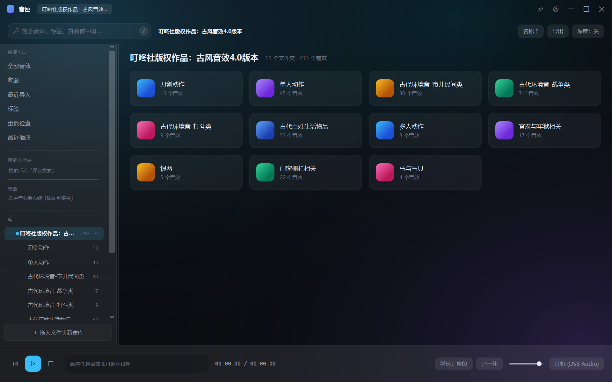

# 音匣 SoundVault

[](https://github.com/xy040402/SoundVault/actions/workflows/build.yml)
[](https://github.com/xy040402/SoundVault/releases/latest)
[](LICENSE)


**本地音效库管理器** — 把硬盘上散落的音效文件夹，变成一个能秒搜、能试听、能打标签、能一键交付给 DAW 的库。

Windows 10 / 11 · WPF (.NET 10) · 单文件程序 · 不联网、不改你的文件



---

## 下载

**只提供一个文件：安装包。**

| 文件 | 说明 |
|---|---|
| **SoundVault-1.0.0-Setup.exe** | 安装包，双击安装，装完即可用。绿色版不单独提供 —— 需要的话装完把 `音匣.exe` 拷出来，或自己 build |

到 [Releases](../../releases/latest) 页面下载 `SoundVault-1.0.0-Setup.exe`。

> 无需预装 .NET；装到 `C:\Program Files` 会弹一次 UAC。

---

## 版本目录

仓库按**版本一个文件夹**组织，每版都自带完整源码、说明书和安装包：

| 目录 | 状态 | 内容 |
|---|---|---|
| [`v1.0.0/`](v1.0.0/) | ✅ 已发布 | 源码 · [使用说明书](v1.0.0/使用说明书.md) · 安装包（Release 下载） |
| [`v1.0.1/`](v1.0.1/) | 🚧 开发中 | [修改意见与方案](v1.0.1/修改意见.md) · 源码 · 说明书 · 安装包 |

```
SoundVault/
├─ v1.0.0/           一个已发布版本
│  ├─ src/ tests/ tools/
│  ├─ 使用说明书.md
│  └─ 安装包/         （exe 不进 Git，见该目录 README）
├─ v1.0.1/           下一个版本
│  ├─ 修改意见.md      这一版要修什么、怎么修
│  ├─ src/ tests/ tools/
│  ├─ 使用说明书.md
│  └─ 安装包/
├─ docs/             跨版本资料（开发历程、设计文档、开发记录）
└─ CHANGELOG.md      版本变更历史
```

> 每个版本文件夹都是**自包含**的：拿到 `v1.0.1/` 一个目录就能编译出这一版。

---


## 这是什么

音匣不搬动、不重命名、不删除你的音频文件。它只做三件事：

1. **建索引** —— 扫一遍文件夹，记下时长、采样率、声道、波形峰值
2. **帮你找** —— 拼音首字母、标签、评分、过滤语法（`dur:<2s` `sr:>48k` …）
3. **帮你用** —— 悬停试听、拖进 DAW、批量导出（可带命名模板和目录结构）

适合：游戏音效、影视拟音、短视频素材、播客音效库这类"文件夹很多、文件几万、名字一塌糊涂"的场景。

---

## 功能

| 分类 | 能力 |
|---|---|
| **浏览** | 库 / 文件夹 / 全部音效 / 收藏 / 最近导入 / 最近播放 / 标签 / 重复检查 / 集合 |
| **搜索** | 中文、拼音全拼、首字母（`bdx` → 拔刀相向）、过滤语法 `#标签` `star:>=4` `dur:<2s` `sr:>48k` `ch:2` `type:wav` |
| **试听** | 鼠标悬停即循环试听；波形上按住拖动播放头；整段/区间循环；LUFS 归一化试听 |
| **整理** | 五星评分、收藏、标签、集合、批量重命名（带预览） |
| **交付** | 拖拽到 DAW、Ctrl+C 复制文件、批量导出（命名模板 + 保留目录结构 + CSV 清单） |
| **外观** | 深色/浅色、自定义主色、面板透明度、圆角、Win11 云母、省电模式 |
| **素材包识别** | 自动认出封面、授权文件、版本号，以及"没下完的文件" |

逐项操作说明见 [v1.0.0/使用说明书.md](v1.0.0/使用说明书.md)；
从立项到发布的完整经过见 [docs/开发历程.md](docs/开发历程.md)。

---

## 安装

**方式一：安装包（推荐）**

下载 `SoundVault-1.0.0-Setup.exe` → 双击 → 选安装位置 → 完成。
安装位置会自动补 `SoundVault` 子目录（选 `D:\Apps` 就是 `D:\Apps\SoundVault`）。
装到 `C:\Program Files` 会弹 UAC 提权；装到用户目录不需要。

**方式二：绿色版（不单独提供下载）**

Release 只提供安装包。想要纯绿色版：装完把 `C:\Program Files\SoundVault\音匣.exe` 拷走即可，
或者自己进 `v1.0.1\` 跑 `.\build.ps1` 构建一份。

**便携模式**：在 `音匣.exe` 旁边建一个空的 `data\` 文件夹，配置和索引就存在那里，整个文件夹拷走即可。

> 不需要预装 .NET —— 单文件自包含。

### 数据在哪

| 文件 | 位置 | 内容 |
|---|---|---|
| `store.json` | `%LocalAppData%\SoundVault\`（便携模式在 `exe\data\`） | 库列表、评分、收藏、标签、集合、外观设置 |
| `index.db` | 同上 | 文件索引与波形峰值（**删了会自动重建**） |

卸载时默认**保留**这两个文件（重装即接上）；想彻底清掉，卸载时勾选"同时删除软件数据"。

---

## 从源码构建

需要 **.NET 10 SDK**。

```powershell
# 单文件 exe
cd v1.0.1`r`ndotnet publish src/SoundVault.App -c Release -r win-x64 --self-contained `
  -p:PublishSingleFile=true -p:EnableCompressionInSingleFile=true `
  -p:IncludeNativeLibrariesForSelfExtract=true -o _local/dist

# 安装包（会把 _local/dist/音匣.exe 打进安装器）
dotnet publish src/SoundVault.Setup -c Release -r win-x64 --self-contained `
  -p:PublishSingleFile=true -p:EnableCompressionInSingleFile=true `
  -p:IncludeNativeLibrariesForSelfExtract=true -o _local/dist
```

或者进版本目录（如 `v1.0.1\`）直接跑 `.\build.ps1`（产物在该目录的 `_local\dist\`）。

### 跑测试

```powershell
.\tools\test.ps1
```

纯断言测试（搜索语法、拼音、文件名清洗、导出模板、LUFS、ViewModel），不需要界面。

---

## 目录结构

```
v1.0.0/                    一个已发布版本（自包含）
  src/
    SoundVault.App/        主程序（WPF）
      MainWindow*.cs       主窗口，按功能拆成多个 partial
      ViewModels/          SearchViewModel / SelectionViewModel（纯逻辑，可单测）
      Services/            索引、拼音搜索、LUFS、素材包扫描、主题…
      Dialogs/             设置、导出、批量重命名、元数据…
      Controls/            虚拟化卡片面板、星级控件…
    SoundVault.Setup/      安装器 / 卸载器（同一个 exe，靠参数区分）
  tests/                   断言测试
  tools/                   构建、测试、签名脚本
  使用说明书.md              这一版的手册
  安装包/                  构建产物（exe 不进 Git）

v1.0.1/                    下一个版本，结构同上 + 修改意见.md
  ├─ 修改意见.md            这一版要修什么、怎么修
  └─ …

docs/                      跨版本资料：开发历程、设计文档、项目简介
docs/dev/                  开发记录、交接说明、验证报告（过程存档）
_local/                    本地杂物：构建产物、历史 exe、备份（不进仓库）
```

## 已知限制

- 仅 Windows（WPF），没有跨平台计划
- 网络盘 / 移动硬盘扫描会慢一些
- 拖拽到某些宿主不生效时，用 `Ctrl+C` 复制文件再粘贴
- 单文件未签名，SmartScreen 可能提示"未知发布者"

---

## 许可

[MIT](LICENSE)。音频素材版权归各自作者所有，本项目不附带任何音频文件。

---

## 作者

个人项目，用 .NET / WPF 写的。

- **反馈 / bug 报告**：2284673040@qq.com
- **Issue**：欢迎在仓库里开 issue，附上 Windows 版本、复现步骤；能带截图更好
- **使用问题**：先看 [`使用说明书`](v1.0.0/使用说明书.md) 的「常见问题」一节

> 这个软件不收集任何数据、不联网，装完就是本地的。
