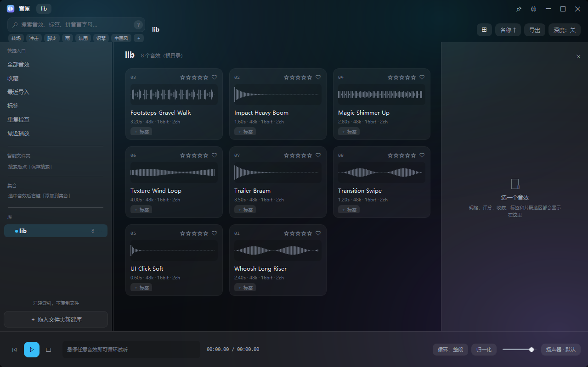
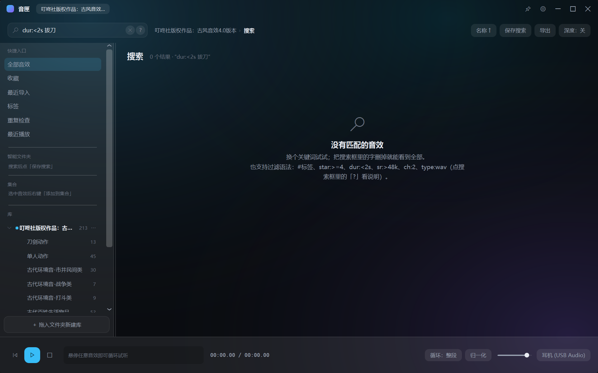
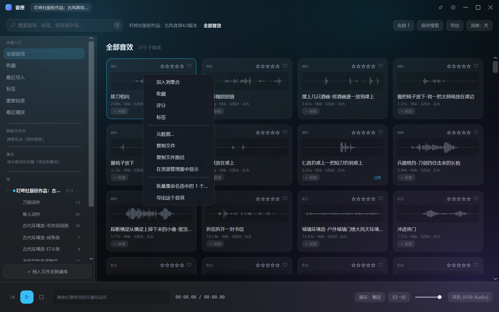
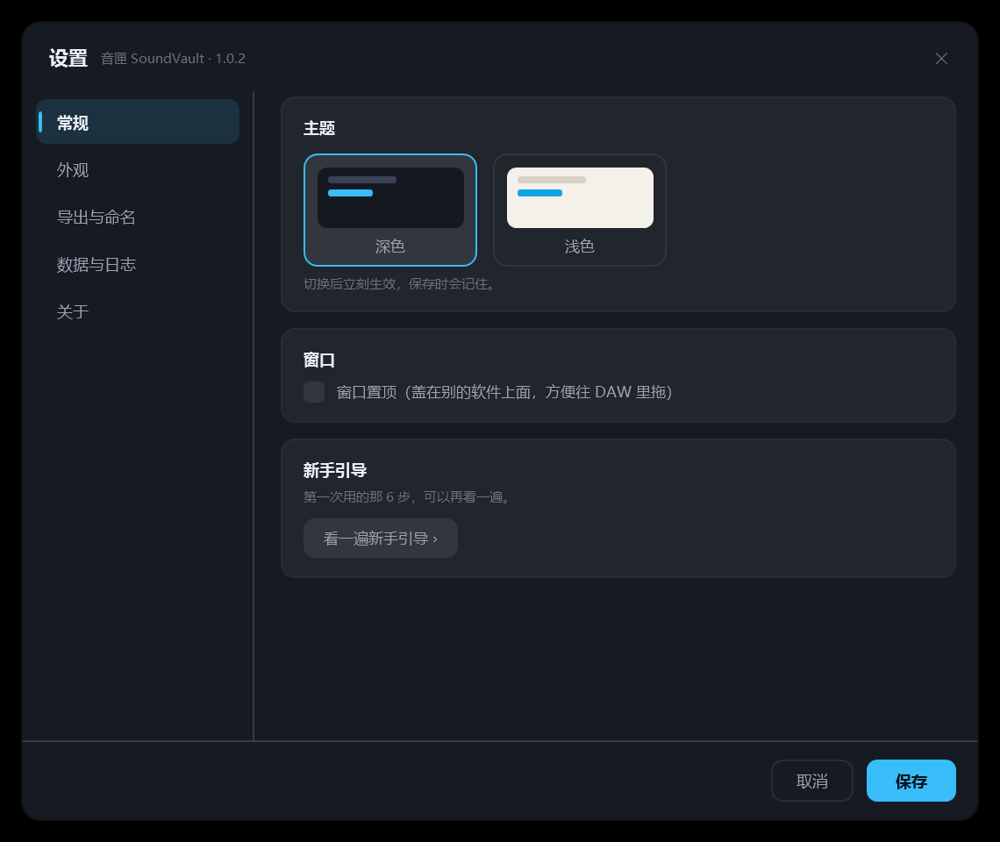
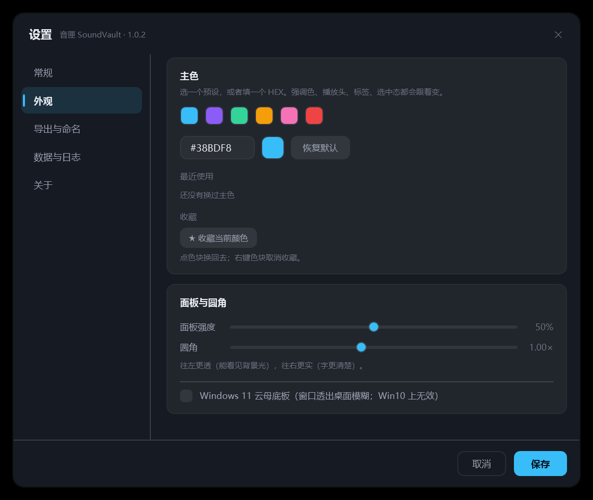

# 音匣 SoundVault

**本地音效库管理器** —— 把硬盘上散落的音效文件夹，变成一个能秒搜、能试听、能打标签、能一键交付给 DAW 的素材库。

Windows 10 / 11 · WPF (.NET 10) · 单文件程序 · **不联网、不移动、不复制、不改你的文件**

[](https://github.com/xy040402/SoundVault/releases/latest)
[](LICENSE)




## 它解决什么

音效素材一多就三件事最烦：找不到、听不了、交付慢。音匣把这三件事压到最短：

| | |
|---|---|
| **找** | 中文、拼音首字母（`bd` → 拔刀）、文件名、标签，还能用过滤语法：`#标签 star:>=4 dur:<2s sr:>48k type:wav` |
| **听** | 鼠标悬停就试听，循环播放，切歌无空隙；48k / 96k / 32bit 都能放 |
| **理** | 评分、收藏、标签、集合、智能文件夹、重复检查、批量重命名、元数据编辑 |
| **交付** | 拖进 DAW、复制文件、批量导出（带命名模板和目录结构），附一份清单 |

## 性能

| 场景 | 数据 |
|---|---|
| 导入 1.48 GB / 60 个文件 | 扫描 **20 ms** 库即可用，波形后台补 |
| 导入 10 万个文件 | 扫描 10.1 秒，补波形 18.1 秒（可继续操作） |
| 搜索（拼音） | 首次 53 ms，逐字增量 2 ms |
| 10 万条滚动 | 52–97 fps |

扫描只读文件头，波形交给后台慢慢算；可以随时取消，也可以中途关掉软件，下次启动接着补。

## 安装

到 [Releases](https://github.com/xy040402/SoundVault/releases/latest) 下载 `SoundVault-1.0.2-Setup.exe`，双击安装即可。

- 默认装在 `%LocalAppData%\Programs\SoundVault`（不需要管理员权限）
- 可选开始菜单 / 桌面快捷方式
- 覆盖安装会保留数据；卸载可选保留或删除配置
- 便携用法：把 `音匣.exe` 放进一个文件夹，同级新建 `data\` 空目录，即走便携模式

## 截图

| | |
|---|---|
|  |  |
|  |  |

## 构建

需要 .NET 10 SDK。

```powershell
cd v1.0.2
.\build.ps1 -Version 1.0.2                 # 应用 + 安装包
.\build.ps1 -Version 1.0.2 -SkipInstaller # 只出应用
.\tools\verify-all.ps1                    # 全量验收（31 项）
```

产物在 `_local\dist\`：`音匣.exe`（单文件，约 73 MB）+ `SoundVault-1.0.2-Setup.exe`。

## 目录

```
v1.0.2/                  当前源码（自包含，一个目录就能编译）
  src/SoundVault.App/    主程序（Audio / Models / Services / Dialogs / Controls）
  src/SoundVault.Setup/  安装器与卸载器（同一个 exe，靠参数区分）
  tests/                 断言测试
  tools/                 构建、验收、签名脚本
  使用说明书.md          用户手册
  修改意见.md            这一版修了什么、为什么
docs/                    设计文档、项目简介、反馈指南、截图
```

## 数据在哪

| 文件 | 内容 |
|---|---|
| `store.json` | 库列表、评分、收藏、集合、标签归属、外观设置 |
| `index.db` | 索引与波形峰值（删了会自动重建） |

默认在 `%LocalAppData%\SoundVault\`；便携模式在 exe 旁边的 `data\`。设置里有「备份数据…」和「导出诊断包」。

## 已知限制

- 只有 Windows（WPF），没有跨平台计划
- 网络盘 / 移动硬盘扫描会慢一些
- 拖拽到某些宿主不生效时，用 `Ctrl+C` 复制文件再粘贴
- 单文件未签名，SmartScreen 可能提示"未知发布者"

## 反馈

- 使用问题：先看 [使用说明书](v1.0.2/使用说明书.md) 的「常见问题」
- 提 bug：带上「设置 → 数据与日志 → 导出诊断包」生成的 zip，里面只有日志、系统信息、设置和崩溃记录
- 其它：[反馈指南](docs/反馈指南.md)

## 许可

MIT，见 [LICENSE](LICENSE)。
