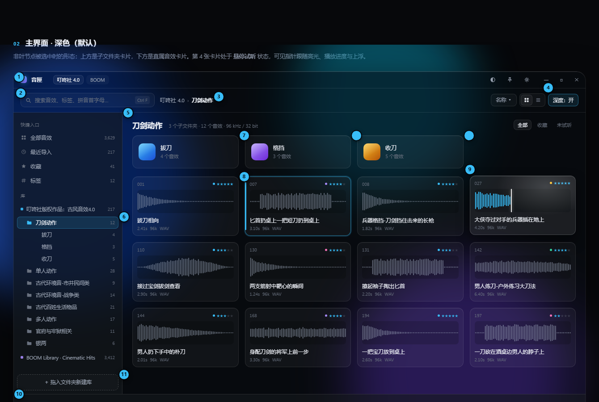
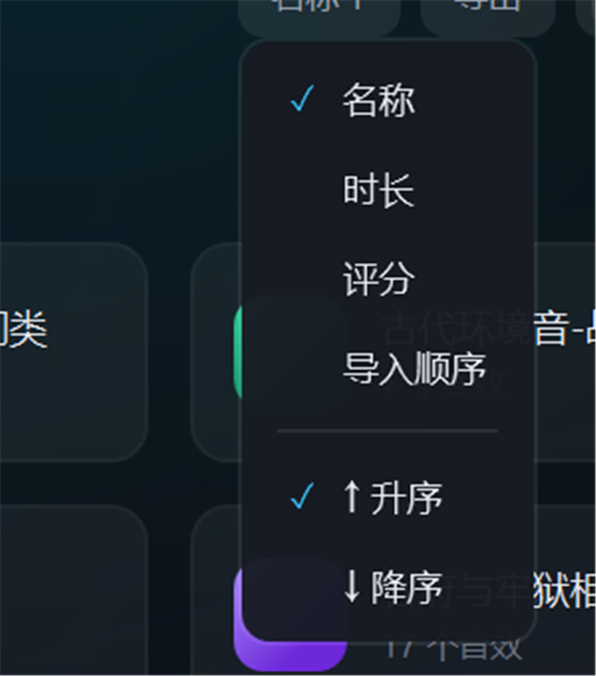
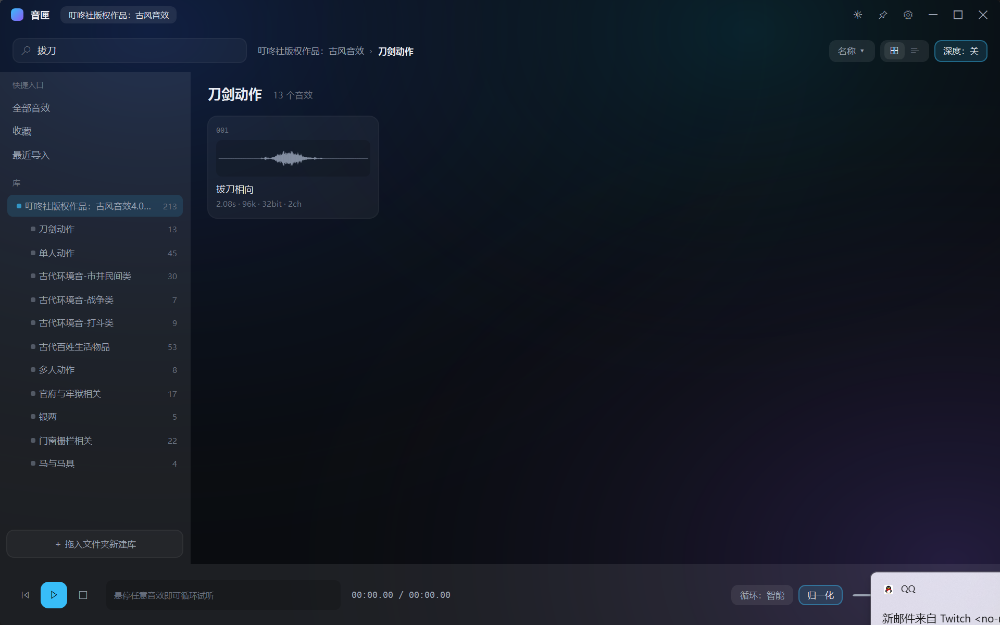
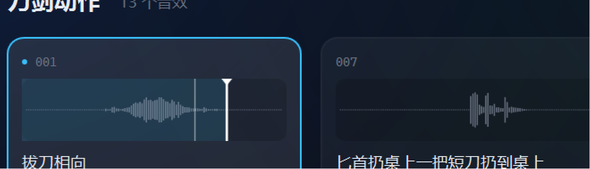
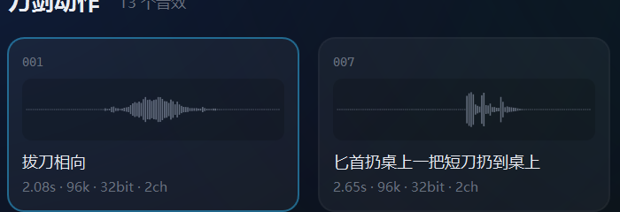
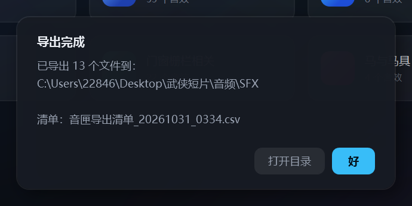
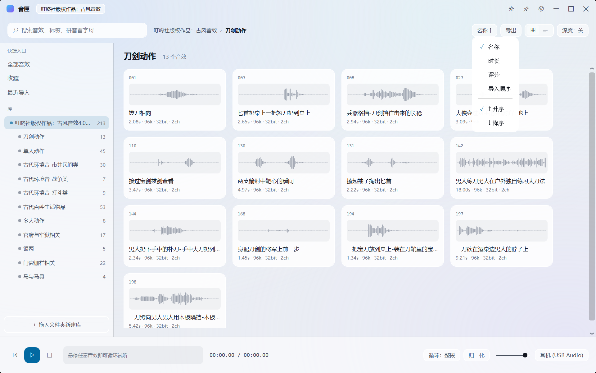

# 音匣 SoundVault · 使用说明

> 版本 **v0.4** ｜ 可执行文件：`dist\音匣.exe`（双击即用，无需安装 .NET）
> 这是一份"现在就能用"的说明书。还没做的功能会明确标注，不会让你白点。

---

## 1. 这是什么

一个 Windows 桌面音效素材库管理器。核心就一句话：**把你买的素材包，变成一个可以听、可以搜、可以拖的本地声音抽屉。**

它不改你的文件、不搬你的文件、不联网、不需要账号。

---

## 2. 启动

1. 双击 `音匣.exe`（72 MB，自包含运行时，拷到别的 Windows 机器也能直接跑）。
2. 首次启动会自动扫描你的《叮咚社古风 4.0》并把结果留在侧栏。
3. 之后每次启动会自动恢复上次导入的库。

> 想换一台机器用：整个 `dist` 文件夹拷走即可，配置另存在 `%LocalAppData%\SoundVault\store.json`。

---

## 3. 界面导览



| 区域 | 说明 |
|---|---|
| ① 标题栏 | 拖住可移动窗口；双击最大化。右侧：主题切换 / 置顶（未启用）/ 设置（未启用）/ 最小化·最大化·关闭 |
| ② 工具栏 | 搜索框、面包屑、排序、导出、视图切换（列表视图开发中）、深度开关 |
| ③ 左栏 | 快捷入口（全部音效 / 收藏 / 最近导入）、库与文件夹、底部"＋ 拖入文件夹新建库" |
| ④ 内容区 | 上：当前文件夹的子文件夹卡片；下：音效卡片（波形 + 名称 + 时长/采样率/声道） |
| ⑤ 播放条 | 播放控制、当前素材名与进度、循环模式、归一化、音量、输出设备 |

---

## 4. 导入素材包

**方式一**：把素材包文件夹**直接拖进窗口** → 自动建库并递归扫描。

**方式二**：点左栏底部的 **"＋ 拖入文件夹新建库"** → 选文件夹。

- 一个素材包 = 一个库，可以导入多个库，它们会并列在左栏。
- 扫描只读文件头，不会移动/修改任何文件。
- 非音频文件（`.jpg`、`.docx`、`.downloading` 残留）会自动跳过。

> **支持格式**：WAV / AIFF / MP3 / FLAC / M4A / WMA / OGG。
> **不支持**：Kontakt（`.nki/.ncw`）、UVI（`.ufs`）这类插件专有容器 —— 那些不是音频文件，需要插件本体才能读。

---

## 5. 浏览

### 库 → 文件夹 → 音效

- 点左栏的**库名**：右侧显示这个包的所有子文件夹卡片。
- 点**子文件夹卡片**（或左栏里的文件夹）：进入该文件夹，显示全部音效。
- 点"快捷入口 → 全部音效"：把当前库所有音效平铺（上限 3000）。

### 深度开关

工具栏右侧 `深度：关` → 点一下变 `深度：开`。开启后会**递归加载子目录**里的所有音效，适合"我只记得它在某个大分类下面"的场景。

### 排序

点 `名称 ↑` 打开菜单：

- 字段：名称 / 时长 / 评分 / 导入顺序
- 方向：`↑ 升序` / `↓ 降序`
- 按钮上直接显示当前状态，比如 `时长 ↓`



### 搜索

在搜索框里输入，实时过滤。搜索框右侧有 **✕**（一键清空，回到搜索前的视图）和 **?**（语法说明）。匹配范围：显示名、原始文件名、编号、所在路径。

**搜索是"整个库"范围的**：不管你现在停在库根还是某个子文件夹，输入关键词都会把整个库里命中的音效列出来（面包屑会显示 `库名 › 搜索`，标题旁显示命中数量）。清空搜索框就回到原来的视图；点左栏任意文件夹也会自动清掉搜索。

> 注意：**目前还不支持拼音**（想打 `bd` 出"拔刀相向"要等下一版），但直接打中文或数字编号（`001`）都行。



---

## 6. 试听（核心）

### 悬停即听

鼠标**停在卡片上**，约 0.14 秒后自动开始循环播放；**移开立刻淡出停止**。

快速划过一排卡片不会鬼叫 —— 停留时间不够就不发声。

### 波形播放头

播放时卡片波形上会出现：

- **粗白线 + 顶部小三角** = 播放头，跟着声音走
- **细灰线** = 鼠标当前位置（告诉你"点下去会从哪儿开始"）



### 点击波形 = 从那里开始播

在波形上任意位置点一下，**立刻从那个位置开始播**，不用等它从头放。

- 一个 18 秒的素材你只想听第 10 秒那一段 → 直接点第 10 秒的位置。
- 点在末尾附近会自动保证至少 200ms 的循环段，不会变成一截蜂鸣。

### 固定播放（鼠标移开也不停）

**双击卡片** → 进入固定状态：卡片右上角出现 **"固定"** 字样，鼠标移开声音继续。再双击取消。

> 单击卡片**只做选择**，不会启动固定播放 —— 这是刻意分开的，避免"我只是想多选几个"结果声音停不下来。

### 循环模式

点播放条的 `循环：整段`：

| 模式 | 行为 |
|---|---|
| **整段循环**（默认） | 从 0 播到文件末尾，不掐头去尾 |
| 智能循环 | 跳过首尾静音（短素材用得上） |
| 单次播放 | 放完即停，不循环 |


### 音量 / 归一化 / 设备

| 控件 | 用法 |
|---|---|
| 音量滑杆 | 拖动即生效，退出后记住 |
| 归一化 | 打开后把不同素材的响度拉到接近（约 -18 dBFS），避免一个炸耳一个听不清 |
| 设备 | 点开可选 WASAPI 输出设备（耳机/监听音箱）；启动时若上次的设备不存在，会自动回退到系统默认 |


---

## 7. 选择、收藏、评分

| 操作 | 结果 |
|---|---|
| 单击卡片 | 选中它 |
| `Ctrl` + 单击 | 加选 / 减选 |
| `Shift` + 单击 | 从上次选中处连选一段 |
| `Ctrl + A` | 全选当前列表 |
| `Esc` | 先清搜索，再清选择 |
| `F` | 收藏 / 取消收藏（对选中的全部生效） |
| `1` – `5` | 打 1–5 星 |
| `0` | 清除评分 |

**收藏和评分都可以直接用鼠标**（不用记快捷键）：
- **收藏**：每张卡片右上角的爱心，点一下收藏、再点一下取消。实心 = 已收藏，空心 = 未收藏。
- **评分**：爱心左边 5 颗星，点第 N 颗就是 N 星，再点同一颗取消；鼠标划过会预览点下去是几星。

键盘 `F` / `1`-`5` / `0` 仍然可用，但所有操作都不依赖它们。

评分和收藏会写到本地配置，下次打开还在。选中的卡片有蓝色描边。



---


### 过滤语法（v0.6）

搜索框除了打普通关键词，还能写条件，可以混着用（空格分隔，条件之间是"并且"）：

| 写法 | 含义 |
|---|---|
| `拔刀` | 名称/文件名/路径/编号里含"拔刀" |
| `#武侠` | 带标签"武侠" |
| `star:>=4` | 评分 ≥ 4（也可以 `star:>=3`、`star:5`） |
| `dur:<2s` | 时长 < 2 秒（`dur:>1.5` 表示长于 1.5 秒） |
| `sr:>48k` | 采样率 > 48kHz（也可以写 `sr:96000`） |
| `ch:2` | 正好 2 声道 |
| `type:wav` | 只看 wav |

例如 `star:>=4 #武侠 dur:<3s` = "4 星以上的武侠短音效"。

## 7.1 标签与智能文件夹（v0.6）

**打标签**：每张卡片底部都有一个带框的小按钮——没有标签时显示 **「＋ 标签」**，有标签时显示 `#武侠`。**点它**就弹出标签菜单：勾选已有标签，或「新建标签…」起一个名字（右键卡片也有同样的菜单）。

**管理标签**：左栏「快捷入口」里点 **「标签」**，右边就是**标签页**——所有标签集中在这里，每行有「改名」「删除」两个按钮。**点某一行会进到那个标签的下一层**（面包屑：`库名 › 标签 › #标签`），列出这个标签下的音效；点面包屑里的「标签」就回到标签页。改名时如果新名字已经有标签，会**合并**成一个；删除只摘标签，不动音频文件。

**保存搜索（智能文件夹）**：在搜索框里写好条件（比如 `star:>=4 #武侠 dur:<3s`），点工具栏的「保存搜索」→ 起个名字。之后它会出现在左栏「智能文件夹」里，**点一下就回到这组筛选结果**，右键可以删掉。

这批功能全部可以用鼠标完成，不需要键盘。

**右键菜单**（v0.6）里还有什么：

| 菜单项 | 作用 |
|---|---|
| 收藏 / 取消收藏 | 同卡片上的爱心 |
| 评分 ▸ 1–5 星 / 清除 | 同卡片上的星星 |
| 标签 ▸ … | 打标、新建标签 |
| 复制文件路径 | 粘到 DAW 或别的软件里 |
| 在资源管理器中显示 | 打开所在文件夹并选中该文件 |
| 导出 | 走原来的导出流程（选中多个时导出多个） |
## 8. 拖进 DAW

**按住卡片拖动 → 松手落到 DAW 里**。

- 起拖阈值 4px，点一下不会误触拖拽。
- 多选之后拖拽会一次带走多个文件。
- 拖到资源管理器 = 复制文件（系统行为）。

**已实测通过**：Adobe Audition、FL Studio、Studio One。

> 如果某个 DAW 不认：先把文件拖到桌面（会复制出来），再从桌面拖进 DAW —— 这是万能兜底。

---

## 9. 批量导出 + 清单

1. 选中要交付的音效（不选 = 导出当前列表全部）。
2. 工具栏点 **导出**（或 `Ctrl + E`）。
3. 选目标目录 → 自动复制并按 `01_拔刀相向.wav` 这样编号命名。
4. 同时生成 `音匣导出清单_日期_时间.csv`。



**清单包含**：序号、文件名、显示名、库、相对路径、时长、采样率、位深、声道、格式、大小、评分、收藏。

- CSV 用 **UTF-8 带 BOM** 写出，Excel 双击不乱码。
- 目标目录已有同名文件时自动加 `_1`、`_2`，**绝不覆盖**。

---

## 10. 外观

右上角太阳/月亮图标切换**深色 / 浅色**，选择会被记住。



> 界面材质目前是"环境光 + 半透明面板"的近似效果，真正的系统级毛玻璃（Mica）排在后续版本。

---

## 11. 快捷键

| 键 | 作用 |
|---|---|
| `空格` | 播放 / 停止当前选中 |
| `F` | 收藏 / 取消收藏 |
| `1`–`5` | 评 1–5 星 |
| `0` | 清除评分 |
| `Ctrl + A` | 全选当前列表 |
| `Ctrl + E` | 导出 |
| `Esc` | 清搜索 / 清选择 |
| 双击卡片 | 固定播放 / 取消固定 |

> 方向键导航、重命名、复制路径等还没做（见第 13 节）。

---

## 12. 数据存在哪

| 内容 | 位置 |
|---|---|
| 库列表、评分、收藏、音量、主题、设备 | `%LocalAppData%\SoundVault\store.json` |
| 崩溃日志 | `%TEMP%\sv-crash.txt` |
| 程序本体 | `dist\音匣.exe` |

删掉 `store.json` 等于重置所有设置（不会删你的音频文件）。

---

## 13. 已知限制（明确标注，免得你找）

| 限制 | 现状 |
|---|---|
| 列表视图 | 按钮在，但功能未完成（悬浮提示已标"开发中"） |
| 标签 / 智能文件夹 | 未做 |
| 拼音搜索 | 未做（只能中文 / 编号 / 路径） |
| 磁盘索引 | 未做，每次启动会重新扫描目录（217 个文件约 1 秒；上万文件会明显变慢） |
| 玻璃材质 | 近似效果，非系统 Mica / 真模糊 |
| 窗口置顶、全局热键 | 未做（按钮占位） |
| 插件专有格式 | 不支持，也不打算支持 |
| 文件名清洗规则 | 目前固定剥离"版权/素材"后缀，尚不可自行配置 |

---

## 14. 出问题怎么办

1. **没声音**：确认播放条音量没拉到 0、系统没静音、设备选的是你正在用的那块声卡。
2. **拖不进 DAW**：先拖到桌面再拖进 DAW（见第 8 节兜底法）。
3. **某个素材"无法解析"**：大概率是它并不是可以解码的音频（比如损坏的下载残留），先在别的播放器里试试。
4. **闪退**：把 `%TEMP%\sv-crash.txt` 发我，里面有完整堆栈。

---

## 15. 最后一句话

目前的完成度是：**"找声音 → 听一下 → 拖进工程 → 交付"这条主链路是通的**。

剩下的是让它更快（索引/虚拟化）、更组织化（标签）、更好看（真玻璃）。这些不影响你现在就用起来。

## 7.2 库管理 / 文件丢失 / 重复检查（v0.9）

**库管理**：左栏「库」那一行的右侧有个 **⋯**，点它：

| 菜单项 | 作用 |
|---|---|
| 重命名库… | 只改音匣里显示的名字，磁盘文件夹不动 |
| 重新扫描这个库 | 只扫这一个库（新买了素材包、硬盘换位置后用） |
| 在资源管理器中打开 | |
| 移除库… | 从音匣里移除 + 清掉它的索引、评分、标签；**不删文件** |

**文件丢失**：硬盘没插、或者文件被挪走时，音匣**不再把它删掉**，而是：

- 卡片变淡，波形左上角一个橙色 **「文件丢失」**；
- 标题旁统计写 `213 个音效 · 3 个丢失`；
- 丢失的卡片不试听、不播放；
- **把文件放回原处，再点「重新扫描这个库」就自动恢复。**

**重复检查**：左栏快捷入口第 5 项。按「文件大小 + 时长」找出可疑的同一段声音，点一行在资源管理器里看。

## 7.3 外观：换主色 / 提示条（v0.10）

标题栏右上角、太阳图标右边有个**调色板**图标，点开就是「外观」：

- **6 套预设**：天青 / 紫罗兰 / 翡翠 / 琥珀 / 玫瑰 / 朱砂，点一下即换；
- **HEX**：直接输入 `#8B5CF6` 这样的色号；
- **RGB / HSV**：两组滑杆，改哪一组另外两组都跟着变，下面有实时预览（按钮 / 标签 / 星星）；
- **恢复默认** 回到天青；**应用** 后整个界面立刻换色，下次打开还是这个颜色。

换色会同时影响：强调色、播放按钮、波形已播放部分、标签胶囊、左栏库节点圆点、环境光。

另外，收藏、换主色这类操作会在窗口底部中间弹一句轻提示（约 2 秒自己消失，不挡鼠标）。

### 外观进阶（v0.11）

| 能力 | 怎么用 |
|---|---|
| 指针跟随高光 | 鼠标在窗口里移动时，会有一团很淡的光跟着；移出窗口淡出。不用设置 |
| 深浅切换过渡 | 点太阳图标切换深浅色时，内容会淡入一下（180ms），不是硬切 |
| 主题导入 / 导出 | 外观对话框底部「导出主题…」存成 `.theme.json`；「导入主题…」读回来（主色 + 省电档） |
| 省电模式 | 外观对话框里勾上，播放头刷新限制到 60fps，笔记本更省电 |

主题文件长这样，可以手动改、也可以发给别人：

```json
{ "accent": "#8B5CF6", "powerSaver": false }
```
**面板强度**（v0.12）：外观对话框里那条滑杆，往左更透（能看见背景光），往右更实（字更清楚）。默认 50% 就是原本的样子。

**圆角**（v0.13）：第二条滑杆，0% = 直角，100% = 原本的圆角，160% = 明显更圆。影响卡片、搜索框、弹层和提示条。
**云母底板**（v0.14）：外观对话框里勾「Windows 11 云母底板」，窗口会透出桌面壁纸的模糊色（Win11 22H2 以上有效；不支持的系统会自动保持原样）。
## 7.4 设置面板（v0.18）

标题栏右边的**齿轮**图标（标题栏不再放太阳和调色板图标了）：

- **主题**：深色 / 浅色，点一下就换，取消会还原
- **外观**：主色 / 面板强度 / 圆角 / 云母，都从这一个入口进
- **窗口置顶**：勾上后音匣会盖在别的软件上面（往 DAW 里拖的时候方便），置顶时齿轮图标会变亮
- **省电模式**：界面刷新限制 60fps
- **默认命名模板**：导出时用哪个命名格式
- **数据**：显示配置与索引的位置，可以「打开数据目录」或「重建索引…」（重建不改动评分/标签/收藏）
**左栏宽度可调**（v0.18.4）：左栏和右边内容之间有一条细线，拖它就行（文件夹名字太长时很有用）。
最窄 150、最宽 560；**双击这条线**回到默认宽度；宽度会被记住。
## 7.5 批量重命名（v0.19）

选中几个音效（Ctrl / Shift）→ 右键 → **批量重命名选中的 N 个…**

- 先看到 **旧名 → 新名** 的对照，同名的会划掉标红（不会被执行）；
- 模板支持 `{n:00} {name} {index} {dur} {sr} {ch} {lib}`；
- 点「开始重命名」才真的改**磁盘上的文件名**；评分、标签、收藏会跟着文件走，不会丢。

> 注意：这个操作不可撤销，改之前请先看一眼预览。

## 7.6 文件名清洗规则（v0.19）

设置 → **文件名清洗**：一行一条关键词。文件名最后一个「-」之后如果含这些词，就把那一段去掉。

默认是「版权 / 素材」，所以 `拔刀相向-叮咚社版权素材` 显示成 `拔刀相向`。换成别的素材包时改这两行即可。
## 7.7 最近播放 / 已用标记（v0.20）

- 快捷入口多了**最近播放**：按你播放过的时间倒序，找回过的东西很快；
- 今天播放过或拖出去用过的音效，卡片**右下角会有「已用」**——同一集里不会重复挑同一个声音；
- 鼠标悬停试听也算"播放过"。
## 7.8 集合（v0.21）

「集合」是**你自己挑的一组音效**，和标签不一样：标签是给音效打属性，集合是"这一集我要用的这几个"。

- 选中音效 → 右键 → **加入到集合** → 选已有集合，或「新建集合…」；
- 左栏「集合」分区里点一行就能打开；
- 右键集合那一行可以**重命名 / 删除**（删集合不会动音效文件）；
- 集合可以跨文件夹、跨库。
## 7.9 复制与拖拽（v0.22）

**Ctrl+C**：把选中的音效当**文件**放进剪贴板——有些 DAW 吃不到拖拽，就在 DAW 里直接 Ctrl+V。
**Ctrl+Shift+C**：复制文件路径文本。
右键菜单里也有「复制文件」和「复制文件路径」。

**拖拽时会跟着鼠标浮一个小标签**：单个音效显示「文件名 · 时长」，多个显示「N 个音效 · 共 时长」，落点前就知道拖的是什么。
## 7.10 便携模式（v0.23）

想让音匣跟着 U 盘走：

1. 设置 → 数据 → **切换为便携模式**（会把现有配置复制到 exe 旁边的 `data\`）；
2. 重启音匣；
3. 以后整个文件夹（`音匣.exe` + `data\`）拷到任何电脑都能直接用。

设置里的「数据」那行会显示当前是 **便携模式** 还是 **普通模式**。
## 7.11 安装与卸载（v0.24）

**安装**：双击 `音匣安装包.exe` → 选安装位置（默认 `%LocalAppData%\Programs\SoundVault`）→ 勾选要不要桌面/开始菜单快捷方式 → 安装。

**卸载**：安装目录里的 `卸载 音匣.exe`，或者 Windows「设置 → 应用 → 已安装的应用」里找 **音匣 SoundVault** 卸载。

卸载**不会删**你的评分、标签、集合、库列表（它们在 `%LocalAppData%\SoundVault`），重装后接着用。

> 安装包 138 MB，因为它把 76 MB 的主程序整个抱进去了。
## 7.12 元数据（v0.25）

右键音效 → **元数据…**，能看到文件里写的：

- **BWF `bext`**：描述、录制者、录制者编号、录制日期；
- **LIST-INFO**：标题、作者、备注；
- **iXML**：工程、场景、备注。

很多素材包只写文件名，那就只会显示"这个文件里没有元数据"——这本身也是有用的信息。
注：目前元数据只在右键里看，还不参与搜索（下一步再看要不要进索引）。
## 7.13 素材包识别（v0.26）

拖一个素材包文件夹进来（或点「＋ 拖入文件夹新建库」），音匣会先认一遍：

- **版本号**：从文件夹名里取（`古风音效4.0版本` → `4.0`），侧栏显示成 `古风音效 v4.0`；
- **封面**：`logo` / `cover` / `folder` / `封面` 的图片；
- **授权文件**：`LICENSE` / `授权` / `使用说明` / `README` 等；
- **没下完的文件**：`.downloading`、`.part`、`.!ut` 这类，会提醒你先下完。

认完弹一个摘要框，确认没问题再继续用。
## 7.14 鼠标光晕（v0.27）

鼠标移动时跟着走的柔光：

- **深色模式**：白色微光；
- **浅色模式**：强调色（默认天青）的柔光——早期版本这里是白色，在白底上等于没有。

光晕现在画在**内容上层**（不挡点击），所以卡片上也能看见。
## 7.15 响度归一（v0.28）

播放条上的**归一化**开关：打开后，每个音效先按 **ITU-R BS.1770 综合响度**测一遍，再拉到 **-18 LUFS** 播放。

- 小声的素材会被提上来，很响的会被压下去，来回试听时音量基本一致；
- 只影响**试听**，导出和拖进 DAW 的原始文件不会被改；
- 几乎静音的素材不会过度放大（上限 5 倍）。
## 7.16 右键「添加到音匣」（v0.29）

设置 → **文件关联** → 「注册右键『添加到音匣』」。

之后在资源管理器里右键任意音频（wav/mp3/flac/aif/aiff/ogg/m4a）→ **添加到音匣**：

- 音匣没开：会启动，并直接跳到这个文件所在的文件夹、选中它；
- 音匣已经开着：那个窗口会被抬到前台，同样跳过去并选中。

再点一次按钮就是移除。
## 7.18 代码签名（v0.31，给发布者看）

`tools\sign.ps1`：

```powershell
# 自签测试（验证流程，别人的电脑仍提示"未知发布者"）
powershell -ExecutionPolicy Bypass -File tools\sign.ps1 -Test

# 正式签名（需要买 OV/EV 代码签名证书）
powershell -ExecutionPolicy Bypass -File tools\sign.ps1 -Pfx D:\cert\my.pfx -Password 密码
```

顺序：先 `dotnet publish` 出 `dist`，**再签名**（签完不能再改 exe）。
