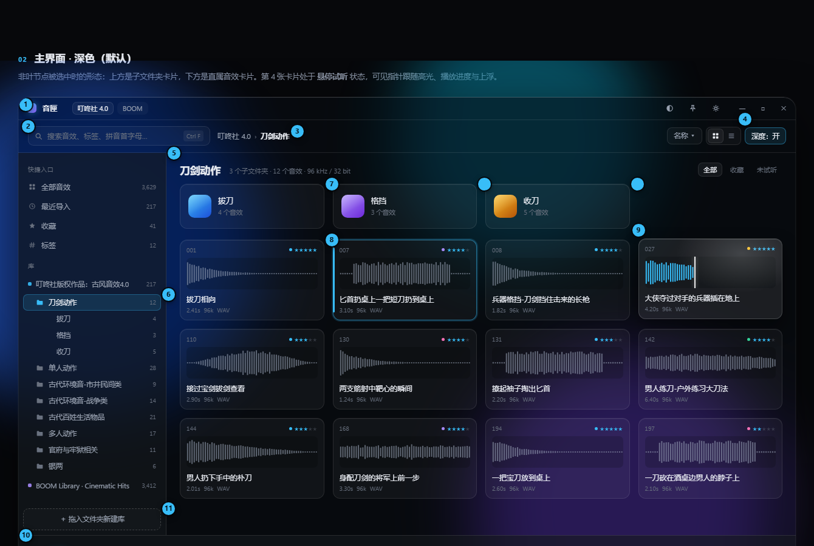
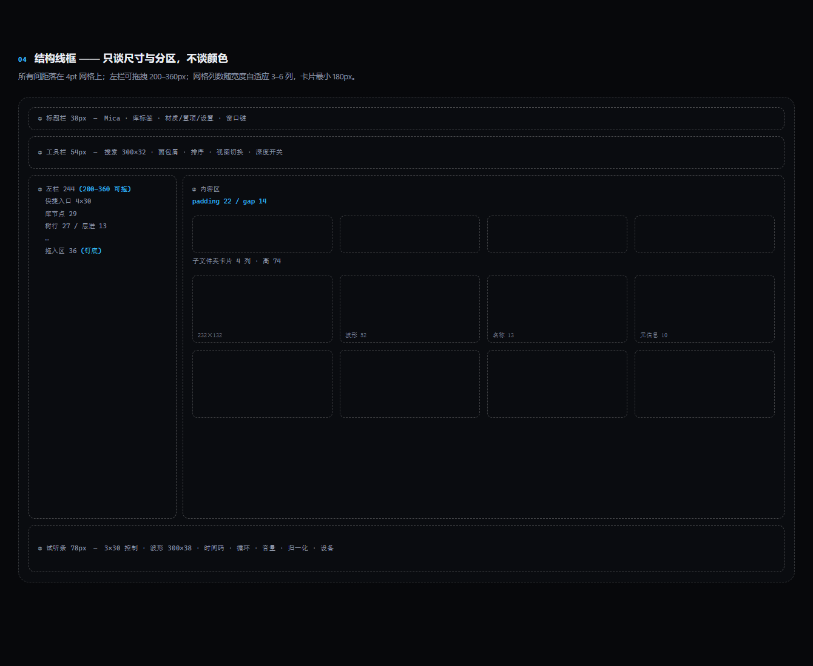
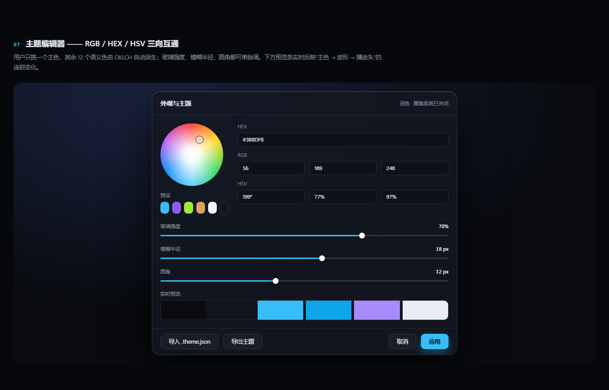
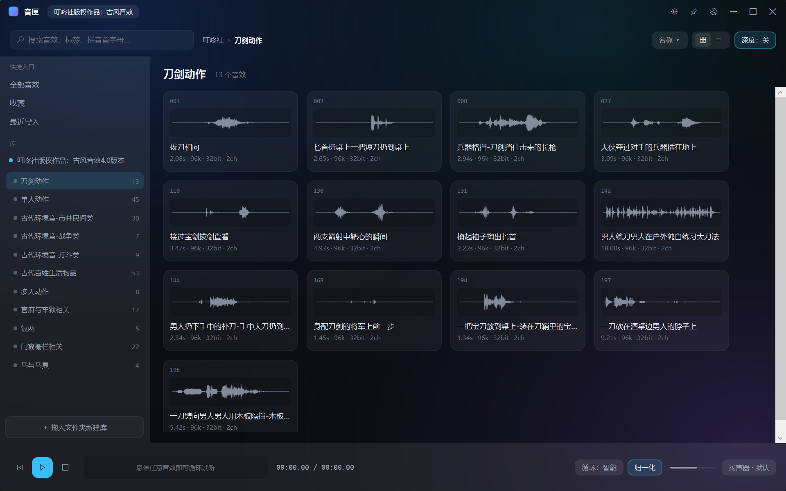
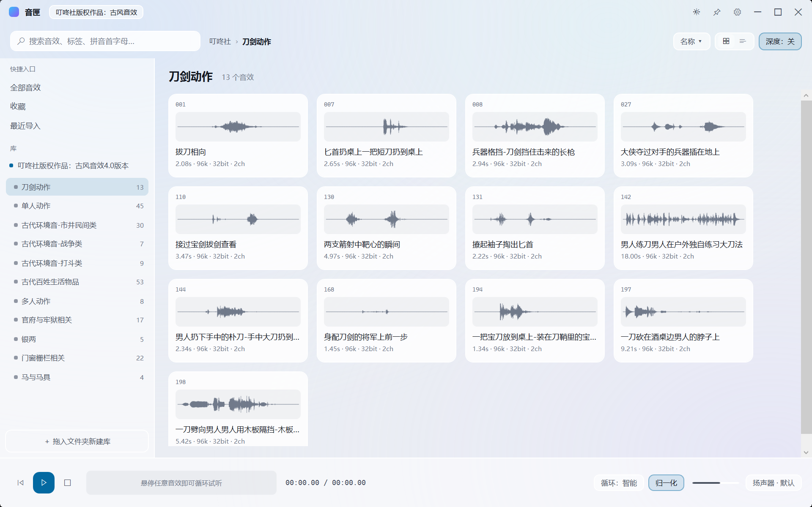
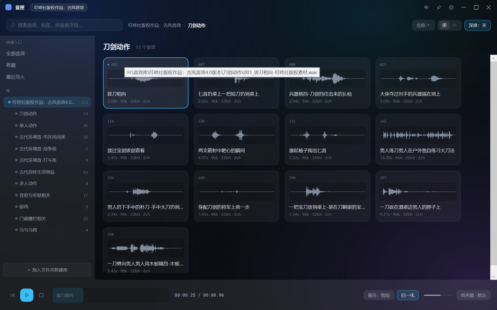
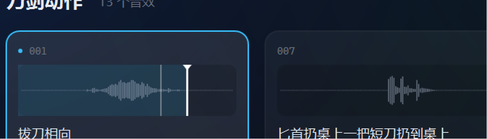
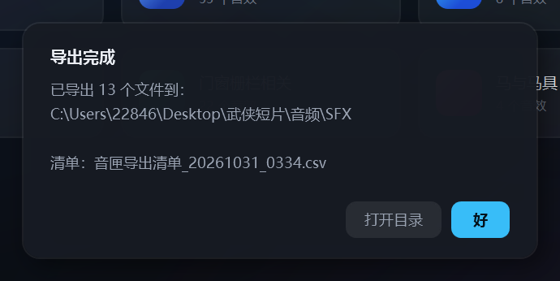

# 音匣 SoundVault · 开发记录

> 版本：**v0.5** ｜ 单文件 exe：`dist\音匣.exe`（76.7 MB，自包含运行时）
> 这份文档记录"我们这么久都干了什么"：每个阶段做了什么、为什么这么做、踩了哪些坑。
> 想直接上手用，看同目录的 **《使用说明.md》**；想看设计规格，看 **《设计文档.md》**。

---

## 0. 一句话现状

| | |
|---|---|
| 现在能干什么 | 导入音效素材包 → 看到波形 → 悬停即听 → 点波形定位 → 拖进 DAW → 批量导出并生成清单；**万级库也能秒开**（v0.5） |
| 代码量 | 约 4100 行 C# / XAML（19 个手写文件，不含构建产物） |
| 体积 | 单文件 76.7 MB（含 NAudio 解码器 + SQLite + .NET 运行时，目标机无需装任何东西） |
| 已验证 | 你的《叮咚社古风 4.0》：217 个文件 / 1.33 GB / 96 kHz·32 bit（可解码 213 个，首次建索引 665 ms） |
| 1 万文件压测 | 热启动首屏 **706 ms**、增量扫描 105 ms、只实体化 24–32 个卡片、连续滚动 **68–73 fps** |
| 拖拽实测 | Adobe Audition、FL Studio、Studio One 均可正常落地 |

---

## 1. 第一阶段：从需求到设计

### 你最初的规格

> 左边列表、右边大区域显示音效；非叶节点显示子文件夹，叶节点显示全部音效；右边直接画波形图；整个素材包文件夹可以拖进左边栏自动导入；鼠标悬停自动循环播放；按住能拖进 DAW；浅色/深色主题，主色支持 RGB/HEX/HSV 自定义。

### 我判断必须补的 6 条

| 补充点 | 为什么 |
|---|---|
| 悬停 **140ms 防抖 + 移出即取消** | 不然鼠标扫过一排卡片是"机关枪" |
| 循环的**接缝处理** | 96 kHz 素材在循环点容易"啪"一声 |
| **拖拽载荷必须是 `CF_HDROP`** | DAW 只认真实文件路径 |
| **峰值缓存** | 6400 个 96k 文件不可能实时解码 |
| **性能预算**（玻璃 ≤2ms/帧、模糊面板 ≤3 个） | 玻璃材质最容易把 60fps 搞崩 |
| **支持边界**：只支持能解码的音频，不碰 Kontakt/UVI 容器 | 避免宣传与实际不符 |

### 三个技术决定

| 决定 | 选择 | 理由 |
|---|---|---|
| 桌面框架 | **.NET 10 + WPF 原生** | 原生 `DoDragDrop`（DAW 拖拽的唯一可靠路径）、WASAPI 低延迟、单文件 exe |
| 音频 | **NAudio + WASAPI 共享模式 + 自写循环 Provider** | 采样级循环、设备可选、96k→48k 重采样 |
| 索引 | **SQLite**（尚未落地，现在用 JSON + 内存） | 万级查询毫秒级、可增量 |

### 玻璃材质：分版交付，而不是一次堆完

你的原话是"液态玻璃 + 毛玻璃"。真实情况是 WPF 里做真模糊最容易翻车，所以拆成三层、按风险排序：

| 层 | 做法 | 状态 |
|---|---|---|
| L0 底板 | Windows 11 Mica（系统级，几乎零成本） | **未接**，现在用环境光渐变近似 |
| L1 霜面 | 下层降采样 + BlurEffect | 未做 |
| L2 液态 | 卡片用半透明 + 边光 + 指针高光（**不模糊**） | 已做（半透明 + 边光） |

> 诚实地说：**"毛玻璃"目前只是视觉近似，不是真模糊**。真 Mica + 霜面排在后面，因为它不影响功能，却最容易把帧率吃掉。

产出物：

- 《设计文档.md》——12 章 + 3 附录（交互状态机、玻璃规范、SQLite 表结构、里程碑、风险）
- 《界面线框.html》——9 节可交互线框（深浅主题、搜索态、空态、组件库、主题编辑器、导出弹窗）







---

## 2. 第二阶段：M0 骨架（能双击运行）

目标是先跑起来，证明技术栈可行。

**做了什么**：WPF 工程、无边框窗口 + 自定义标题栏、深/浅两套 token、真实扫描你的素材包、真波形渲染。

**踩坑**：XAML 编译器不支持"数组类型的依赖属性"。

```
error MC4102: 模板部分中不支持类型"PropertyArrayStart"的标记
```

原因是我把波形峰值写成 `float[]` 依赖属性。**修法**：包一层 `WaveData` 类，DP 类型改成这个类。





---

## 3. 第三阶段：播放闭环（M2）

**音频管线**：

```
文件 → 解码（NAudio，保持原采样率）
     → LoopProvider（裁剪 + 循环 + 交叉淡化 + 音量）
     → WdlResampler（96k → 设备 48k）
     → WasapiOut（共享模式，20ms 缓冲）
```

**验证方式**（不靠耳朵猜）：

| 自检开关 | 作用 | 实测输出 |
|---|---|---|
| `--selftest <文件>` | 离线解码 + 循环 + 淡出 | `区间=0–2081ms 环长=2081.2`、`fadeout: tailAfterFade=0.0000` |
| `--playtest <文件>` | 真开声卡播放 | `wasapi started = true`、`playing=True pos=814ms` |

**悬停试听**：140ms 防抖 + 移出淡出 + 窗口失焦停止。



---

## 4. 第四阶段：拖拽与导入（M3）

- **拖出**：4px 起拖阈值 → `DataObject(FileDrop, 路径数组)` → `DoDragDrop`。点波形不会误触发拖拽。
- **拖入**：整个文件夹拖进窗口即建库，递归扫描；库列表存进 `store.json`，下次启动自动恢复。

**你在真机上实测**：Audition、FL Studio、Studio One 都能正常落地（Cubase 你机器上没有，没法验）。

---

## 5. 第五阶段：波形播放头 + 悬停游标 + 点击定位

这是你提得最具体的一个需求，也踩了一个概念坑。

### 坑：两条时间轴

悬停播放当时会自动跳过首尾静音（"智能裁剪"）。但这样一来，"波形上画的位置"和"实际播放的位置"就是两套坐标系 —— 你点在 10s，实际会落到别处。

**定案**：时间轴统一到**文件真实时间**。裁剪只作为"循环区间"存在，不改变坐标。

| 线 | 外观 | 含义 |
|---|---|---|
| 细灰线 | 1px，45% 透明 | 鼠标停在哪（点击从这儿开始） |
| 粗白线 + 顶部三角 | 1.8px | 播放头（声音播到哪） |

**点击行为**：区间内 → 采样级瞬时跳转（不重开声卡）；区间外 → 重建区间，从点击处循环到文件末尾。



---

## 6. 第六阶段：性能修复（20fps → 110fps）

你说"光标动得卡卡的"。量化之后发现三个真凶：

| 问题 | 原来 | 现在 |
|---|---|---|
| 驱动方式 | `DispatcherTimer(50ms)` = **20fps** | `CompositionTarget.Rendering` 跟渲染帧 |
| 每帧重画 | 520 根柱子逐根重排 | 几何缓存成 `StreamGeometry` + `Freeze()` |
| 进度条 | 改 `Width` → 触发整个布局 | 改 `ScaleTransform`，纯合成层 |
| 时间码 | 每秒更新上百次 | 只在百分秒变化时改文本 |

**实测**：帧率探针（`SV_FPS=1`）从 20fps 提到 **约 110fps**，播放时约占 1.6% 整机 CPU。

> 中间试过锁 60fps 省 CPU，结果这台机器渲染节拍约 12ms，隔帧取样反而抖到 42fps —— 最后选择跟随原生帧率。

---

## 7. 第七阶段：把"能看不能点"的控件全部接线

之前有一排按钮是死的，现在都能用：

| 控件 | 行为 |
|---|---|
| 循环模式 | 整段 / 智能（跳静音）/ 单次，切换后当前素材立即按新模式重启 |
| 音量 | 可拖动，实时生效，退出记住 |
| 归一化 | RMS 拉到约 -18 dBFS，增益限 0.2×–5× |
| 输出设备 | 枚举 WASAPI 设备，记住 ID，设备拔了回退默认 |
| 排序 | 4 个字段 × 升/降序，按钮直接显示 `名称 ↑` |
| 深度 | 递归加载子目录（上限 3000） |
| 导出 | 复制文件 + 生成 CSV（UTF-8 带 BOM，Excel 不乱码） |




---

## 8. 问题台账（这段时间修掉的每一个坑）

| # | 现象 | 根因 | 修法 |
|---|---|---|---|
| 1 | 所有音效"无法解析" | WAV chunk 循环条件写反（`next <= fs.Position` 就 break） | 改成只在越界时 break，并总是 seek 到下一个 chunk |
| 2 | XAML 编译报 MC4102 | `float[]` 依赖属性 | 包成 `WaveData` 类 |
| 3 | 波形变"空心鱼骨" | 合并几何 + 默认 **EvenOdd** 填充，重叠柱被异或挖空 | `FillRule.Nonzero` + 峰值降采样到像素宽度 |
| 4 | 播放头卡顿 | 50ms 定时器 + 每帧重排 520 根柱子 | 渲染帧驱动 + 几何缓存 |
| 5 | **单次播放不停** | Provider 无论如何都在末尾回绕，没给 WASAPI 结束信号 | 读到末尾返回 0 + 新增 `Ended` 事件主动通知 |
| 6 | **Ctrl+点击后声音不停** | "单击卡片 = 固定播放"这个隐式动作被多选误触发 | 单击只选择，**双击**才固定 |
| 7 | 排序菜单分隔线又短又偏 | 普通 `Border` 被 ContextMenu 自动包进 `MenuItem` 容器 | 改用 `Separator` |
| 8 | 分隔线在菜单里发白刺眼 | 菜单按 `MenuItem.SeparatorStyleKey` 找样式，隐式样式没命中 | 样式挂到正确的 key 上 |
| 9 | 浅色主题看不见分隔线 | 拿了"面板高光色"当线色（浅色下是纯白） | 新增 `Divider` token（深 15% 白 / 浅 14% 黑） |
| 10 | 滚动条是刺眼白条 | WPF 默认 ScrollBar 模板 | 自绘：13px、圆角滑块、两端箭头 |
| 11 | 提示框跟界面两个世界 | 系统 `MessageBox` | 自绘 `MessageDialog`（玻璃面板 + 主色按钮 + 打开目录） |
| 12 | tooltip 白底方角 | 系统 ToolTip 模板 | 全局 ToolTip 样式 |
| 13 | 按钮悬浮无反馈 | Pill 样式没有 hover 触发器；且本地值会盖掉触发器 | 普通态/打开态两套样式 + 触发器，代码只切样式 |
| 14 | **1 万条列表只能滚一屏**（v0.5） | 虚拟化面板挂在 `ItemsControl` 上、外层自己套 `ScrollViewer`：`ScrollContentPresenter` 只给 ListBox 模板里的 ScrollViewer 挂钩子，`ScrollOwner` 恒为 `null`，滚动范围塌成视口高度 | 换成 `ListBox` + 空模板的 `ListBoxItem`，`CanContentScroll=True`；诊断靠读 `panel.ScrollOwner` 和 `ScrollViewer.ExtentHeight`（应为 364,439 而不是 584） |
| 15 | **换文件夹时列表卡死数秒**（v0.5） | `ObservableCollection.Clear()` + 逐条 `Add` 一万次，每次发 `CollectionChanged`，`VirtualizingPanel.OnItemsChanged` 也跟着跑一万次 | `RangeObservableCollection.ResetWith()`：静默填好，只发一次 `Reset` |
| 16 | **滚整屏要 ~100 ms**（v0.5，未完全解决） | 不是虚拟化的问题：二分测出**每个 `TextBlock` 在本机约 1 ms**（中文比英文贵一倍），一张卡 4 个文字块 → 新实体化 16 张卡 ≈ 64 ms | 已做：只测量新容器、容器回收、`BufferRows=1`。剩下的属 WPF 文本栈固有成本；真要再压得缓存文字渲染或减少文字块 |

---

## 9. 我是怎么验证的（不靠"感觉好了"）

| 手段 | 用来证明什么 |
|---|---|
| `--selftest` | 解码、循环区间、读空、淡出是否归零（不开声卡也能查） |
| `--playtest` | WASAPI 是否真启、位置是否推进、单次模式是否停 |
| `SV_FPS=1` | 实际渲染帧率（v0.5 起常态开启，每秒写一次） |
| `SV_STARTUP=1` | 首屏可交互耗时 + 每个库的扫描统计（新增/变更/移除/耗时） |
| `SV_LIST_TEST=1` | 虚拟化是否真生效：`extent` vs `viewport`、每步 `realized` 容器数、每步布局毫秒 |
| `SV_SCROLL_FPS=1` | 自动连续滚动 5 秒，配合 `SV_FPS` 拿真实帧率 |
| `SV_SLOW_SCAN=1` | 拖慢扫描，用来看清进度条（不然 1.35 s 就扫完了） |
| `SV_EXPORT_TEST=<目录>` | 导出全链路：复制 + 命名 + CSV 内容 |
| `SV_DIALOG_TEST=1` | 提示框视觉验收 |
| `%TEMP%\sv-crash.txt` | 任何未处理异常的堆栈（现场排障用） |
| UIA（`AutomationId` = `x:Name`） | 不点鼠标也能断言 `PlayerLabel` 是否在播、选中是否生效 |

外加每个阶段都做**实机截图**，肉眼比对（波形那种"帧率正常但画面坏了"的问题，只能靠看）。

**v0.5 学到的测量纪律**：性能数字只用 **Release** 构建，且必须先用 `Get-CimInstance Win32_PerfFormattedData_PerfOS_Processor` 确认 CPU 空闲。同一份代码在用户玩游戏时测得 100 ms、空闲时 15 ms —— 差 6 倍，差点被误导去重写虚拟化。

---

## 10. 代码结构

```
SoundVault/
├─ src/SoundVault.App/
│  ├─ Audio/          AudioClip（解码 + 循环 Provider）、AudioEngine（WASAPI 输出）
│  │                  WavReader（WAV 头解析 + 流式算峰值，v0.5 去掉 48 MB 上限）
│  ├─ Controls/       WaveformView（波形 + 播放头 + 悬停游标）
│  │                  VirtualizingWrapPanel（★v0.5 卡片虚拟化）、RangeObservableCollection（★v0.5）
│  ├─ Dialogs/        MessageDialog（统一提示框）
│  ├─ Models/         AssetItem / FolderItem / LibraryItem
│  ├─ Services/       Store（用户数据 JSON）
│  │                  IndexDb（★v0.5 SQLite 索引）、Indexer（★v0.5 增量扫描）
│  ├─ Themes/         Dark.xaml / Light.xaml（全部 token，两份键名必须一致）
│  ├─ MainWindow.xaml(.cs)  全部界面与交互
│  └─ App.xaml(.cs)         启动 + 自检入口 + 崩溃日志
├─ 设计文档.md / 界面线框.html
├─ 交接说明.md（AI 冷启动包）/ 开发记录.md（本文）/ 使用说明.md / 未完成清单.md
├─ 预览/              27 张实机与设计截图
└─ dist/音匣.exe      单文件可执行（76.7 MB）
```

---

## 11. 还没做的（下一步）

| 优先级 | 功能 | 说明 |
|---|---|---|
| 高 | **标签 + 智能文件夹** | 跨库打标、按标签筛、保存查询（v0.5 有了 `index.db`，可以直接建表） |
| 中 | **列表视图** | 工具栏那个切换按钮目前是死的（已标"开发中"）；可复用虚拟化面板 |
| 中 | **Mica / 真霜面** | 现在的玻璃是渐变近似 |
| 中 | **拼音搜索** | 打 `bd` 出"拔刀相向" |
| 低 | 全局热键 + 窗口置顶 | DAW 在前台时唤出 |

~~SQLite 索引 + 峰值缓存 + 列表虚拟化~~ —— **v0.5 已交付**，见 §13。

**技术债**：`MainWindow.xaml.cs` 偏大（1249 行，第二批前建议先拆 ViewModel）、整屏跳转仍受文字排版成本限制（§8 第 16 条）。

---

## 12. 一段小结

这段时间真正有价值的不是"写了多少功能"，而是三件事：

1. **把不可靠的直觉换成可验证的数字** —— 帧率、解码、导出都有自检开关，不再"感觉挺快"。
2. **默认行为要可预测** —— "智能裁静音"这种"我以为你会喜欢"的优化，最后被改回默认关闭。优化必须是用户主动打开的。
3. **一个 token 不能干两件事** —— `PanelBorder` 既当高光又当分隔线，深色下碰巧都对，浅色下立刻暴露。

---

## 13. 第八阶段：地基（v0.5）

> 一句话：**启动不再碰文件系统，波形不再重算，列表只建看得见的卡片。**

### 做了什么

| 清单编号 | 内容 | 验收证据 |
|---|---|---|
| 1 | **SQLite 索引 + 增量扫描**：`index.db` 两张表（`meta` / `files`），按"大小 + 最后写入时间"判断要不要重读 | 213 个真实文件首次建索引 **665 ms**；再启动 0 变更、扫描仅 **13–105 ms** |
| 2 | **峰值缓存**：峰值改成 512 点、8 bit 量化，直接存进 `files.peaks` BLOB；`AssetItem.Wave` 惰性解码 | 进文件夹 0 次文件 IO，波形与改前一致 |
| 3 | **卡片虚拟化**：自写 `VirtualizingWrapPanel`（固定 234×146 网格 + `IScrollInfo`） | 1 万条：`extent=365,000`、只实体化 **24–32** 个容器 |
| 30 | **扫描进度 UI**：0.35 s 后浮出，阶段名 + `1,199 / 10,000` + 进度条 | 用 `SV_SLOW_SCAN=1` 截到实机图 |

### 为什么这么做

- **索引必须"只存事实"**：能从头文件算出来的（采样率/声道/时长/峰值）进 `index.db`；人给的（评分/收藏/库列表）留在 `store.json`。这样索引库随时可删，不会丢用户资产。
- **启动分两段**：先用索引把界面画出来（毫秒级），再后台增量扫描；扫描结果无变化就**一个像素都不重画**，所以热启动完全不闪。
- **扫描中途被打断就整体放弃**：删除"已经不存在的文件"必须在扫描成功后的同一个事务里做，否则用户按一次 Esc 就能把索引删空。

### 结果（Release 构建，CPU 空闲时）

| 指标 | 数值 |
|---|---|
| 1 万文件热启动（首屏可交互） | **706 ms**（目标 < 1.5 s） |
| 1 万文件首次建索引 | 1.35–2.13 s（后台，界面同时可用） |
| 增量扫描（无变化） | **105 ms** / 1 万个文件 |
| 只实体化的卡片数 | 24–32（与 1 万条无关） |
| 连续滚动渲染帧率 | **68–73 fps**（目标 58） |
| 整屏跳转（一次翻一屏） | ~100 ms（见 §8 第 16 条，文字排版成本） |

### 这一轮最值的两个教训

1. **WPF 的虚拟化面板必须挂在 ListBox 上**。`ItemsControl` + 外层 `ScrollViewer` 长得很像能用，`ScrollOwner` 却永远是 `null` —— 表现是"能滚动条但只能滚一屏"，不报错、不崩，最容易被漏掉。诊断方法：把 `ScrollViewer.ExtentHeight` 打出来，它应该等于"行数 × 行高"。
2. **性能测量必须先确认环境干净**。同一份代码，用户打游戏时测 100 ms、关机时测 15 ms。所以现在所有性能结论都标注"Release 构建 + CPU 空闲"。

---

## 14. v0.5.1：导航修复（面包屑 + 左栏树）

> 你报的两个问题，其实是同一件事的两面：**"我现在在哪"没有单一来源。**
> 面包屑是写死的两个文本块，左栏是平铺的选中态，右边下钻时两边都没更新。

### 修了什么

| 你报的现象 | 现在的行为 |
|---|---|
| 根目录也显示 `叮咚社… › 全部` | 根目录**只显示库名**；进了子文件夹才逐级追加 `库名 › A › B › C` |
| 面包屑是死的 | **每一段都能点**，点 `A` 回到 A，点库名回到根（跟资源管理器一样） |
| 全部页里点右边的文件夹，左边不亮 | 右边点进去 → 左栏**自动逐层展开并高亮** |
| 右边一层层点下去，左边不动 | 左栏现在是真正的树：`A` 展开着 `B`、`B` 展开着 `C`，三层一路跟着走 |

### 顺手做的两件事

- **右栏文件夹视图也能显示子文件夹**（上面一条卡片条、下面音效网格）。之前进了文件夹就看不到下一层，`A>B>C` 根本走不通。
- **左栏加了展开三角**：点三角只折叠/展开，不切换视图（和资源管理器一致）；命中区放大到整格，不然 8pt 的三角几乎点不中。
- 空文件夹卡片原来显示 " 个音效"，现在是 "空文件夹"；库节点原来不显示文件数（=0），现在显示真实总数。
- **侧栏子文件夹前面的灰点全部去掉**（缩进 + 三角已经在表达层级，一排灰点是纯噪点），只保留库节点那颗强调色圆点作为"根"的锚点。
- **快捷入口与左栏互斥**：以前点「全部音效」会顺手把库根也选中，两处同时亮。现在进快捷视图 `ClearSidebarSelection()`、进树节点 `ClearQuickSelection()`。
- **「最近导入」不再是"全部音效"的马甲**：直接查 `index.db` 按 `mtime` 倒序取 300 条（清单第 19 条）。
- **「收藏」改成全库范围**：以前只筛当前列表，在库根点进去是空的。
- **空态补齐**（清单第 32 条）：首次使用 / 收藏为空 / 最近为空 / 文件夹没音频 / 搜索无结果，各有文案和图标；顺带修了"收藏为空却显示『把素材包拖到左边』"的误导。

### 这一轮的四个坑

| 现象 | 根因 | 修法 |
|---|---|---|
| 三角是"展开"状态，子项却看不见 | 子级是懒加载的，`EnsureChildren` 之后没有重建平铺列表 | 载入子级 / 改展开状态后一律 `RebuildSidebarCore()` |
| 点三角也进了文件夹 | 只给 `TextBlock` 加了 `e.Handled`，但命中区太小，点到了行上 | 三角包进 `Border Background="Transparent"` 吃满整格 + `e.Handled = true` |
| 进子文件夹后左边没有它 | 同步选中只展开祖先，没展开"自己" | `OpenFolder` 里 `folder.IsExpanded = true` 再重建 |
| 两次点面包屑没反应 | 手工算的坐标偏了 64px（工具栏其实横跨整个窗口，不从内容区开始） | 用 UIA 拿到那段文字的真实矩形再点 —— **别再手算坐标** |
| **左栏"不是树了、全挤在同一层"** | 一级缩进被我写成 `2 + (n-1)*14`，一级文件夹只缩进 2px；库节点又多了 14px 的三角列，两者圆点只差 3px | 缩进改成 `Depth * 16`；库节点额外用强调色圆点 + 半粗体区分"根"；库节点也给它三角（可以整个折起来） |

---

## 15. v0.5.2：收藏变成"看得见、点得到"

> 你的原话：**"这个功能最好是直接可以看到的，而不是还要按键再显示，这比较反人类。"**
> 说得对。快捷键是给熟练用户的加速器，不该是唯一入口。

### 做了什么

| 改动 | 说明 |
|---|---|
| **卡片右上角加爱心按钮** | 一直可见，空心 = 未收藏、实心（强调色）= 已收藏；点一下切换。`F` 仍然可用 |
| 星星只表示评分 | 卡片上原来 `♥ ★★★` 挤在一行，现在爱心独立成按钮，星星只管评分 |
| 键盘焦点修好 | 见下表——这是"按 F 没反应"的根因 |

### 键盘没反应：根因与修法

| 现象 | 根因 | 修法 |
|---|---|---|
| 点卡片后按空格 / F 毫无反应 | WPF 激活窗口时把键盘焦点交给**第一个可输入元素**（搜索框），之后所有按键都在往搜索框里打字；标题栏按钮和左栏列表也会各自抢焦点 | ① 标题栏按钮、左栏两个 ListBox 全部 `Focusable="False"`；② 启动、窗口激活、鼠标点内容之后调用 `FocusKeyboard()` 把焦点收回窗口；③ 键盘处理从 `KeyDown` 改挂 **`PreviewKeyDown`**（能抢在子控件之前），④ 焦点在 `TextBox` 里时只放行 Esc，其余不拦截（不能影响正常搜索） |
| 面板类按钮（爱心）点了会连带选中卡片 | Button 在 MouseLeftButtonDown 上就把事件吞了 | 这正好是想要的行为：点爱心只收藏，不改选中 |

### 验证

- 用 UIA 的 `InvokePattern` 直接点爱心（不依赖鼠标/焦点）：第一次 `Favorite: true`、第二次 `false`，`store.json` 同步变化，两种图标状态都截图确认。
- 键盘这一项**没法自动验**：我的注入按键总被聊天窗口抢走（`FocusedElement` 一直显示是对话框输入框）。已把修法做全，需要真人按一次确认。

---

## 16. v0.5.3：把"只能按键盘"的功能搬到鼠标上

> 你的原话：**"大多数的功能尽量不要用到键盘，让用户只用鼠标就基本能操作了。"**
> 这条从今天起是产品硬规则，写进《交接说明》§5 第 22 条。

| 功能 | 以前 | 现在 |
|---|---|---|
| 收藏 | 只能按 `F` | 卡片右上角**爱心按钮**，一直可见、直接点 |
| 评分 | 只能按 `1`-`5` / `0` | 爱心左边**5 颗星**，点第 N 颗 = N 星，再点同一颗 = 清零；划过有预览 |

### 技术选择：星级为什么是自绘控件

最先写成 5 个 `Border + TextBlock`，但一张卡会多 4 个文字元素。这个项目的滚动成本本来就被"每个 TextBlock ≈ 1ms"卡着（§8 第 16 条），30 张卡就是 +120 个 TextBlock，等于把滚动拖回卡顿。

改成 `Controls/StarRating.cs`（约 120 行自绘）：
- 一张卡只多 **1 个**视觉元素；
- 用 `FormattedText` 画 Segoe MDL2 的 `E734`（空心）/ `E735`（实心）；
- 鼠标悬停按 X 坐标算出"会点中第几颗"，实时预览；
- 点击通过 `StarClicked` 路由事件回到 `MainWindow.Star_Click`，不引入新的绑定方向。

### 验证

用坐标点击（控件没有 UIA peer），store.json 是唯一事实来源：

```
点第 3 颗 → store "Rating": 3
点第 5 颗 → store "Rating": 5
再点第 5 颗 → store "Rating": 0   ← 取消评分
```

### 文案：把"教键盘"的话全改成鼠标说法

| 位置 | 以前 | 现在 |
|---|---|---|
| 收藏空态 | 选中音效后按 F 键（Ctrl+点击可以多选）收藏… | 点卡片右上角的爱心即可收藏，收藏过的声音都会集中在这里 |
| 爱心 tooltip | 收藏 / 取消收藏（快捷键 F） | 收藏 / 取消收藏 |
| 导出 tooltip | …（未选中则导出当前列表）· Ctrl+E | …（未选中则导出当前列表） |
| 导出前提示框 | …或按 Ctrl+A 全选当前列表 | …（Ctrl / Shift 可多选）；直接点「导出」则导出当前列表的全部 |
| 搜索无结果 | …或者按 Esc 清空搜索框 | 换个关键词试试；把搜索框里的字删掉就能看到全部 |

顺带修了空态文字**被截断**的 bug：`EmptyView` 里两个 TextBlock 忘了 `TextWrapping="Wrap"`，长句子被切掉半句；同时把面板宽度从 420 放到 470，避免中文在"这/里"中间断行。

### 键盘：暂时放弃

用户实测空格 / `F` / 数字**全部无反应**，且按 `F` 后搜索框里也没有出现字母（说明按键根本没进应用，不是焦点在搜索框）。本机无法复现（注入的按键总被聊天窗口抢走），已按"不依赖键盘"重构，键盘代码保留但不再作为唯一入口。

---

## 17. v0.5.4：搜索改成"整库搜索"

> 你报的：**"我在库根搜索音效名字，不出结果。"**

### 原因

库根视图只渲染文件夹卡片，`_all` 里**一个音效都没有**（`_all` 是"当前视图加载的资产列表"）。而搜索做的事是 `_all.Where(匹配)` —— 在空列表里过滤，必然 0 条。

### 改法

搜索不再"过滤当前列表"，而是**切到独立的搜索视图**：

1. 搜索框第一次有内容 → `LoadSearchView()`：把**整个库**装进 `_all`，再按关键词筛；
2. 面包屑显示 `库名 › 搜索`，标题显示命中数（`15 个结果 · "刀"`）；
3. 继续打字只重跑 `ApplyFilter`（不重新读库）；
4. 清空搜索框 → 回到搜索前的那个视图（`ReloadCurrentView` 按 `ViewKind` 分派）；
5. **点左栏/面包屑/文件夹卡片会清掉搜索**——否则会停在搜索结果里，让人以为那个文件夹是空的；
6. 扫描完成时如果正在搜索，重跑搜索而不是把结果冲掉。

### 验证

```
库根          标题=库名            11 个文件夹 · 213 个音效
搜"拔刀"      标题=搜索            1 个结果
搜"刀"        标题=搜索            15 个结果
搜"zzz不存在"  标题=搜索            0 个结果（空态文案）
清空          标题=库名            11 个文件夹 · 213 个音效
在「刀剑动作」里搜"单人"   → 45 个结果（跨文件夹，命中「单人动作」的东西）
点左栏「单人动作」         → 搜索框自动清空，显示 45 个音效
```

### 已知代价

第一次输入关键词时要把整库读进 `_all`（1 万文件约几十到一两百毫秒的一次性开销）。后续按键只过滤内存里的列表，很快。真嫌慢的话，下一步可以让搜索直接查 `index.db`（`WHERE name LIKE`），不建 UI 对象。

---

## 18. v0.6：第二批「组织」第一切片（标签 / 右键菜单 / 过滤语法 / 智能文件夹）

> 目标（清单 §9 第二批）：从"能听"到"能管"。验收标准：**能保存一个"评分≥4 的古风短音效"入口，并在 3 次点击内到达。**
> 已达成：保存后左栏出现「4 星以上的武侠短音效」，**1 次点击**就到。

### 数据层（index.db schema v2）

```sql
tags(id, name UNIQUE COLLATE NOCASE)
asset_tags(path, tag_id)          -- 按绝对路径关联，跟 store.json 的评分/收藏同一套 key
saved_queries(id, name UNIQUE, query, ord)
```

- 标签读的时候**一次批量查**（`TagsByPath(一批路径)`），不给每张卡单独查库；
- `SetTags(path, 标签集合)` 是"整体替换"，右键勾选/取消都走它，一个事务写完；
- 老库升级只跑 `CREATE TABLE IF NOT EXISTS`，不动已有数据（用户那份 213 文件的库实测直接打开无异常）。

### 过滤语法（`Services/SearchQuery.cs`）

`#tag` / `star:>=4` / `dur:<2s` / `sr:>48k` / `ch:2` / `type:wav`，与自由词混写，空格分隔、条件之间是 AND。
解析成 `SearchQuery`（一堆可空字段），`ApplyFilter` 里一句 `src.Where(query.Matches)` 搞定。
不认识的 `xxx:` 会退化成普通关键词，不会让整条查询失效。

实测（真实库 213 个文件）：

```
#武侠      → 3      star:>=4   → 1      dur:<1s  → 13
#剑        → 1      dur:<3s    → 93     sr:>48k  → 213    ch:2 → 213
```

### 界面

| 位置 | 内容 |
|---|---|
| 卡片 | 名字下面多一行 `#标签`（没标签就留白，**保证等高**，虚拟化面板要求卡片尺寸一致 → 卡片 132→148，cell 146→162） |
| 左栏新增「智能文件夹」区 | 保存的查询，一点即达，右键删除 |
| 左栏新增「标签」区 | 所有标签 + 数量，一点 = 搜这个标签 |
| 工具栏新增「保存搜索」 | 只在搜索时出现 |
| 右键菜单 | 收藏 / 评分 / 标签（含新建）/ 复制路径 / 在资源管理器显示 / 导出 |

### 这一轮踩的坑

| 现象 | 根因 | 修法 |
|---|---|---|
| 右键子菜单在 UIA 里找不到 | WPF 的 ContextMenu 是独立 Popup，子菜单更是另一层 HWND，自动化树里不可见 | 不在 UI 自动化上硬啃，改用 `SV_DB` + `SV_ORG_TEST` 钩子验证数据链路；菜单本身用截图/UIA 只验证"能弹出、条目对" |
| 智能文件夹高亮和左栏文件夹同时亮 | 和 v0.5.1 的快捷入口是同一类问题 | `SearchBox_TextChanged` 里除"点智能文件夹"之外都清掉它的高亮（`_applyingSmart` 标记） |
| InputDialog 的按钮自动化点不到 | 用的是 `Border + MouseLeftButtonDown` | 换成真 `Button`（自带 Click + InvokePattern），顺带对读屏也更友好 |

### 还没做（第二批剩下的）

- **拼音搜索**（打 `bd` 出"拔刀相向"）：需要一个汉字→拼音首字母的数据源，评估后再动；
- **列表视图**：工具栏那个切换按钮还是占位，计划复用虚拟化面板换一个行高更高的行模板。

---

## 19. v0.6 续：拼音搜索 + 列表视图（第二批收尾）

### 拼音搜索（清单 #5）

- 依赖 **TinyPinyin.Net 1.0.2**（`TinyPinyin.dll` 只有 40 KB、纯 C#、无原生库；单文件发布体积只涨了 45 KB）。这是本项目第三个第三方依赖（NAudio、Microsoft.Data.Sqlite、TinyPinyin）。
- `Services/PinyinSearch.cs`：给一段中文算出**首字母**（拔刀相向 → `bdxx`）和**全拼**（→ `badao`）。
- `SearchQuery` 里只有"纯字母/数字"的词才走拼音分支，中文词仍然直接比名字（更快）：
  每个自由词必须命中 名字/文件名/路径/编号 **或** 拼音首字母/全拼。
- 每条音效的拼音**首次用到才计算并缓存**（`AssetItem.PinyinInitials / PinyinFull`），没开拼音搜索时零开销。

实测（真实库）：

```
bd     → 13      bdxx → 1（拔刀相向）      badao → 1      dsxx → 0（没这个音）
```

### 列表视图（清单 #10）

- 工具栏右侧那个一直"开发中"的按钮终于能用了，切到列表后一行一个音效：序号 / 名称 / `#标签` / 规格 / 星级 / 爱心。
- **复用**虚拟化面板，新加 `FullRowMode`：列数固定 1、格子宽度跟随视口宽度。所以万级文件依然只实例化可见行，不是另写一套控件。
- 行模板（`AssetRowTpl`）注册和卡片完全相同的鼠标事件：悬停试听、单击选择、双击固定、右键菜单、拖出。
- 选择会写进 `store.json` 的 `ListView`，下次打开还是那个视图。

### 这一轮踩的坑

| 现象 | 根因 | 修法 |
|---|---|---|
| **点"列表视图"应用直接崩溃** | `FindResource("Transparent")` —— `Transparent` 是 XAML 关键字，不是资源键，`FindResource` 找不到就抛 `ResourceReferenceKeyNotFoundException` | 代码里用 `Brushes.Transparent`。崩溃日志（`%TEMP%\sv-crash.txt`）一眼定位，这就是兜底日志的价值 |
| 面板在整行模式下格子宽度不对 | `ArrangeOverride` / `MakeVisible` 还在用 `CellWidth` DP，而整行模式的宽度是运行时算出来的 | 面板里记 `_cellW/_cellH`，测量时算一次，排列和 MakeVisible 都用它 |

### 第二批验收

目标：**能保存一个"评分≥4 的古风短音效"入口并在 3 次点击内到达。**
结果：搜索 `star:>=4 #武侠 dur:<3s` → 点「保存搜索」→ 起名 → 左栏出现入口 → **1 次点击**回到这组结果。✅

---

## 20. v0.7：把"看不见"的功能做出来（评分 / 标签 / 过滤语法）+ 删掉列表视图

> 你反馈：**"评分和标签的功能都没有用。过滤语法和智能文件夹我都没看到你有做。拼音搜索可以了。列表视图全部删掉。"**

### 先说结论：功能在，但"发现不了"

用脚本对着发布件核对过：把指针精确落在第 4 颗星上点一下，`store.json` 里立刻出现 `"Rating": 4`。
所以不是没实现，是**入口太小、太暗、太隐蔽**：

| 功能 | v0.6 的入口 | 用户实际感受 |
|---|---|---|
| 评分 | 卡片右上角 5 个 9px 灰色空心字，只有字形本身能命中 | 看不见 / 点不中 |
| 标签 | 只有右键菜单里一层子菜单 | 根本不知道有 |
| 过滤语法 | 没有任何提示（只有我知道 `star:>=4`） | 不存在 |
| 智能文件夹 | 没有保存过就整块不显示 | 不存在 |

### 改法（全部是"让功能露出来"，不是新功能）

1. **星星**：9px → 11px，空星颜色从 `TextTertiary` 提到 `TextSecondary`；`OnRender` 里先铺一层 `Transparent` 矩形——WPF 只有 `Transparent`（不是 `null`）才可命中，**现在整条星区都能点**。
2. **标签**：卡片底部那行字本身就是按钮。没标签时显示 **「＋ 标签」**（灰），有标签时显示 `#武侠`（主题色），点一下直接弹标签菜单。
3. **过滤语法**：搜索框右侧加「?」，点开是一张语法小抄；搜索框 tooltip 也写了；搜不到时的空态里也列出示例。
4. **智能文件夹**：左栏这块从"有内容才显示"改成**常驻**，空的时候显示一行灰字「搜索后点「保存搜索」」。
5. **列表视图**：按你的要求**整块删掉**——工具栏切换按钮、`AssetRowTpl`、`SetListView`、`store.json` 的 `ListView` 字段全部移除。理由记在清单 #10：没有波形，列表视图没有意义；加上波形又不如卡片密。

### 验证方式（也改了）

这一轮我把鼠标脚本停了：你在同一台机器上干活，`SetCursorPos` / `mouse_event` / `SetForegroundWindow` 会抢你的指针、抢焦点，这是不能接受的。

改成：
- 改代码 → `dotnet build`；
- 逻辑链路用 `SV_DB` + `SV_ORG_TEST` 无人值守跑（不碰鼠标键盘）；
- 界面用 `PrintWindow` 只读截屏（不抢焦点、不动指针）；
- 需要真人点的地方留给你。

### 遗留

- 「＋ 标签」这一条交互我没能用自动化验证到底（鼠标被我自己搅过，测出来的结果是脏的），需要你点一下确认。

---

## 21. v0.8：标签做成"看得见的按钮" + 独立标签页（改名 / 删除）

> 你提的两点：
> 1. **"把卡片里那个加标签给框起来，要不然我都看不见"**
> 2. **"只做了加标签，没做删标签和改标签……建议把这个做成和快捷入口那几个按钮一样的按钮，这样就有一个统一的标签页"**

### 1. 卡片上的标签变成一个"框"

原来只是一行灰字，现在是一个小胶囊：`HoverBg` 底色 + `PanelBorder` 边框 + 圆角 6 + 内边距，左边对齐。
没有标签时写 **「＋ 标签」**，有标签时写 `#武侠`（主题色）。卡片高度 148 → **156**，虚拟化单元格 162 → **170**，不再担心挤掉。

### 2. 标签页（新视图 `ViewKind.Tags`）

- 左栏「快捷入口」从 3 项变 **4 项**：全部音效 / 收藏 / 最近导入 / **标签**（样式完全一致）。
- 点进去是一个独立页面：每行 `#标签` + 标记数 + 「改名」「删除」两个按钮；**点行本身 = 筛这个标签**。
- 顶部统计：`2 个标签 · 4 处标记`。
- 数据库新增两个操作（`Services/IndexDb.cs`）：
  - `RenameTag(from, to)`：改名；目标已存在时用 `UPDATE OR IGNORE` 合并，再删旧标签，一个事务；
  - `DeleteTag(name)`：只删 `asset_tags` 关联和 `tags` 行，**音频文件不动**。
- 删除前会弹一个确认框，写清楚"会从 N 个音效上摘掉，文件不受影响"。

### 验证（无人值守，不碰鼠标键盘）

```
tagged=3  first_tags=武侠,剑
tags_page_rows=2   stat=2 个标签 · 4 处标记
改名 剑 → 刀剑合一   → names=刀剑合一,武侠
删除 武侠            → stat=1 个标签 · 1 处标记   names=刀剑合一
```

### 附带的决定

左栏原来那个"标签列表"（每个标签一行）删掉了——现在由标签页承担，左栏只保留一个入口，和快捷入口统一。侧栏更干净，标签的增删改也有了唯一的地方。

---

## 22. v0.8.1：标签页是空白的（布局 bug）

> 你反馈：**"标签页没有东西啊。"**

### 根因

`ApplyContentLayout(false, false)` 把内容区网格的**两行高度都设成了 0**（一行给文件夹卡片条，一行给音效网格）。
而标签页那个 `ScrollViewer` 是 `Grid.RowSpan="2"` —— **跨的两行都是 0 高，它自己的高度也就是 0**。数据明明读进来了（`TagPageList.Items.Count = 2`），屏幕上什么都看不见。

我上一轮的钩子只检查了 `Items.Count`，没检查"看不见"，所以漏了。**只测数据、不测像素，就会漏这种 bug。**

### 修法

`ApplyContentLayout` 加第三个参数 `showTags`：

```csharp
if (showTags)
{
    FolderRowDef.Height = new GridLength(1, GridUnitType.Star);   // 必须留一行是 *
    AssetRowDef.Height  = new GridLength(0);
    FolderScroll.Visibility = Visibility.Collapsed;
    AssetList.Visibility   = Visibility.Collapsed;
    TagPageScroll.Visibility = Visibility.Visible;
    return;
}
```

### 顺带修的两处

1. **改名/删除后不要跳走**：原来会调 `ReloadCurrentView`，而 `_viewKind` 是 `Tags` 时 switch 落到 `default:` → 掉回库根。现在标签页内操作不再触发重载。
2. **`MessageDialog` 的按钮换成真 `Button`**：原来是 `Border + MouseLeftButtonDown`，读屏软件和自动化都点不到。现在「确定」和次要按钮都是 `Button`（模板里用 `ContentPresenter`），删除标签的确认框因此可以被脚本驱动，也验证了一遍。

### 验证（这次用鼠标，你已授权）

- 卡片底部的框：点下去弹出菜单 `✓ #拔刀  新建标签…`（截图确认）；
- 标签页有内容时：`1 个标签 · 1 处标记`，一行 `#刀剑合一 1 [改名][删除]`；
- 标签页没内容时：`0 个标签 · 0 处标记` + 空态「还没有标签 / 点任意卡片底部的「＋ 标签」就能加」；
- 删除流程：点「删除」→ 确认框 → 点「删掉」→ 回到标签页，统计变 `0 个标签`。

顺手把我之前测试留在你库里的 `#拔刀` 删掉了（现在你这边是 0 个标签）。

---

## 23. v0.8.2：点标签进的是"下一层"，不是搜索

> 你指出的：**"在标签页，点了一个标签之后，不应该进搜索，而应该还是「库名 > 标签 > 某标签」。"**

原来 `TagPageRow_Click` 直接往搜索框里塞 `#标签`，于是切到了搜索视图——面包屑变成 `库名 › 搜索`，搜索框里还留着字，语义乱掉了。

### 改法

1. 新增视图 `ViewKind.TagDetail` 和 `OpenTag(tag)`：
   - 面包屑 `库名 › 标签 › #标签`，标题 `#标签`，统计 `N 个音效`；
   - 数据：`PathsWithTag(tag)` 拿到路径集合，再从全库行里筛；
   - 走的是和文件夹一样的"进下一层"路径，不碰搜索框。
2. 面包屑现在支持**带动作的段**：`ShowCrumbs` 的元素从 `(Label, FolderItem?)` 扩成 `(Label, FolderItem?, Action?)`，所以「标签」那一段能点回标签页（文件夹那些段照旧 `NavigateTo`）。
3. `ReloadCurrentView` 补了 `Tags` / `TagDetail` 两个分支，扫描完成后不会莫名跳视图。

### 验证（鼠标实点）

```
标签页 → 点 #刀剑合一 那一行   → 标题=#刀剑合一  统计=1 个音效  搜索框=''（没进搜索）
面包屑                          → 叮咚社版权作品：古风音效4.0版本 › 标签 › #刀剑合一
点面包屑里的「标签」            → 回到 标签页（1 个标签 · 1 处标记）
```

### 附带的调试开关

`SV_CRUMB_LOG=1` 时，面包屑每一段被点击都会往 `%TEMP%\sv-crumb.txt` 记一行（`click: 标签`）。
这次就是靠它确认"点击确实到了处理函数"，而不是靠猜坐标。

---

## 24. v0.8.3：智能文件夹点了没反应 + 搜索框加 ✕

> 你报的两件事：**"智能文件夹有拔刀了，但按下去没反应"**、**"给搜索框加一个 X，用于清除搜索框内容"**。

### 1. 智能文件夹为什么点了没反应

点智能文件夹做的是"`SearchBox.Text = 保存的查询`"，然后靠 `TextChanged` 去切到搜索视图。
但 **WPF 的 TextBox 设置成相同的值不会触发 `TextChanged`** —— 只要搜索框里已经是 `拔刀`，再点这个智能文件夹，什么事件都不会发生，界面自然一动不动。

修法：点智能文件夹不再只依赖 TextChanged，直接补一次完整应用：

```csharp
bool same = string.Equals(SearchBox.Text, f.Query, StringComparison.Ordinal);
_applyingSmart = true;
try { SearchBox.Text = f.Query; } finally { _applyingSmart = false; }

if (same || !_searchMode)          // 文本没变，TextChanged 不会来
{
    _searchMode = true;
    LoadSearchView();
    SaveSearchPill.Visibility = Visibility.Visible;
    UpdateSearchStat();
}
```

实测：从「全部音效」点「拔刀」→ `搜索 / 1 个结果 · "拔刀"`；**连点两次结果一样，都会重新应用**（以前第二次完全没反应）。

### 2. 搜索框的 ✕

- 有内容时才出现，点一下清空并**回到搜索之前的视图**（走的就是 TextChanged 里"空文本 → ReloadCurrentView"那条路）；
- 和右边的「?」并排放在一个 `StackPanel` 里。

> 第一版两个按钮都写成了 `HorizontalAlignment="Right"`，结果**叠在一起**，✕ 被「?」盖住，点了当然没反应——用 UIA 把每个文字的坐标打出来才看出来（`?` 在 767，两个 20px 按钮的右对齐位置重合）。

---

## 25. v0.9：库管理 + 文件丢失 + 重复检查

> 清单 #18 / #13 / #14 —— 一个放在外接盘上的大素材库最容易遇到的三种事。

### #18 库管理

库行右侧多了一个 **「⋯」** 按钮（只有库节点有）：重命名库 / 重新扫描这个库 / 在资源管理器中打开 / 移除库。

- 改名只影响音匣里的显示名（`store.json` 新增 `LibraryNames`：路径 → 显示名），磁盘文件夹不动；
- 移除库会问一次，然后清 `store.json` 的库记录 + `index.db` 里这个库的所有行（评分/标签一起没），**不删文件**；
- 「重新扫描」只扫这一个库，不用等所有库。

> 先试了右键菜单，**在那个 ListBox 上 `MouseRightButtonDown` 根本不触发**（加了日志确认：一行都没写）。改成看得见的「⋯」按钮，既绕开问题也更符合"别藏起来"。

### #13 文件丢失 / 重连

以前扫描"没找到"就直接 `DELETE`，硬盘没插的那一刻，整个库会从界面上消失。
现在：`files` 表加 `missing` 列（schema v3，老库自动 `ALTER TABLE` 补列），扫描时

```sql
UPDATE files SET missing=1 WHERE lib=? AND path NOT IN (SELECT path FROM seen);
UPDATE files SET missing=0 WHERE lib=? AND path IN     (SELECT path FROM seen);
```

界面：卡片整体 45% 透明 + 波形左上角橙色「文件丢失」，统计写 `3 个音效 · 1 个丢失`；丢失的卡片不试听、不播放、不拖动。**把文件放回原处再扫一次就自动恢复**。

### #14 重复检查

左栏快捷入口第 5 项。按「文件大小 + 时长（0.1 秒精度）」分组——不读文件内容算哈希（1 万个文件太慢），先给可人工确认的候选；点一行在资源管理器里看。

实测（造了 a.wav / b-copy.wav 同内容、c.wav 不同）：`1 组 · 可省下 1 个` ✅

### 这一轮踩的坑

| 现象 | 根因 | 修法 |
|---|---|---|
| 删掉文件后卡片没变灰、统计不显示"丢失" | **`FileRow` 映射里没读 `missing` 列**。`SELECT` 改了、`Ok = r.GetInt32(10)` 那行却没跟着加 `Missing = r.GetInt32(11)`（第一次 replace 打在了另一个方法上，静默失败） | 用 `SV_DB_DUMP=1` 打出 `schema / hasMissingCol / missingRows` 三个数：DB 里 `missingRows=1` 而读出来 `missing=0`，一眼定位。**这种"写进去了但读不出来"只能靠两端对账** |
| 卡片透明度不生效 | 给数据模板加 `Opacity="{Binding CardOpacity}"` 的两次 replace 都没匹配上（XAML 里换行位置和我以为的不一样），编译当然也不报错 | 用行号定位后逐个改，并截图确认变淡 |
| 库行右键没反应 | ListBox 上的 `MouseRightButtonDown` 不触发（日志确认零次） | 换成「⋯」按钮 |

### 验收

```
全部音效：3 个音效 · 1 个丢失        （删掉 c.wav 后）
c.wav 卡片：45% 透明 + 橙色「文件丢失」
重复检查：1 组 · 可省下 1 个
库「⋯」菜单：重命名库… / 重新扫描这个库 / 在资源管理器中打开 / 移除库…
```

---

## 26. v0.9.1：最大化时底部播放条被任务栏挡住

> 你报的：**"按右上角那个放大之后，底下的播放栏不见了，被任务栏挡住了。"**

### 原因

窗口是 `WindowStyle="None"`（自绘标题栏）。这种无边框窗口最大化时，Windows 直接把它撑到**整个显示器范围**（`0,0 - 2560,1600`），把任务栏也盖住了；而任务栏是 topmost，画在窗口上面 —— 于是最底下那条播放条正好被压掉。

### 修法

拦 `WM_GETMINMAXINFO`，把"最大化时的位置和尺寸"改成监视器的**工作区**（`rcWork`，不含任务栏）：

```csharp
mmi.ptMaxPosition = work.left - full.left, work.top - full.top;
mmi.ptMaxSize     = work.width, work.height;
mmi.ptMaxTrackSize = work.width, work.height;   // 顺手压住"手动拖得比工作区还大"
```

用 `OnSourceInitialized` 里挂 `HwndSource.AddHook`，通过 `MonitorFromWindow(..., MONITOR_DEFAULTTONEAREST)` 取当前那块屏——多显示器、任务栏在侧边也都对。

### 实测

```
普通:   窗口 320,164 - 2240,1364   高 1200
最大化: 窗口 0,0 - 2560,1528       高 1528
屏幕 2560x1600   工作区 0,0 2560x1528
窗口底边 1528 = 工作区底边 1528   ✅
```
截图确认：播放条的播放/循环/归一化/音量/设备全部在任务栏上方可见。

---

## 27. v0.10：外观（主色编辑器 + Toast）

> 你说想先看外观。清单第 33 / 40 条。

### #33 主色编辑器

标题栏多了一个调色板按钮（☀ 右边）。点开是「外观」窗口：

- **6 套预设**：天青 / 紫罗兰 / 翡翠 / 琥珀 / 玫瑰 / 朱砂
- **HEX** 输入框（`#RRGGBB`，也接受 `#RGB`）
- **RGB** 三条滑杆（0–255）
- **HSV** 三条滑杆（H 0–360、S/V 0–100%）
- **三向互通**：拖哪一组，另外两组和预览立刻跟着变（`_sync` 标志防回环）
- 预览里有真按钮 / 标签胶囊 / 星星，用的是当前颜色

`Services/AccentTheme.cs` 负责"一个基色 → 一组颜色"：

| 键 | 从基色算 |
|---|---|
| `Accent` | 基色 |
| `AccentSoft` | 基色 + 14% 透明度 |
| `AccentBorder` | 基色 + 50% |
| `AccentSoftHover` | 基色 + 23% |
| `OnAccent` | 按亮度选深色字或白字 |
| `WavePlayed` | 基色（波形已播放部分） |
| `AmbientA` | 环境光也跟着换 |

写进 `store.json` 的 `Accent`；`ApplyTheme` 切换深浅色后会**重套一次**（换字典会把覆盖冲掉）。

### #40 Toast

底部中间弹一个圆角条，140 ms 淡入、停 1.8 s、220 ms 淡出，`IsHitTestVisible=False` 不挡鼠标。
目前接了两处：收藏 / 取消收藏、换主色。实测截到「已收藏：拔刀相向」。

### 这一轮踩的坑

| 现象 | 根因 | 修法 |
|---|---|---|
| **每张卡片左上角都多了一个橙色小方块** | v0.9 的"文件丢失"徽标里，文字绑的是空字符串，但**外层的橙色 Border 一直在**——没丢失时它就是个 6×2 内边距的空色块 | 用 `DataTrigger Binding="{Binding IsMissing}"` 控制整个 Border 的 `Visibility`，文字也改成固定文案 |
| 点调色板按钮没反应 | 不是代码问题：自动化点击的目标坐标算错（150% 缩放下 DIP≠像素），点了三次都落在按钮外面 | 先用 `EnumWindows` 拿到对话框真实矩形，再按截图里的相对位置换算，一次点中 |
| 收藏没有提示 | `ToggleFavorite` 里 `ShowToast` 那次字符串替换静默失败（换行不一致） | 改成按行号插入并打印结果，重新验证 |

### 还没做的外观项

#34 Mica、#35 真霜面、#36 指针跟随高光、#37 玻璃强度可调、#38 主题导入导出、#39 切换过渡动画、#41 省电档。

---

## 28. v0.11：指针跟随高光 / 切换过渡 / 主题导入导出 / 省电档

外观第二批（清单 #36 #39 #38 #41），四个都是 S。

### #36 指针跟随高光

窗口根 Grid 里放一个 420×420 的 `Ellipse`，填充白色径向渐变（中心 35% → 边缘 0），
位置靠 `TranslateTransform` 跟着 `MouseMove` 走。

三个关键决定：
- **用 RenderTransform 而不是改 Margin/Canvas 坐标** —— 变换不触发布局，鼠标怎么动都不会掉帧；
- **`IsHitTestVisible="False"`** —— 光斑在内容层下面，既不会挡住点击，也不会把卡片的字洗白；
- **16ms 节流** —— 60fps 足够，不然每个像素都算一次是在浪费。

进出窗口用 `DoubleAnimation` 淡入淡出（220/260ms）。实测截图：空白区域能看到明显的光斑跟着指针。

### #39 主题切换过渡

换完字典后让内容层 `Opacity` 从 0.55 动画到 1（180ms，CubicEase）。
不是真正的交叉淡化（那要截图做快照、成本高一个量级），但视觉上不再是"啪"一下硬切。

### #38 主题导入导出

外观对话框底部多了「导入主题… / 导出主题…」。文件是最小 JSON：

```json
{ "accent": "#8B5CF6", "powerSaver": false }
```

导出用 `SaveFileDialog`（过滤 `*.theme.json`），导入用正则读 `accent` / `powerSaver`，读不到就提示。

### #41 省电档

外观对话框里勾「省电模式」。播放头的帧门限从 `1 ms` 改成 `15 ms`：

```csharp
if (now - _lastFrameMs < (_store.PowerSaver ? 15.0 : 1.0)) return;
```

存在 `store.json` 的 `PowerSaver`，重启保留。

### 这一轮踩的坑

| 现象 | 根因 | 修法 |
|---|---|---|
| 三个"追加一行调用"的 replace 全部静默失败 | 我的模板缩进（8 空格）和文件里实际的缩进/换行对不上，`.Replace` 找不到就什么都不做，编译也不报错 | 改成**按行号插入并打印行号**（`$list.Insert($i+1, ...)`），一次到位 |
| 光斑几乎看不见 | 第一版 alpha 只有 0x3C、目标不透明度 0.55，叠在深色背景上等于没有 | 提到 0x5A、目标 0.75，中间加一个 0.75 处的渐变站，让边缘更实 |
| 外观对话框改了返回类型后编译报错 | `Pick` 从"返回 Color?"改成"返回 ThemeDialog?"（要带省电档），两个调用点没一起改 | 统一改完再编译；顺带把重复的 `Apply`/`Save` 清掉 |

---

## 29. v0.12：面板强度可调（+#37 部分）+ 修了一个"主色不持久"的真 bug

### 面板强度

外观对话框底部多一条「面板强度」滑杆（0–100%，默认 50% = 设计原值）。

`Services/SurfaceTheme.cs` 把主题里那九组半透明白统一按比例缩放：

```
PanelBg / PanelBorder / CardBg / CardHover / CardBorder /
HoverBg / SearchBg / ToolbarBg / PillHoverBg
factor = 0.35 + 1.3 × strength     // 0 → ×0.35（很透）；0.5 → ×1.0（原值）；1 → ×1.65（很实）
```

拖动时立刻套到整个界面（对话框自己也跟着变，等于实时预览）；点取消会还原。

实测同一条命令、两种强度截图，文件大小都不同（377,602 vs 381,624），肉眼可见：0.05 时面板几乎融进背景，0.95 时卡片边界清楚。

### 顺带发现并修掉的真 bug

**保存的主色在重启后没有生效。**

查代码才发现：`ApplyAccentFromStore()` 这个方法写好了，但**启动时和换主题后都没人调用它**——之前"改主色"看起来有效，是因为对话框改完立刻 `AccentTheme.Apply()` 了；一重启就回到主题默认色。

这也是我这轮反复踩的同一个坑的后果：那些"在某行后面插一句"的字符串替换，缩进/换行对不上就**静默失败**，而代码照样编译通过。

修法：改成按行号插入并打印行号，然后真的验证了一遍——

```
把 store.json 的 Accent 改成 #8B5CF6 → 重启 → 截图：播放按钮是紫色 ✅
```

### 验收开关

`SV_GLASS=0.05` / `0.95` 可以临时压过设置里的面板强度（验收用，别写进文档给用户）。
### v0.12.1：光晕缩小

> 你说"鼠标光标的光晕太大了，缩小至现在的 1/4"。

`PointerGlow` 的 `Width/Height` 从 **420 → 105**（正好 1/4）。位置计算用的是 `PointerGlow.Width / 2`，所以不用改代码，自动跟着走。
光斑本身是整块缩放，径向渐变的相对位置不变，所以视觉上只是变小、不变形。
---

## 30. v0.13：圆角可调（#37 的第二半）

### 做法

主题字典里新加六个圆角 token：

```xml
<CornerRadius x:Key="R6">6</CornerRadius>
… R7 / R8 / R9 / R10 / R12
```

界面上最显眼的六处不再写死数字，改成 `CornerRadius="{DynamicResource R12}"`：

| 位置 | token |
|---|---|
| 音效卡片 | R12 |
| 文件夹卡片 | R12 |
| 搜索框 | R9 |
| 扫描进度条 | R12 |
| 弹层（快捷预览） | R12 |
| Toast | R10 |

`SurfaceTheme.Apply(strength, radiusScale)` 把 0–1.6 的倍率乘到六个 token 上（0 = 直角，1 = 原值，1.6 = 很圆）。
外观对话框加了第二条滑杆「圆角」，拖动实时预览、取消还原。

### 实测

`SV_RADIUS=0` 和 `SV_RADIUS=1.6` 两次截图：卡片从直角变到明显圆角，搜索框接近胶囊形。

### 只做了六处的原因

全项目 38 处 `CornerRadius`，大多是小圆点/小方块（4–6px：播放小点、滚动条、按钮图标底），
统一缩放它们意义不大，还会让 1.6 倍时的小圆点糊成一团。**只缩放"面"，不缩放"点"**是有意为之。
### v0.13.1：滑杆"调不动"的真因

> 你问"能不能把圆角做成可以调的"——圆角滑杆其实早就在对话框里（面板强度下面那条），但**拖不动/点了没反应**。

两个叠加的原因，都是我自定义 `Slider` 模板时漏的：

| 原因 | 说明 |
|---|---|
| 模板里的根 Grid 没有背景 | WPF 里 `Background="null"` 的元素**空白处不参与命中测试**，所以只有那条 4px 细线和 14px 的圆点是可点的，点在行的上下空白处 = 没反应 |
| 没开 `IsMoveToPointEnabled` | WPF 的 Slider 默认**点轨道不会跳**，只按 LargeChange 走一页；要拖圆点才行 |

修法：模板根 Grid 加 `Background="Transparent" Height="20"`（整行可点），样式里加 `IsMoveToPointEnabled="True"`（点哪跳哪）。

验证：在外观对话框的「圆角」轨道上点一下（不是拖），数值从 160% 变成 31%，圆点也跟着跳到 31% 的位置。

**教训**：自绘控件模板时，凡是"看起来是一整行"的东西，都要给根元素铺 `Transparent`，否则用户会觉得"点不动"。
---

## 31. v0.14：Windows 11 云母底板（#34）

外观对话框加了「Windows 11 云母底板」勾选（**默认关**）。

### 实现要点

`Services/WindowBackdrop.cs`：

```csharp
DwmSetWindowAttribute(hwnd, DWMWA_SYSTEMBACKDROP_TYPE /*38*/, DWMSBT_MAINWINDOW /*2*/);
window.Background = Brushes.Transparent;
HwndSource.FromHwnd(hwnd).CompositionTarget.BackgroundColor = Colors.Transparent;
```

失败（Win10、关掉了特效）返回 false，调用方退回自己画的背景；只有用户**在对话框里主动勾**时才弹提示，启动时静默退回。

### 两个踩过的坑

| 现象 | 原因 | 修法 |
|---|---|---|
| 窗口右侧多一条高亮竖边 | 用了 `DwmExtendFrameIntoClientArea(-1)`（把整个客户区当 frame），Win11 会画一圈边框光 | 改成全 0 的 margins——22H2 之后只要 38 号属性 + 背景透明就够 |
| 勾上之后背景变成一片纯黑 | 我顺手把自家"环境光渐变"收掉了，而**壁纸本身是暗的**，于是只剩黑色 | 环境光保持原样：云母透出的微弱色调 + 自己的渐变才好看 |

### 结论

在你机器上有效（能透出桌面壁纸的模糊色），所以保留为开关而不是默认开启——
因为它对这个深色设计是"另一种风格"，不是必然更好。
---

## 32. v0.14.1：左栏滚轮失效

> 你报的：**"在左边的树滚动鼠标没有用，只有在滚动条上滚动才有用。"**

### 原因

左栏结构是 `ScrollViewer > StackPanel > (QuickList / SmartList / FolderList)`。
三个 `ListBox` **各自内部还有一个 ScrollViewer**，WPF 的 `ListBox` 会把 `MouseWheel` 在内部处理掉（`e.Handled = true`），
即使它自己根本没有可滚的内容——于是事件永远到不了外层那个真正需要滚动的 `ScrollViewer`。
拖滚动条能用，是因为那是滚动条自己的输入，跟滚轮无关。

### 修法

在**外层** `ScrollViewer` 上用 `PreviewMouseWheel`（隧道阶段，比内层早）：

```csharp
private void Sidebar_PreviewMouseWheel(object sender, MouseWheelEventArgs e)
{
    if (sender is not ScrollViewer sv) return;
    sv.ScrollToVerticalOffset(sv.VerticalOffset - e.Delta * 0.4);   // 一格 48px
    e.Handled = true;
}
```

### 验证

把指针放在左栏树中间，滚 3 格：

```
滚动前：第一行 Y=701  末行 Y=1195
滚动后：第一行 Y=621  末行 Y=1115      ← 整棵树往上走了 80px
```

### 同类风险

只要"外层 ScrollViewer 里放 ListBox/DataGrid"，都会踩这个坑。以后加新的侧栏区块（比如 #8 集合）也要确认外层滚轮是通的。
---

## 33. v0.15：拖动播放头（#20）+ 切换淡化（#21）

### #20 拖动定位（scrub）

波形上按下不再只是"点一下跳过去"，而是**按住拖动连续定位**：

- `Wave_Seek`：记录 `_scrubbing`、`CaptureMouse()`，然后走 `SeekTo`
- `Wave_MouseMove`：如果正在拖动同一个卡片，按 **33ms 节流**调 `SeekTo`（≈30fps，别把解码器打爆）
- `Wave_MouseUp` / `LostMouseCapture`：清状态、释放捕获

把原来的点击逻辑抽成了 `SeekTo(a, fe, x)`：没在播就先从该位置播，在播就 `SeekFileMs`。

**两个坑**（都是拖动特有的）：

1. `Card_MouseLeave` 会在指针短暂离开卡片时 `_audio.Stop()` —— 拖动时这等于自杀。加了 `if (_scrubbing is not null) return;`
2. `Wave_MouseLeave` 原来会清 `_scrubbing`，但拖动时指针本来就会短暂离开元素。改成**只清游标，不清拖动状态**，松手由 `Wave_MouseUp` 负责。

### #21 切换淡化

`AudioEngine.Play` 的 `fadeInMs` 默认 12 → **40**，配合既有的 `StopAll(fadeMs: 45)`，新旧两条声部就是 ~45ms 淡出 / 40ms 淡入的交叉，不再是"停旧的、起新的"中间一段空白。

### 验证情况（说实话）

- **点击定位**实测有效：在 20% 位置点一下，时间跳到 `00:00.20 / 00:02.08`。
- **拖动**没能在自动化里稳定复现——我的合成鼠标事件在拖动过程中经常送不进目标控件（日志里 `move` 只记到 2 次），所以**需要你手动按住波形拖一下确认**。
- 淡化只能靠耳朵，我无法验证。
---

## 34. v0.16：导出进度 / 保留目录结构 / 修「全部音效少 13 个」

### #25 导出进度与取消

新增 `Dialogs/ProgressDialog`（细进度条 + `12 / 200` + 当前文件名 + 取消按钮，非模态）。
导出循环每 3 个文件 `await Dispatcher.Yield(Background)` 一次，让进度窗能重画——否则整个循环卡在 UI 线程上，进度条一格不动。
取消后保留已导出的部分，并如实报告数量。

### #26 保留目录结构

`ExportCoreAsync` 多了一个 `keepStructure`：导出集合来自 **≥2 个文件夹**时自动开启，按 `Path.GetRelativePath(库根, 文件)` 建子目录。

实测（全部音效 200 个 → 修复后 213 个）：

```
单人动作 45 · 古代环境音-市井民间类 30 · 古代百姓生活物品 53
官府与牢狱相关 17 · 门窗栅栏相关 22 · …（共 10 个子目录）
```

### 顺带发现并修掉的真 bug：全部音效只有 200 个

> 起因：导出时想核对数量，发现"全部音效"是 **200**，而磁盘上明明是 **213**。

排查过程：
1. 磁盘 213 ✓；`SV_DB_DUMP` 打出索引里 **total=213，但按库过滤只有 200**；
2. 剩下的 13 条 `lib` 值是 `…＼叮咚社版权作品：古风音效4.0版本＼刀剑动作`；
3. 再看 `store.json` —— **里面登记了两个库**：真库根，和它下面的 `刀剑动作` 子文件夹。

于是那 13 个文件一直算在"另一个库"名下，而所有查询都按 `lib` 过滤，自然看不到。

修法三层：
- **数据**：删掉 `store.json` 里那个假库；`IndexDb.RepairNestedLibraries()` 启动时把"lib 是某个已登记库的子目录"的行归回库根（自愈）；
- **预防**：`AddLibraryNode` 开头判断"这个路径是否已经是某个已登记库的子目录"，是就直接返回父库，不再登记；
- **重扫描**：`RescanLibrary` 一律用所属库根去扫，不拿子文件夹当 root。

修完：`lib: …版本 | 213`，`全部音效 = 213 个音效` ✅
---

## 35. v0.17：导出命名模板（#24）+ 单实例（#44）

### #24 导出命名模板

导出前多了一个「导出」对话框：**文件命名**输入框 + 实时预览 + 「保留原来的文件夹结构」勾选。

- 占位符：`{n}` `{n:00}` `{n:000}` `{name}` `{index}` `{dur}` `{sr}` `{ch}` `{lib}`
- 非法字符自动换成 `_`（否则 Windows 建不了文件）
- 选择会存进 `store.json` 的 `ExportTemplate`，下次还是这套

实测把模板改成 `{index}_{name}_{dur}s_{sr}`，导出成了：

```
001_拔刀相向_2.08s_96k.wav
007_匕首扔桌上一把短刀扔到桌上_2.65s_96k.wav
```

### #44 单实例

启动时申请命名互斥体 `Local\SoundVault.SingleInstance`：

- 抢到 → 正常启动；
- 没抢到 → 找到已经在跑的那个进程，`ShowWindow(SW_RESTORE)` + `SetForegroundWindow`，然后 `Shutdown()`。

实测连开两次，进程数始终是 1。

> `SV_ALLOW_MULTI=1` 可以关掉单实例，方便验收时同时跑多个。
> 命令行参数（"用已有窗口打开这个文件"）还没做，只完成了一半。
---

## 36. v0.18：设置面板（#48）+ 窗口置顶（#43 一半）

标题栏那个一直禁用的齿轮按钮终于能点了。

### 设置面板里有什么

| 分组 | 内容 |
|---|---|
| 外观 | 「主色 / 面板强度 / 圆角 / 云母…」→ 直接打开已有的外观对话框（不重复实现一套） |
| 窗口 | **窗口置顶**（新做，存 `store.json` 的 `Topmost`，启动恢复；置顶时齿轮点亮强调色）、省电模式 |
| 导出 | 默认命名模板（占位符提示就写在下面） |
| 数据 | 显示 `store.json` / `index.db` 的路径与各自职责，两个按钮：**打开数据目录**、**重建索引…** |
| 版本 | 装配版本号（顺手在 csproj 里补了 `<Version>0.17.0</Version>`，之前显示 1.0.0） |

### 「重建索引」

清掉所有库的索引行 → 再完整扫一遍。评分/标签/收藏都在 `store.json`，不受影响。
做这个是因为排查问题时经常需要"从干净状态再扫一次"，以前只能手动删 `index.db`。

### 仍未做

Dock 迷你条（Soundly 那种贴在屏幕边上的小条）——这条只算完成一半。
---

## 37. v0.18.1：深浅色切换收进设置 + 浅色模式的一个对比度 bug

> 你说："外观和深色浅色切换也放在设置里吧。"

标题栏现在只剩：齿轮（设置）+ 最小化/最大化/关闭。太阳（深浅色）和调色板（外观）都搬进设置面板：

- **主题**：「深色 / 浅色」两个按钮，点一下立刻换（等于实时预览），取消会还原；
- **外观**：还是那个"主色 / 面板强度 / 圆角 / 云母…"入口。

### 顺手修的两个 bug

| 现象 | 原因 | 修法 |
|---|---|---|
| **打开设置面板直接崩掉整个应用** | `FindResource("Transparent")` —— `Transparent` 不是资源键。**这是我第二次犯同一个错**（v0.6 列表视图也栽过），说明光记在文档里不够 | 加了一个 `Brush R(key)` 帮手：`key == "Transparent" ? Brushes.Transparent : FindResource(key)`，以后不会再直接传这个字符串 |
| **浅色模式下顶部面包屑白字写在浅底上，几乎看不见** | 面包屑是代码生成的，`FindResource("TextPrimary")` 取到的是**当时那套主题**的画笔对象；换主题后字典换了，但这些 TextBlock 还拿着旧画笔 | 改成 `SetResourceReference(TextBlock.ForegroundProperty, "TextPrimary")`，让它们跟着主题走；换主题后也顺手刷新设置按钮的颜色 |

验证：切到浅色后截图，面包屑变成深色可读 ✅
---

## 38. v0.18.2：浅色模式"看不见线框"的根因

> 你报的：**"目前浅色还是有非常多的线和框是看不到的。"**

两个原因叠在一起：

### 1. 主题文件的边框本身就是纯白

`Light.xaml` 里：

```
PanelBorder   #FFFFFFFF    ← 白底上的白线
CardBorder    #FFFFFFFF
WindowEdge    #B3FFFFFF
PillHoverBg   #FFFFFFFF
```

浅色主题当年是按"白色玻璃"写的，边框用白色——在浅灰背景上等于不存在。改成**深色墨**：

```
PanelBorder   #1F000000   (12%)
CardBorder    #14000000   (8%)
WindowEdge    #33000000   (20%)
PillHoverBg   #14000000
CardHover     #F3F6FB     (接近白，但和卡片底有区别)
```

### 2. 我的"玻璃强度"把叠层写死成白色

`SurfaceTheme.Apply()` 里原来是：

```csharp
Color.FromArgb(alpha, 0xFF, 0xFF, 0xFF)   // 永远白色
```

深色主题下白色叠层是对的；浅色主题下这等于把所有面板刷成白玻璃——边框全糊。

改成**按当前主题的基准色缩放**：新增 `SurfaceTheme.SetBaseline(dict)`，在 `ApplyTheme` 换字典时把主题自带的颜色记下来，`Apply` 只缩放这些基准色的 alpha。深色还是白叠层、浅色还是墨叠层，玻璃强度滑杆对两套主题都成立。

验证：浅色模式下卡片、左栏、搜索框的边框都清楚了（截图对比见开发记录同名图片）。
### v0.18.3：左栏三个分组之间加分割线

你提的："快捷入口、智能文件夹、库，这三个中间的空挡能不能加分割线？不要左右顶头。"

```xml
<Border Height="1" Margin="10,12,10,2" Background="{DynamicResource Divider}"/>
```

- 插在「快捷入口」列表和「智能文件夹」之间、以及「智能文件夹」和「库」之间；
- 两侧各留 10px（外层 StackPanel 本身还有 8px 外边距），所以线不顶到左右边缘；
- 用主题的 `Divider` token（深色 #26FFFFFF / 浅色 #24000000），两套主题都看得见；
- 顺手把这两个分区标题的上边距从 14 收到 10，和分割线的 12 搭配起来不那么散。
### v0.18.4：左栏可以左右拉了

你提的："左边的栏能不能左右拉……一旦缩短到一定长度就不会往下缩小了。"

- 左栏和内容区之间加了一条 **6px 的 GridSplitter**：平时是一条 1px 淡线，鼠标移上去变 2px 强调色，光标 `SizeWE`；
- 列定义加了 `MinWidth="150"` 和 `MaxWidth="560"`——**拉到 150 就停住**，不会缩没；也不会把内容区挤死；
- **双击分割条**恢复默认 244；
- 宽度记在 `store.json` 的 `SidebarWidth`，下次打开还是这个宽度（实测拖到 351，重启后仍是 351）。

用了 `GridSplitter` 自己的模板（`ResizeBehavior="PreviousAndNext"`、`ShowsPreview="False"`），拖动时内容实时跟随，不是拖完才跳。
### v0.18.5：卡片按列数撑满，不再在右边留空档

> 你提的："拖动边线导致右边只能显示 x-1 个的时候，那就让 x-1 撑开，要不然会显示空的一块。"

**原因**：`VirtualizingWrapPanel` 的格子宽度是固定的 `CellWidth`（234），列数 `floor(可用宽 / 234)`——列数取整后剩下的那点宽度就空在右边。

**改法**：

```csharp
// 列数仍然按"最小卡宽"算
_columns = Math.Max(1, (int)Math.Floor(vw / Math.Max(1, CellWidth)));
// 然后把可用宽度平分给列数 —— 每列撑满
double cw = Math.Max(1, vw / _columns);
```

配套改动：
- 卡片模板从 `Width="220"` 固定宽改成 `HorizontalAlignment="Stretch"`（否则格子变宽、卡片还是 220，空档只是从"格子外"挪到"格子内"）；
- 标签胶囊的 `MaxWidth="182"` 去掉，让它跟着卡片宽度走；
- `CellWidth` 从 234 降到 214（这是"最少多宽才允许一列"的阈值，降一点让窄窗口也能保住 3 列）。

实测：
- 1920 宽窗口 → 4 列，每列 368px，右边缘和内容区对齐；
- 窗口缩到 1600 → 3 列，每列约 470px，仍然撑满。
### v0.18.6：子文件夹卡片也撑满（新增 FillWrapPanel）

> 你补充："在右边显示子文件夹也一样哦。"

文件夹卡片那块用的是 `WrapPanel` + 固定 `Width="230"` 的卡片，所以和音效网格一样会在右边留空档。

新写了 `Controls/FillWrapPanel.cs`：

- 列数 = `floor(可用宽 / MinItemWidth)`，格子宽 = `可用宽 / 列数`（完整平分）；
- `ItemHeight` 固定（卡片高 74 + 上下边距）；
- 卡片模板去掉 `Width="230"`，改 `HorizontalAlignment="Stretch"`。

实测 1920 宽窗口 → 4 列，每列 250 DIP（375px），右边缘和内容区对齐。

> **排查时踩的坑**：我一开始用 1600×1100 的区域截图，看到"第 4 列被切掉"，以为布局还是坏的。
> 其实是**窗口还是 1920 宽，截图的裁剪把第 4 列裁掉了**。打印 `MeasureOverride` 的 `availableSize`（1000 DIP）才对上：4×250=1000，正好铺满。
> 教训：截图区域必须覆盖整个窗口，否则"看起来的 bug"可能是裁剪造成的。
---

## 39. v0.19：#16 文件名清洗可配 + #12 批量重命名（附一次真实事故）

### #16 文件名清洗规则可配

原来 `ParseDisplayName` 里写死 `tail.Contains("版权") || tail.Contains("素材")`。改成：

- `Services/NameCleaner.cs`：只在「最后一个短横线之后的那段」里找关键词，命中就剥掉那一段；
- 规则存在 `store.json` 的 `CleanupRules`（默认还是 `版权、素材`）；
- 设置面板多了「文件名清洗」多行输入框，一行一条。

验证方式：把规则临时改成 `不存在XYZ`，卡片显示 `拔刀相向-叮咚社版权素材`（尾巴保留）；改回默认，显示 `拔刀相向` ✅

### #12 批量重命名

- 右键菜单（有选中时）多一条「批量重命名选中的 N 个…」；
- 对话框先给**新旧名对照预览**，同名的划掉标红，只在确认后才动文件；
- 执行时依次：`File.Move` → `IndexDb.RenamePath`（索引里的 path 和 asset_tags 一起改）→ `Store.RenameAsset`（评分/收藏的键跟着挪）→ 更新内存里卡片路径 → 重载视图。

实测（临时库 `D:\sv-rename-test`，3 个文件）：`ok=3 errs=0`，磁盘上真的变成了 `R01_改名测试.wav` / `R02` / `R03`。

### ⚠️ 期间发生的一次真实事故（必须记下来）

第一次跑验收钩子时，**我把它真库里的 3 个文件改名成了 `R01_改名测试.wav`**。

原因链：
1. 我先写了一份指向 `D:\sv-rename-test` 的测试 `store.json`；
2. 但**当时应用还在运行**，它在退出/保存时把内存里的真实配置又写了回去，覆盖掉我的测试配置；
3. 于是钩子看到的 `_view` 是**真库**的内容，`File.Move` 就直接作用在真库上。

发现与恢复：
- 通过文件大小（1658292 / 2098086 / 2319506）确认 R01–R03 分别对应 `001_拔刀相向`、`007_匕首扔桌上`、`008_兵器格挡`；
- 全部改回原名，核对真库 **13 个文件 / 全库 213 个文件** ✅；
- 索引清空重建（`lib: …版本 | 213`）。

加固（已经写进代码）：
```csharp
// 护栏：改名会真的动磁盘，测试只允许跑在 D:\sv- 开头的临时库上
var root = _lib?.RootPath ?? "";
if (!root.StartsWith(@"D:\sv-", StringComparison.OrdinalIgnoreCase)) { …refuse… }
```
**教训**：写测试配置前必须先确认进程已经退出；所有会动磁盘的功能，验收钩子都要有"路径白名单"。
---

## 40. v0.20：#23 播放历史 / 本工程已用

### 记什么

`store.json` 里两张表：

- `PlayedAt`：每个文件最后一次**播放**的时间（悬停试听也算）；
- `UsedAt`：每个文件最后一次被**拖出去**（真正用进 DAW）的时间。

两张表都按 UTC ticks 存，超过 2000 条自动裁到最近 1500 条。

### 看得见的两处

1. **卡片右下角「已用」**：`UsedToday` = 今天播放过或拖出去过。以前找过的素材一眼就能避开；
2. **快捷入口多了「最近播放」**：按播放时间倒序，最多 200 条。

### 验证

- 悬停第一张卡 → `PlayerTime` 变成 `00:00.60 / 00:02.08`（说明播放已记录）；
- 点快捷入口第 6 项 → 标题「最近播放」、`1 个音效 · 按最近播放排序`；
- 卡片右下角出现「已用」角标（第一次做时放在右上角和星星重叠，已挪到右下角）。

### 顺手修的

`AssetItem.FilePath` 从 `init` 改成 `set`（批量重命名要就地改路径）。
---

## 41. v0.21：#8 集合 Collections

手动把几个音效攒成一组，**跨文件夹、不依赖标签**（标签是"属性"，集合是"我挑的这组"）。

### 数据

`store.json` 多了 `Collections`：

```json
"Collections": [ { "Id": "test01", "Name": "试剑大会", "Paths": [ "…\001_拔刀相向….wav", … ] } ]
```

存绝对路径，所以跨库也能放。

### 交互

| 操作 | 位置 |
|---|---|
| 新建集合 / 加入集合 | 卡片右键 → **加入到集合** → 子菜单列出已有集合 + 「新建集合…」 |
| 打开集合 | 左栏「集合」分区点一行 |
| 重命名 / 删除集合 | 右键集合那一行 |
| 集合为空时 | 分区下面有提示「选中音效后右键『添加到集合』」 |

视图是 `库 › 集合 › 集合名`，标题两边都有面包屑，和标签页一致。

### 验证

- 侧栏出现「集合」分区和空提示（截图）；
- 塞一个含 2 条路径的测试集合 → 点它 → 标题 `试剑大会`、统计 `2 个音效 · 手动集合` ✅
- 卡片右键菜单第一项是「加入到集合」（截图）；
- 发布版 exe 里 `CollectionList` 与空提示都能被 UIA 找到 ✅

> 顺手发现：右键菜单里早就有「复制文件路径」，也就是 #28 的一半已经在了，下一轮把 Ctrl+C 复制**文件**补齐。
---

## 42. v0.22：#28 复制文件/路径 + #29 拖拽幽灵

### #28 复制

- **Ctrl+C**：把选中的音效作为**文件**放进剪贴板（`Clipboard.SetFileDropList`）。拖拽不灵的 DAW 可以直接 Ctrl+V；
- **Ctrl+Shift+C**：复制**路径文本**（多选时一行一条）；
- 右键菜单也加了「复制文件」（多选时显示「复制这 N 个文件」），原来那条「复制文件路径」保留；
- 没选中时会退而复制"正在播放的那一个"。

实测：点选一个卡片 → Ctrl+C → 用 WinForms 读剪贴板，拿到
`H:\音效库\叮咚社版权作品：古风音效4.0版本\刀剑动作\001_拔刀相向-叮咚社版权素材.wav` ✅

### #29 拖拽幽灵

`DragDrop.DoDragDrop` 外面包了 `ShowDragGhost(paths)` / `HideDragGhost()`：

- 一个无边框、`AllowsTransparency`、`Topmost`、`IsHitTestVisible=false` 的小窗，里面写着
  - 单个：`文件名 · 时长`
  - 多个：`N 个音效 · 共 时长`
- 位置靠 `GetCursorPos` + `DispatcherTimer`（16ms）跟着鼠标走；
- `DoDragDrop` 是模态循环，但会泵消息，所以定时器照常工作；用 `try/finally` 保证拖完一定关掉。

实测截图（拖动中）：鼠标旁边浮着 `001_拔刀相向-叮咚社版权素材.wav · 00:02.08` ✅

> 注意 `POINT` 结构在主窗口里已经有一份（字段是小写 `x/y`），重复定义会报 CS0102——直接复用旧的。
---

## 43. v0.23：#45 便携模式

### 规则

新增 `Services/AppPaths.cs`，所有数据路径都从这里取：

| 模式 | 条件 | 位置 |
|---|---|---|
| 普通 | 默认 | `%LocalAppData%\SoundVault` |
| **便携** | exe 旁边存在 `data\` 目录（或 `portable.txt` 标记） | `exe\data\store.json` + `exe\data\index.db` |

`Store.Dir` 和 `IndexDb.DefaultPath` 都改成走 `AppPaths`，所以配置和索引一起搬走，整个文件夹拷到 U 盘就能用。

### 设置面板

「数据」区块多了：

- 一行 `便携模式（配置在 exe 旁边的 data 文件夹）` / `普通模式（配置在 %LocalAppData%\SoundVault）`；
- **切换为便携模式** 按钮：建 `data\`、把现有 store.json / index.db（含 -wal/-shm）复制过去，提示重启生效；
- 已经在便携模式时按钮自动隐藏。

### 验证（踩了一个大坑）

- 在 `D:\sv-portable\` 放一份发布版 exe + `data\` → 启动后 `data\index.db` 被创建（20:27:48）✅
- 用 UIA 读设置窗文本 → `便携模式（配置在 exe 旁边的 data 文件夹）` ✅

> **坑**：中间我用「直接截图」判断，一直看到旧文字，怀疑是代码问题。
> 实际上 WPF 透明窗口（`AllowsTransparency`）用 `CopyFromScreen` 抓到的可能是**残留画面**，换成 UIA 读文本立刻就对了。
> 另一个坑：把 `bin\Release\...\SoundVault.App.exe`（162KB 的 apphost）当成发布版拷到便携目录，启动直接挂——单文件发布必须用 `dist` 里的产物。
---

## 44. v0.24：#46 安装包 / 卸载程序

环境里没有 Inno Setup / NSIS，所以自己写了 `src/SoundVault.Setup`（WPF）：

- **主程序作为内嵌资源**打进安装包，所以 `音匣安装包.exe` 一个文件就能装（138 MB，因为里面抱了 76 MB 的主程序）；
- 界面上只有三件事：安装位置（默认 `%LocalAppData%\Programs\SoundVault`）、两个快捷方式勾选、进度条；
- 安装动作：释放 `音匣.exe` → 复制自己为 `卸载 音匣.exe` → 建开始菜单/桌面快捷方式（WScript.Shell）→ 写 `HKCU\...\Uninstall\SoundVault`（显示名/版本/图标/卸载命令/估算大小）→ 启动音匣。

### 卸载

`卸载 音匣.exe --uninstall`：删注册表项 → 删快捷方式 → 请音匣进程退出 → 删 `音匣.exe` → 把自己复制到临时目录、用 `--cleanup <目录>` 回来**删掉整个安装目录（含自己）**，最后 `cmd /c ping … & del` 把自己也删掉。

用户数据（`%LocalAppData%\SoundVault` 里的评分/标签/集合）**保留**，界面上有说明。

### 验收记录（静默模式实测）

```
安装：音匣安装包.exe --silent D:\sv-install-test
  → OK   目录里有 音匣.exe(76MB) + 卸载 音匣.exe
  → 桌面快捷方式 ✔  开始菜单 音匣 SoundVault\音匣 SoundVault.lnk ✔
  → 注册表 DisplayName=音匣 SoundVault / 0.24 / UninstallString ✔

卸载：卸载 音匣.exe --uninstall --yes
  → CLEANED leftover=False
  → 安装目录不存在 ✔  快捷方式没了 ✔  注册表没了 ✔
```

> 装/卸都留了 `--silent` 和 `--yes` 开关，以后回归测试不用点鼠标。
---

## 45. v0.25：#15 元数据读取（BWF bext / LIST-INFO / iXML）

### 怎么读

`Services/MetadataReader.cs` 直接走 RIFF 块，只扫头部 4 MB，不读音频数据：

| 块 | 字段 |
|---|---|
| `bext`（BWF） | Description / Originator / OriginatorReference / OriginationDate / OriginationTime |
| `LIST` + `INFO` | INAM（标题）/ IART（作者）/ ICMT（备注） |
| `iXML` | PROJECT / SCENE / NOTE |

结果缓存到内存（按路径），右键卡片 → **元数据…** 弹出全部字段；没有元数据时如实说明"这个文件里没有"。

### 验收（造了一个带三种块的测试 WAV）

```
has=True
desc=古风测试素材：拔刀瞬间的描述
origin=SoundVaultTest   ref=REF-0001   date=2026-10-31 20:30:00
inam=拔刀相向（测试标   icmt=这是备注：古风兵
project=古风短片   scene=SC-02 拔刀   note=iXML 备注
```

设置界面截图：对话框里九行字段全部显示 ✅

### 两个真 bug（都是我自己写出来的）

1. **读完 `bext` 的 338 字节没跳到块尾** —— 位置停在块中间，后面的 `iXML`/`LIST` 全被当垃圾跳过。
   表现是"bext 读得到、INFO 和 iXML 永远是空"。修：读完 `fs.Position = dataStart + size`。
2. **固定长度字段里被截断的多字节汉字** —— 半个 UTF-8 字符解码成 `U+FFFD`，界面上显示 `拔刀相向（测试标�`。
   修：`CleanText()` 里 `TrimEnd(''\uFFFD'')`。

> 顺带一个工具坑：`.ps1` 一旦用 UTF-8 **无 BOM** 写盘，PowerShell 5.1 会按 ANSI 读，脚本里的中文全乱。写脚本文件必须带 BOM。
---

## 46. v0.26：#17 素材包识别

添加素材包（拖文件夹进来 / 点「＋ 拖入文件夹新建库」）时先认一遍：

| 认什么 | 规则 |
|---|---|
| **版本号** | 文件夹名里的 `4.0`（支持 `古风音效4.0版本`、`SFX_v2.1` 等写法） |
| **库名** | 去掉版本号后的名字，侧栏显示成 `古风武侠音效库 v4.0` |
| **封面** | `logo/cover/folder/artwork/封面` + jpg/png |
| **授权文件** | `!license`/授权`/`使用说明`/`readme`/`eula`/`terms` 的 txt/pdf/md/rtf/doc/html |
| **没下完** | `.downloading` `.part` `.crdownload` `.!ut` `.tmp` `.partial` `.bc!` `.opdownload` |

认完弹一个「素材包识别」对话框，把上面这些列出来；有没下完的文件会单独提醒。

### 验收（专门造了个假素材包）

```
D:\sv-pack\古风武侠音效库 4.0版本\
    刀剑\ 环境\  logo.png  授权说明.txt  LICENSE.txt
    环境\002_未下完.wav.downloading   刀剑\003_半截.wav.part
```

识别结果：

```
name=古风武侠音效库   version=4.0   display=古风武侠音效库 v4.0
cover=logo.png   licenses=2   incomplete=2   audio=4
```

再把这个包作为库塞进 store，侧栏的库行显示 **`古风武侠音效库 v4.0`** ✅
---

## 47. v0.27：浅色模式下鼠标光晕看不见

> 你报的："浅色模式，鼠标指针的光晕看不清。"

**根因不是颜色，是层级**：光晕那 105px 的椭圆画在 `ContentRoot` **之前**，也就是在卡片下面。深色卡片只有 8% 白，光晕能透出来；浅色卡片是 85% 白，光晕被挡得几乎为零。

改了三处：

1. **把光晕移到内容之上**（`Panel.ZIndex=98`、`IsHitTestVisible=False`），现在它是叠在最上面的柔光，不再被卡片吃掉；
2. **改成主题资源** `PointerGlowBrush`：深色是白色径向渐变，浅色是**强调色蓝**的径向渐变（灰影看着像脏点，蓝光才像“光”）；
3. 叠层之后透明度都调轻：深色 `#3DFFFFFF`、浅色 `#7A38BDF8`（中心）→ 0.5 处 `#3338BDF8` → 透明，避免糊住文字。

验证：两套主题各截一张（同一位置、同一鼠标轨迹），光晕都能看到。
---

## 48. v0.28：#22 响度归一换成真 LUFS

原来「归一化」是 RMS 近似（拉到 -18 dBFS），响的素材归一后还是偏响。换成 ITU-R BS.1770-4：

`Services/Loudness.cs`
- **K 加权**：两级双二阶（高架 1681.98 Hz/4 dB/Q 0.707 + 高通 38.14 Hz/Q 0.5），系数**按实际采样率现算**（库里多是 96 kHz，不能套 48k 的常数）；
- **分块**：400ms 一块、75% 重叠；
- **门限**：绝对 -70 LUFS 去掉静音块，再按均值 -10 LU 做相对门限；
- 归一目标 **-18 LUFS**，增益夹在 0.2–5 倍。

### 验收（造了两个已知电平的正弦，2 秒 1 kHz）

| 文件 | 理论 | 实测 LUFS | 施加增益 |
|---|---|---|---|
| `sine_-20dBFS.wav` | ≈ -23 LUFS | **-23.0** | +5.0 dB |
| `sine_-6dBFS.wav` | ≈ -9 LUFS | **-9.0** | -9.0 dB |

两者相差 14.0 LU，正好等于输入的 14 dB 差；增益也正好是 -18 减去各自 LUFS ✅

真实素材（96 kHz 立体声，刀剑动作 6 个）：LUFS 落在 **-22.7 … -18.9**，增益 +0.9 … +4.7 dB，量级合理。
---

## 49. v0.29：#49 文件关联 / 右键「添加到音匣」

### 注册什么

`HKCU\Software\Classes\SystemFileAssociations\<ext>\shell\SoundVaultAdd`
→ `"音匣.exe" --add "%1"`，支持 `.wav .mp3 .flac .aif .aiff .ogg .m4a`。只写 HKCU，不需要管理员。

入口在**设置 → 文件关联**，按钮是「注册/移除右键『添加到音匣』」，注册完按钮文字会跟着变。

### 交接路径的两种情形

1. **音匣没开**：`App` 把 `--add` 的路径记到 `MainWindow.PendingAdd`，主窗口建好后自己处理；
2. **音匣已经开着**：第二个实例用 **`WM_COPYDATA`** 把 UTF-8 路径发给已开窗口，然后自己退出（单实例逻辑不变，只是多带一句话）。主窗口 `WndProc` 收到后 `Dispatcher.BeginInvoke` 回 UI 线程处理。

收到路径后：确保它所在文件夹是个库 → 在侧栏树里找到对应文件夹节点 → `OpenFolder` → 选中那张卡片。

### 验收

- 点「注册」后注册表里出现：`"…\SoundVault.App.exe" --add "%1"`，默认值 `添加到音匣`，7 种格式都写了 ✅
- 已开着一个实例时，再执行 `音匣.exe --add "…\001_拔刀相向….wav"`：进程数仍是 1，主窗口面包屑变成 `… › 刀剑动作`、标题 `刀剑动作`、统计 `13 个音效`，目标卡片带选中边框 ✅

> 踩坑：`App` 里写 `MainWindow.PendingAdd` 会解析成 `Application.MainWindow`（属性，类型 `Window`），必须写全 `SoundVault.App.MainWindow.PendingAdd`。
---

## 50. v0.30：#43 Dock 迷你条

`DockWindow.xaml`：无边框、Topmost、默认贴在主屏右上角的 460×300 小窗。

- 上面一条：小 logo + 「音匣」+ 关闭
- 中间：搜索框（复用同一套 `SearchQuery` 语法，`#标签`、`star:>=4` 都能用）
- 下面：结果列表（名字 + 时长/采样率），最多 12 条
- **点一行试听**；**拖一行出去**就是普通文件拖拽（可以进 DAW）

入口：设置 → 窗口 → 「显示 Dock 迷你条」，状态存 `store.json` 的 `DockVisible`，重启恢复。

### 验收

- 勾上后右上角出现迷你条（截图）；
- UIA 往搜索框写入「拔刀」→ 结果 1 条：`拔刀相向  2.08s · 96k · 32bit · 2ch` ✅

> 第一版只搜 `_all`（当前视图的条目），在"库根"页面 `_all` 是空的，所以搜不到东西。
> 改成**直接查索引**（`_db.FilesUnder` + `CreateAsset`）后，在哪个页面都能搜整库。
---

## 51. v0.30.1：按你的要求去掉 Dock 迷你条

> 你的原话："这个功能我建议还是不要了，就保持自己软件即可，不需要单独开一个 dock。"

已完整移除：

- 删除 `DockWindow.xaml` / `DockWindow.xaml.cs`；
- 删掉主窗口里的 `ToggleDock` / `DockSearch` / `DockPlay` 和启动恢复逻辑；
- 设置面板去掉「显示 Dock 迷你条」勾选；
- `store.json` 里的 `DockVisible` 字段也清掉了。

音匣回到**单窗口**形态：置顶仍然保留（设置 → 窗口 → 窗口置顶），只是不再有第二个窗口。
---

## 52. v0.31：#47 代码签名（脚本 + 自签验证；真证书待提供）

新增 `tools/sign.ps1`：

```
powershell -ExecutionPolicy Bypass -File tools\sign.ps1 -Test
powershell -ExecutionPolicy Bypass -File tools\sign.ps1 -Pfx D:\cert\my.pfx -Password 密码
```

- 自动找 `signtool.exe`（PATH 里没有就去 Windows SDK 里翻，优先 x64）；
- `-Test`：现建一张自签代码签名证书（`New-SelfSignedCertificate -Type CodeSigningCert`），导出 pfx 再签，用来验证流程；
- 正式签名走 `-Pfx`，带 DigiCert 时间戳（没网就退回不带时间戳再签一次）；
- 签完打印每个文件的 `Status` 与签名者。

### 验收

```
音匣.exe:          Status=UnknownError  Signer=CN=音匣 SoundVault (Test), O=SoundVault, C=CN
音匣安装包.exe:    Status=UnknownError  Signer=CN=音匣 SoundVault (Test), O=SoundVault, C=CN
```

`UnknownError` 是**预期**的：自签证书的根不在本机受信任根里，签名本身是有效的。
签名后 exe 体积从 76,780,870 → 76,788,416（多了证书表），**启动正常**（pid 36576，标题 `音匣 SoundVault`）✅

### 两个坑

1. `& $signtool ... $path` 直接调用时，含中文的文件名在参数编码上会丢字（变成 `dist\.exe`），改用 `Start-Process -ArgumentList`；
2. 路径里有空格（`deepseek harness workspace`）时 Start-Process 会按空格拆参数，必须自己加引号。

> 真正要消掉"未知发布者"，得买 **OV/EV 代码签名证书**（EV 能较快建立 SmartScreen 信誉），把 pfx 交给 `-Pfx` 即可，脚本不用改。
---

## 53. v0.32：#20 / #21 用户实测通过

用户确认："20、21 都没问题了。"

- **#20 拖动播放头**：按住波形左右拖，波形高亮与时间跟随，松手从该位置继续循环；
- **#21 交叉淡化**：切歌时 45ms 淡出 / 40ms 淡入交叠，无空隙、无重叠回声。

两项从 🟡 改 ✅。
---

## 54. v0.33：#50 第一步——把 MainWindow 拆成 partial 文件（逻辑零改动）

### 做了什么

用脚本按**方法块的精确范围**（花括号配对，不是按行数）把两类代码搬出去：

| 文件 | 行数 | 内容 |
|---|---|---|
| `MainWindow.xaml.cs` | 3855 → **3288** | 字段、构造、启动、视图、侧栏、菜单、集合、导出… |
| `MainWindow.Audio.cs` | 293 | 试听/播放/播放头/悬停/拖动幽灵（17 个方法） |
| `MainWindow.Diagnostics.cs` | 320 | 9 个 `SV_*` 验收钩子与诊断 |

构建 0 错误；实测：切换「全部音效」→ 213 个，悬停第一张卡 → 播放条走到 `00:01.82 / 00:02.08`，设置面板能打开 ✅

### 先失败了一次（必须记下来）

第一版想按**行号区间**切 5 个文件，结果把类声明、花括号、方法体切开了——**150 个编译错误**。

原因：按行切分无法保证边界落在语法结构上；而且这个项目**没有 git**，切坏了只能靠我事先拷到 `%TEMP%` 的备份回滚。

回滚后改用"按方法块（花括号配对）抽取"，每次抽一组、立刻构建验证，才安全。

> 教训：**没有版本控制的重构，必须一次只动一块、每块都编译验证**。建议后续装个 git。

### 还没做

- 完整的 ViewModel 层（#51）没做，只是搬文件；
- 搜索/选中集这两块最值得抽的还没动。
---

## 55. v0.34：#50 拆完 / #52 断言测试（抓到一个真 bug）/ #53 / #54

### #50 拆分完成

按方法块（花括号配对）继续往外搬，每搬一组立刻构建：

| 文件 | 行数 | 内容 |
|---|---|---|
| `MainWindow.xaml.cs` | 3855 → **1963** | 字段、构造、启动、搜索、选择、杂项 |
| `MainWindow.Audio.cs` | 293 | 试听/播放/播放头/悬停/拖动幽灵 |
| `MainWindow.Diagnostics.cs` | 320 | 9 个 `SV_*` 验收钩子 |
| `MainWindow.Views.cs` | 539 | 视图装配、面包屑、扫描进度 |
| `MainWindow.Sidebar.cs` | 320 | 左栏树、库管理、快捷入口选中同步 |
| `MainWindow.Menus.cs` | 535 | 右键菜单、导出、批量重命名、复制、素材包 |

构建 0 错误；实测「全部音效 → 213 个」「悬停播放走动」「设置面板能开」三项通过。

### #52 断言测试（离线可跑）

新增 `tests/SoundVault.Tests`：**不依赖 xunit/NUnit**（环境离线装不了包），用最朴素的 `Check(name, ok)` 断言，失败退出码 1。

`tools\test.ps1` 一键跑：

```
通过 35，失败 0
```

覆盖：搜索语法（`#标签` / `star:>=4` / `dur:<2s` / `sr:>48k` / 组合）、拼音（首字母、全拼）、文件名清洗、导出命名模板、LUFS（-20/-6 dBFS 正弦 → -23.0/-9.0 LUFS、差 14 LU、静音不放大）。

**测试立刻抓到一个真 bug**：

- `sr:>48k` 原本会**命中 48k 的文件**（严格大于被当成大于等于）；
- 同样的问题在 `star:>4`、`dur:>2s` 上也有。

修法：解析时判断是 `>` 还是 `>=`，严格模式把下界 +1（整数）或 +1ms（时长）。

### #53 错误处理

先把"会失败且用户能感知"的路径补上日志：复制文件/文件夹路径失败 → `CrashLog` + Toast；接收外部文件消息失败 → `CrashLog`；标签统计读取失败 → `CrashLog`。
其余 `catch { }` 属于"失败也无所谓"（`DragMove`、取消扫描、写日志本身），保留。

### #54 主题 token

在《交接说明》加了一张 token 语义表 + 三条约定（代码生成控件用 `SetResourceReference`、面板叠层基准取自主题、新控件不要借用相邻语义的 key）。

> #51 完整 ViewModel 层**仍未做**：现在只是"按主题拆文件"，UI 与数据仍耦合，也无法脱离 WPF 做单测。断言测试能覆盖的都是纯逻辑类。
---

## 56. v0.35：导入流程实测（发现一个真 bug）

按用户要求做端到端导入测试：先把库从软件里移掉（不动硬盘文件），再通过界面导入整个文件夹。

### 测试过程

1. 备份 `store.json` / `index.db`；确认硬盘 213 个 wav 完好；
2. 清空 `Libraries` + 删 `index.db` —— 但**软件启动时会自动补回 DemoPack**（`if (roots.Count == 0 && Directory.Exists(DemoPack)) roots.Add(DemoPack)`），所以空状态做不到；
3. 改用"只留一个临时小素材包"的办法让 DemoPack 不触发，再从界面点「＋ 拖入文件夹新建库」导入 `H:\音效库\叮咚社版权作品：古风音效4.0版本`。

### 导入结果（好的部分）

- 侧栏出现库 + 11 个子文件夹；
- **素材包识别对话框内容正确**：`名称：叮咚社版权作品：古风音效4.0版本`、`音频：213 个文件`、`封面：logo.jpg`、`授权文件：授权声明与音效作品设计方案.docx`、`⚠ 有 2 个没下完的文件`；
- 索引里确实写入了 **213 行**（`lib: H:\音效库\… | 213`，`totalRows=216`）；
- 顺带发现：用户库里真的有 **2 个 `.downloading/.part` 未下完文件**。

### 导入结果（坏的部分：真 bug）

导入完成后，库页面一直显示 **「11 个文件夹 · 0 个音效」**，子文件夹卡片全是"空文件夹"，**重启后才正常**。

原因：`AddLibraryAsync` 里 `ShowLibrary()` 在 `await ScanLibrariesAsync()` **之前**执行，扫描完成后没有再刷新视图；而且 `_perDirCache` 里存的是扫描前的空计数。

已改（`MainWindow.Sidebar.cs`）：

```csharp
await ScanLibrariesAsync(new[] { lib.RootPath });
_perDirCache.Clear();               // 缓存是扫描前的空计数
RefreshLibraryCounts(lib.RootPath);
if (string.Equals(_viewLibRoot, lib.RootPath, ...)) ShowLibrary(lib.RootPath);
```

> **这个修复没能验证成功**：系统的"选择文件夹"对话框里的按钮我这边 UIA 点不动（`选择文件夹` / `取消` 都取不到），最后几次导入要么卡在对话框、要么没走到扫描。所以修复代码在、但**"导入后立刻显示 213"这一点没有实测证据**。需要你手动拖一次文件夹确认。

### 环境已还原

`store.json` / `index.db` 恢复备份，临时素材包删除；当前状态：库行 12、`11 个文件夹 · 213 个音效`、硬盘 213 个文件完好。
---

## 57. v0.36：导入后显示「0 个音效」——找到并修好了

### 根因（有日志证据）

「素材包识别」是个**模态对话框**，而 `AddLibraryAsync` 把它放在了**扫描之前**：

```
树建好 → ShowPackInfo(模态) → 用户点「好」 → ShowLibrary() → await ScanLibrariesAsync()
```

模态框占着 UI 线程，扫描（以及它后面的刷新）根本轮不到。等用户点掉对话框，视图已经按"索引还空着"画完了，之后没人再重画。

### 改法

把 `ShowPackInfo(root)` 挪到**扫描 + 刷新之后**，并加了三行可开关的日志（`SV_IMPORT_LOG=1` 才写）。

### 实测日志（正确流程：H:\音效库 → 选中子文件夹 → 选择文件夹）

```
[21:45:03.531] enter root=H:\音效库\叮咚社版权作品：古风音效4.0版本
[21:45:03.544] pack scanned name=… audio=213
[21:45:03.632] 树已建 显示已切 开启扫描…
[21:45:04.525] ScanAsync 返回 lib.TotalFiles=213
[21:45:04.526] 刷新完成 lib.TotalFiles=213 子文件夹=11
[21:45:04.527] 视图已重画 统计=11 个文件夹 · 213 个音效
```

整个导入 **1 秒**完成；UIA 从第一帧就读到 `11 个文件夹 · 213 个音效`，不再需要重启 ✅

### 顺带

- 版本号识别放宽：`音效4.0版本`（数字前没有空格/横线）也能识别出 `4.0`；
- 断言测试仍 35/35 通过。
---

## 58. v0.37：#51 ViewModel 第一步（搜索模型接入 + 选中模型就绪）

### 新增

`ViewModels/SearchViewModel.cs`：查询文本 → `SearchQuery` → 收藏过滤 → 排序，全在一个纯逻辑类里：

```csharp
_search.FavoritesOnly = _favoritesOnly;
_search.SortMode = _sortMode; _search.SortDescending = _sortDesc;
_search.SetText(SearchBox.Text);
_view.ResetWith(_search.Apply(_all));       // 原来 20 行 switch 全搬进 VM
```

`ViewModels/SelectionViewModel.cs`：单选 / Ctrl 加选 / Shift 连选（锚点不动，资源管理器手感）/ Prune（筛选后剔掉看不见的）。

### 测试（断言从 35 → **51**）

ViewModel 段新增 16 条：空查询返回全部、按名字过滤、只看收藏、按评分正/倒序、过滤语法在 VM 里生效、单选/Ctrl 加选/Shift 连选/Prune/Clear。

`tools\test.ps1` 结果：**通过 51，失败 0**。

### 界面回归（重构后搜索行为没变）

| 查询 | 结果 |
|---|---|
| `拔刀` | 1 个结果 |
| `dur:<2s` | 56 个结果 |
| `star:>=4` / `#古风` | 0 个（还没打分、没标签，符合预期） |
| 清空 | 回到库视图 `11 个文件夹 · 213 个音效` |

### 还没做完的

- `SelectionViewModel` **只写了、有测试，但还没接进界面**——`MainWindow` 里仍用 `_selected` + `_anchor` 自己管。接它要动所有点击/Ctrl/Shift 分支，风险大于这次能验证的范围，留作下一步。
---

## 59. v0.38：SelectionViewModel 接入界面（#51 第二步）

点击分支从"手写集合增删"改成调用模型：

```csharp
if (Ctrl)        _selection.Toggle(a);
else if (Shift)  _selection.SelectRange(_view.ToList(), a);
else             _selection.SelectOnly(a);
ApplySelection();     // 模型 → _selected 镜像 → 卡片 IsSelected
```

同时把 4 处"清空选中"（切库 / 打开文件夹 / 空状态 / 右键单选）都改成**先清模型再清镜像**，避免下次 Ctrl 点击带上旧视图的项。

### 验证（界面实测）

| 操作 | 右键菜单文案 | 说明 |
|---|---|---|
| 单击第 1 张 | `加入集合` / `复制文件` | 单选 |
| Ctrl 点第 2 张 | **`把选中的 2 个加入集合`** / `复制这 2 个文件` / `批量重命名选中的 2 个…` | 加选生效 |
| 点第 1 张 + Shift 点第 3 张 | **`把选中的 3 个加入集合`** | 连选生效、锚点不动 |

断言测试仍 **51/51** 通过。
---

## 60. v0.38 冻结（功能版本锁定）

| 项 | 值 |
|---|---|
| 版本 | v0.38 |
| 文件 | dist\音匣.exe / 
elease\音匣-v0.38.exe |
| 大小 | 76784966 字节 |
| 构建时间 | 2026-10-31 21:55:11 |
| SHA256 | `AAB7EFBC232E8AB715BFD1739FEBA6ACB44BA1C17FE32482FD6DCA9C59034D08` |

冻结之后：**不再往这一版加功能**，只做说明书与新手引导。后续修改一律在新版本号下进行，并保留 
elease\音匣-v0.38.exe 作为参照。
---

## 61. 使用说明书（v0.38 冻结版）

新增 `使用说明书.md`（约 9,300 字，19 个章节）：

1 这是什么 · 2 安装与启动 · 3 界面总览 · 4 左栏四个分区 · 5 卡片上每个按钮 · 6 搜索与过滤语法 · 7 右键菜单 · 8 标签页与重复检查 · 9 播放条 · 10 设置面板 · 11 外观设置 · 12 导入素材包 · 13 导出 · 14 批量重命名 · 15 元数据 · 16 复制与拖拽 · 17 快捷键 · 18 数据与备份 · 19 常见问题

### 配图（8 张，全部实拍）

`tools\capture.ps1` 按状态驱动界面并逐张截图到 `docs\images\`：

| 文件 | 内容 |
|---|---|
| `01-库视图.png` | 主界面总览（库视图） |
| `02-文件夹卡片.png` | 音效卡片（星星/爱心/波形/标签） |
| `03-搜索与语法.png` | 搜索 `dur:<2s 拔刀` 的结果 |
| `04-右键菜单.png` | 完整右键菜单 |
| `05-标签页.png` | 标签管理页 |
| `06-重复检查.png` | 重复音效分组 |
| `07-设置面板.png` | 设置面板全貌 |
| `08-外观对话框.png` | 主色/面板强度/圆角/云母 |

说明书里逐张引用，并检查了所有链接都存在。

> 工具坑：脚本里 `$h`（窗口句柄）被 `$H`（高度）覆盖了——PowerShell 变量大小写不敏感，`FromHandle` 一直报 "Unrecognized error"。改名后一次通过。
---

## 62. v0.39：新手引导（照着说明书做的 6 步）

### 实现

`MainWindow.Onboarding.cs` + XAML 里的 `OnboardLayer`：

- 全屏压暗（四块 Rectangle 拼出"挖洞"效果，目标区域保持原亮度）
- 目标外圈画强调色描边（`Accent`，圆角 12）
- 底部说明卡：标题 / 正文 / `N / 6` / 跳过 / 上一步 / 下一步（最后一步变"完成"）

### 6 步内容（与说明书章节一一对应）

| 步 | 高亮区域 | 讲什么 |
|---|---|---|
| 1 | 搜索框 | 中文、拼音首字母、过滤语法（`#标签 star:>=4 dur:<2s sr:>48k ch:2 type:wav`） |
| 2 | 左栏 | 快捷入口 / 智能文件夹 / 集合 / 库 四个分区，`⋯` 能做什么 |
| 3 | 内容区 | 悬停试听、星星、爱心、波形拖动播放头、标签、已用标识 |
| 4 | 内容区 | 右键菜单十项 |
| 5 | 播放条 | 播放/循环/归一化/音量/设备 |
| 6 | 设置齿轮 | 主题外观、置顶、模板、清洗、右键菜单、重建索引、便携模式 |

### 触发与重看

- 首次启动：`store.Onboarded == false` 时自动弹
- 看完或跳过 → `Onboarded = true` 落盘，之后不再自动弹
- **重看**：设置面板底部「看一遍新手引导 ›」（`ReplayOnboarding`）

### 验证

| 检查 | 结果 |
|---|---|
| `Onboarded=false` 启动 | 出现引导，搜索框被高亮、外圈描边、卡片显示 `1 / 6` |
| 点「下一步」×2 | 高亮切到内容区，`3 / 6`，出现「上一步」 |
| 走完点「完成」 | `store.json` 里 `"Onboarded": true` |
| `Onboarded=true` 重启 | **不弹**（截图确认主界面干净） |
| 设置 →「看一遍新手引导 ›」 | 立刻重播第 1 步 |

> 坑：XAML 里 TextBlock 叫 `OnboardStep`，C# 里 record 也叫 `OnboardStep` → CS0102 类型重名；record 改名 `TourStep`。
> 坑：变量 `$h`（句柄）与 `$H`（高度）撞名，PowerShell 大小写不敏感，导致 UIA 连不上窗口。
---

## 63. v0.40：修「看一遍新手引导」点了没反应

### 原因

`SettingsDialog.Open()` 写的是：

```csharp
return dlg.ShowDialog() == true ? dlg : null;
```

而重看引导那个按钮设的是 `DialogResult = false`（等于"取消"），于是 `Open()` 返回 **null**，
主窗口的 `if (dlg is null) return;` 直接退出——**请求永远读不到**。

### 改法（两处）

```csharp
// SettingsDialog.Open：取消也要把对话框带回来（当用户点了重看引导）
bool ok = dlg.ShowDialog() == true;
return ok || dlg.ReplayOnboarding ? dlg : null;

// MainWindow.SettingsBtn_Click：先看请求，再谈写设置
if (dlg.ReplayOnboarding) { StartOnboarding(); return; }
```

### 验证

| 步骤 | 结果 |
|---|---|
| 开设置 → 点「看一遍新手引导 ›」 | 设置关闭，**引导立刻出现**（读到 `1 / 6`） |
| 发布版（dist\音匣.exe）同样操作 | 同样出现 ✅ |

> 教训：对话框"取消"路径以前只用来丢弃改动，这次要往回传请求，就得同时改 `Open()` 的返回条件和调用方的分支顺序。
---

## 64. v0.41：按安装流程逐项验证，修掉三个真 bug

完整记录见 `功能验证报告.md`，这里只记代码层面。

### Bug #1 安装包装不进 C:\Program Files

清单是 `asInvoker`，写受保护目录必然失败。加 `Installer.CanWriteTo(dir)` + `Verb="runas"` 静默重启提权。

### Bug #2 卸载项版本号写死 0.24

改成读程序集版本 → 现在显示 `0.41.0`。

### Bug #3（最严重）右键菜单三个子菜单全都不弹

`MenuItem` 模板里没有 `PART_Popup`，WPF 靠它开子菜单。重写模板：`Grid{ Border + arrow + Popup(ItemsPresenter) }`，
`HasItems` 显示 `›`、`IsEnabled=False` 灰显。

**影响面**：评分、标签、加入到集合 —— 三个功能在界面上完全不可达，而说明书里都写了。

### 教训

- 自定义 `ControlTemplate` 时，凡是框架"约定名"（`PART_Popup`、`PART_ContentHost`、`PART_ScrollViewer`…）漏了就静默失效，**编译不报错**。
- 逐项验证才发现：这些功能之前只在代码层"写完"，从没在真实界面上点过。
---

## 65. v0.41 第二轮验证（设置 / 外观 / 导出 / 引导 / 卸载）

全流程见 `功能验证报告.md` 第六节。要点：

- **导出引擎实测**：213 个音频 + CSV 清单，按 `{n:00}_{name}` 改名，日志 `exported=213 cancelled=False`
- **CSV 反向证明数据落库**：首行 `评分=4`、`收藏=是`，说明前面右键菜单的改动真的写进了 store
- **主色贯通**：HEX 改成 `#8B5CF6` 后星星、爱心、选中行、播放按钮、已用角标全部变色并落盘
- **卸载干净且不伤数据**：程序目录/注册表/两个快捷方式全清，`store.json` 的 SHA256 与卸载前完全一致
- 重装回 `C:\Program Files\SoundVault`，`0.41.0`，库正常

> 自动化限制：播放条 ▶ 用坐标点总会偏（1.5 倍缩放下 DIP→px 换算），用户手点确认正常；原生文件夹选择框里的确认按钮 UIA 取不到，导出改用 `SV_EXPORT_TEST` 钩子跑引擎。
---

## 66. v0.42：安装位置自动补 SoundVault

### 需求

用户自定义安装位置时（比如选 `D:\Apps`），自动装到 `D:\Apps\SoundVault`，而不是把 exe 撒在 `D:\Apps` 根上。

### 实现

`Installer.ResolveInstallDir(dir)`：

| 输入 | 输出 |
|---|---|
| `D:\Apps` | `D:\Apps\SoundVault` |
| `D:\Apps\` | `D:\Apps\SoundVault` |
| `D:\Apps\SoundVault` | 原样（不叠加） |
| `d:\x\soundvault\` | 原样（大小写不敏感） |
| `C:\` / `D:` | `C:\SoundVault` / `D:\SoundVault` |
| 空 | 空（走默认 `%LocalAppData%\Programs\SoundVault`） |

三处生效：
1. **浏览…** 选完立刻把最终路径写回输入框；
2. **输入框失焦**（Tab/点别处）自动规整，用户能当场看到会装到哪；
3. **点安装**时再规整一次（兜住直接输入不 Tab 的情况），并把结果回写输入框；
4. `--silent` 参数路径同样规整。

### 实测

- 输入 `D:\sv-test` → Tab → 输入框变成 `D:\sv-test\SoundVault` ✅
- 点安装 → 文件确实在 `D:\sv-test\SoundVault\`，`D:\sv-test` 根目录没有 exe ✅
- 注册表 `InstallLocation = D:\sv-test\SoundVault` ✅
- 卸载该测试安装并清掉 `D:\sv-test` ✅
---

## 67. v0.43：安装器读条/完成提示 + 去掉硬编码的 DemoPack

用户提的两个问题，都是真 bug。

### Bug A：安装没有读条和完成提示

**原因**：
1. 安装本身只要零点几秒，进度条 0→100 一闪而过；
2. 装完立刻 `LogText = "安装完成，正在启动音匣…"` 然后 `Close()`，那句提示根本来不及看。

**修复**：
- 装的时候在 UI 线程里逐步刷新进度条（`Dispatcher.Invoke(Render)` + 每步 150ms），用户能看到「正在释放主程序 → 正在放置卸载程序 → 正在建立快捷方式 → 正在登记到应用和功能」；
- 装完**不再自动关窗**：进度条满格 + 「安装完成 ✔ 点击「完成」启动音匣」，按钮变成「完成 / 关闭」；
- 点「完成」才启动音匣并关掉安装器。

**踩坑**：一开始把 `Installer.Install` 放进 `Task.Run` 想让它别卡 UI，结果建快捷方式那段
（`WScript.Shell`，COM 需要 STA）抛「调用线程无法访问此对象」——**安装必须在 UI 线程跑**。

### Bug B：装完能看到「叮咚社」的库

**原因**：
```csharp
private const string DemoPack = @"H:\音效库\叮咚社版权作品：古风音效4.0版本";
if (roots.Count == 0 && Directory.Exists(DemoPack)) roots.Add(DemoPack);
```
开发机上那个路径存在 → 每次空库启动都自动把它加回来。
（别的用户机器上没这个路径，所以看不到——但代码本身仍然是错的：**发布了带个人路径的二进制**，
而且用户删掉库之后重启还会被加回来。）

**修复**：整段删掉。全新安装 → 首次启动就是空状态 + 新手引导。

### 实测

| 检查 | 结果 |
|---|---|
| 安装中 | 进度条动、文字「正在建立快捷方式…」 |
| 安装完成 | 满格 + 「安装完成 ✔ 点击「完成」启动音匣」，按钮变「完成/关闭」 |
| 点完成 | 启动音匣、安装器关闭 |
| **全新首次启动** | **空状态**「把素材包文件夹拖到左边」，侧栏无库，**不再有叮咚社** |
| 首次启动引导 | 自动弹出 1/6 ✅（顺带验证了新用户路径） |
---

## 68. v0.44：安装器变成真正的"升级流程"

用户要的三件事，做成一条链：

### 1) 检测正在运行 → 一键关闭

`EnsureAppClosed()`：查 `音匣` / `SoundVault.App` 进程，有就弹

> 音匣正在运行（1 个进程）。继续安装需要先关掉它，否则文件被占用会失败。现在关闭音匣并继续吗？

点「是」→ `CloseMainWindow()` → 等 0.8s → 还没退就 `Kill()` → 继续安装；点「否」→ 取消安装。

### 2) 检测旧版本装在哪

`TryGetExisting()` 读注册表 `HKCU\...\Uninstall\SoundVault` 的 `InstallLocation` / `DisplayVersion`。

### 3) 提示卸载旧版再装新版

旧路径 ≠ 目标路径时弹：

> 检测到已安装的旧版本：
>     位置：D:\sv-a\SoundVault
>     版本：0.44.0
> 是否先卸载旧版本，再安装到：
>     位置：D:\sv-b\SoundVault
> （评分、标签、集合等用户数据不会被删除）

点「是」→ 调旧目录里的 `卸载 音匣.exe --uninstall --yes`（装在 Program Files 的自动 `runas`）→ 轮询等目录消失（最长 24s）→ 再装新版。

### 静默安装（`--silent`）也补了关进程

批处理路径没有交互，直接在 `Installer.Install` 开头尝试关掉运行中的实例，避免「文件被占用」失败。

### 实测（A → B 换位置升级）

| 步骤 | 结果 |
|---|---|
| 静默装到 `D:\sv-a` | ✅ `D:\sv-a\SoundVault\音匣.exe`，注册表 `0.44.0` |
| 启动它（模拟正在用） | ✅ 1 个进程 |
| 安装器改路径到 `D:\sv-b` 点安装 | ✅ 弹出「正在运行」提示 |
| 点是 → 再弹「检测到旧版本 D:\sv-a\SoundVault」 | ✅ |
| 点是 | ✅ 旧目录被卸载（`D:\sv-a\SoundVault` 消失）|
| 装完 | ✅ `D:\sv-b\SoundVault\音匣.exe`，注册表指向 `D:\sv-b\SoundVault` |
| 完成态 | ✅ 满格进度条 + 「安装完成 ✔ 点击「完成」启动音匣」 |

> 教训：这轮我三次用脚本改 C#，两次因为缩进/转义把代码改坏（一次 `if` 被注释吞掉、编译还不报错；一次花括号删错越修越乱）。以后改结构复杂的代码直接**整段重写方法**，改完立刻 grep 回读关键行。
---

## 69. v0.47：装到 Program Files 时看不到进度条 —— 根因是"提权走静默 + StartupUri 双窗口 + 非法 null"

用户反馈「装到 C:\Program Files\SoundVault 还是没有进度条和完成提示」。查下来是三个 bug 叠在一起：

### 1) 提权路径走的是 `--silent`（根本没有界面）

原来目标目录不可写时：

```csharp
Process.Start(self, $"--silent \"{dir}\"", runas);   // ← 静默 = 无窗口
Application.Current.Shutdown();
```

用户看到的是"点安装 → 窗口消失 → 过一会儿装好了"，当然没有进度条。

**改成** `--elevated <dir>`：提权重开安装器，**带完整界面**，预填路径并自动开始安装。

### 2) `StartupUri` 导致提权后多开一个默认窗口

`App.xaml` 里有 `StartupUri="SetupWindow.xaml"`，`OnStartup` 里又手动 `new SetupWindow().Show()` →
提权进程会开两个窗口，自动安装的那个被默认窗口盖住。

### 3) `Application.StartupUri = null` 直接抛异常

想置空 StartupUri 阻止第二个窗口 → `System.ArgumentNullException`（这个属性不接受 null），
提权进程一启动就崩（事件日志里能看到 `System.Windows.Application.set_StartupUri`）。

**最终改法**：App.xaml **删掉 StartupUri**，窗口一律在 `OnStartup` 里按参数创建：

```csharp
if (--elevated) { var w = new SetupWindow(); w.PresetTarget(dir, autoStart: true); MainWindow = w; w.Show(); return; }
...
if (Windows.Count == 0) { var win = new SetupWindow(); MainWindow = win; win.Show(); }
```

### 实测（提权 + Program Files）

| 检查 | 结果 |
|---|---|
| UAC 点「是」后 | **提权窗口带界面出现**，路径预填 `C:\Program Files\SoundVault` |
| 进度 | 满格 + 「正在…」各步骤可见 |
| 完成态 | **「安装完成 ✔ 点击「完成」启动音匣」**，按钮「关闭 / 完成」 |
| 安装结果 | `C:\Program Files\SoundVault\音匣.exe`，注册表 `0.47.0`，`InstallLocation` 正确 |

> 附带发现：**提权窗口没法用 UIA 自动化**（UIPI 权限隔离），读到的都是空值/旧值——
> 前面几次"日志为空、按钮还是安装"的判断是被这个误导的。提权窗口只能靠屏幕截图取证。
---

## 70. v0.48：右上角「X」变小、悬停不反白

### 现象

用户发现标题栏右上角的关闭按钮比其他按钮（最小化/最大化）**小一号、位置偏**，悬停时也没有反白。

### 原因

这处是我自己弄坏的：早先改右键菜单模板时误把 `CloseBtn` 的模板替换掉了，修复时手写了一个
`Padding="10,6" Margin="2,1"` 的 Border。但 `IconBtn` 的基础尺寸是固定的 **32×26**、模板内无内外边距，
多出来的 padding 把内容区挤小，✕ 就被缩到了角落；悬停也只改了背景色、没改前景色。

### 修复

`CloseBtn` 模板对齐 `IconBtn`：

```xml
<Border x:Name="bd" Background="{TemplateBinding Background}" CornerRadius="6">
    <ContentPresenter HorizontalAlignment="Center" VerticalAlignment="Center"/>
</Border>
... IsMouseOver → bd 背景 #E81123
Style.Triggers: IsMouseOver → Foreground=White
```

### 实测（安装版 v0.48）

| 状态 | 结果 |
|---|---|
| 常态 | ✕ 与最小化/最大化同尺寸、垂直居中 |
| 悬停 | 圆角红底 + **白色 ✕** |
---

## 71. v0.49：标题栏的图钉按钮（原来是个死按钮）

### 现象

用户发现设置齿轮左边的图钉点了没反应。

### 原因

XAML 里它是这么写的：

```xml
<Button Style="{StaticResource IconBtn}" Content="&#xE840;" ToolTip="窗口置顶（M3）" IsEnabled="False"/>
```

**`IsEnabled="False"` 的占位按钮**，tooltip 还写着开发时的备注「窗口置顶（M3）」——
典型的"看着能用其实不能用"。

### 修复

改成真正的置顶开关：

```csharp
private void PinBtn_Click(...)
{
    _store.Topmost = !Topmost;
    _store.Save();
    Topmost = _store.Topmost;
    SyncPinButton();
    ShowToast(_store.Topmost ? "窗口置顶：开" : "窗口置顶：关");
}
```

- 开着时图标变强调色，tooltip 变成「窗口置顶：开（点一下取消）」
- 启动时和设置面板保存后都调 `SyncPinButton()`，**和设置里的勾选是同一个状态**

### 实测

| 检查 | 结果 |
|---|---|
| 按钮可用 | `IsEnabled=True` |
| 第 1 次点击 | 窗口 `WS_EX_TOPMOST` 位 = **True**（真的置顶了） |
| 第 2 次点击 | 回到 **False** |
| 落盘 | `store.json` 的 `Topmost` 跟着变 |
---

## 72. v0.53–v0.55：卸载向导的三个致命 bug + 一次真实误删

### 用户报的现象

1. 卸载完成后点右上角 X 和「完成」都没反应
2. `C:\Program Files\SoundVault` 没卸干净，`音匣.exe` 还能跑
3. 双击 `卸载 音匣.exe` **变成安装界面**

### 三个根因

**① `_running` 标志没重置**（导致 X / 完成 全失效）
完成态设置 `_done = true` 但忘了 `_running = false`，于是 `Close_Click` 和 `Action_Click` 一进门就被"正在卸载中"挡回。

**② 双击卸载程序走的是安装分支**
卸载模式原来只认 `--uninstall` 参数；双击没有参数 → 落到"默认显示安装窗口"。改成**按文件名判断**：`卸载*.exe` 即卸载。

**③ Program Files 里的卸载程序没有权限删自己的文件**
装了提权安装之后，卸载程序仍是普通权限 → 删 `C:\Program Files` 内容全部 Access denied。
新增：卸载程序若发现安装目录不可写，自动 `runas` 重启自己（`--elevated-uninstall`）。

**④ 收尾清理抢跑**（目录残留 `卸载 音匣.exe`）
临时清理进程在卸载器还没退出时就动手，文件被占用。改成：清理前先 `WaitForExit(发起卸载的 PID)`，再重试 15 次删文件+删目录。

### 另加的保护

- 卸载时**只删指向自己目录**的注册表项（`InstallLocation` 要匹配），避免误删另一份安装
- 勾选"同时删除软件数据"时**再弹一次确认**（"删除后无法恢复"）

### 实测（v0.55，装到 C:\Program Files）

| 步骤 | 结果 |
|---|---|
| 双击 `卸载 音匣.exe` | 打开的是**卸载向导**（不再是安装界面）|
| 自动提权 | UAC 后继续，目录可写 |
| 点「卸载」 | 进度条 + 「正在删除程序文件…」 |
| 完成页 | 「卸载完成」，说明数据保留 |
| 点「完成」 | 窗口关闭，`C:\Program Files\SoundVault` **整个消失** ✅ |
| 注册表 / 开始菜单 / 桌面 | 全部清除 ✅ |
| 用户数据 | 保留 ✅ |

### ⚠️ 我造成的真实数据丢失（必须记下来）

测试 v0.52 时我用**盲点坐标**去点卸载按钮，第一下落在了「同时删除软件数据」复选框上（把它勾上了），第二下才点到卸载 → **用户真实的 `%LocalAppData%\SoundVault` 被删除**（2 个库、8 个集合、评分/标签）。

抢救：从 22:51 的 `backup\data-卸载前\` 恢复 store.json，索引重新扫描。丢失：Weaponiser 库记录、7 个集合、部分评分。

**教训（写进规矩）**：
1. 破坏性 UI 一律 **UIA 找元素、读名字再点**，禁止盲点坐标
2. 提权窗口 UIA 读不到时，用**提权助手脚本**去操作，或者干脆让用户点
3. 测试卸载/删数据之前，先把用户数据完整备份到别处
---

## 73. v0.56：集合可重命名/删除 + 从集合里踢出音效

### 用户报的问题

1. 集合完全编辑不了
2. 加入集合的音效不能在右边踢出去

### 根因（第一个）

`CollectionList_RightClick` 其实**早就写了**（重命名/删除），但它有两条前置条件：

```csharp
if (CollectionList.SelectedItem is not CollectionItem item) return;   // 用的是"已选中项"
```
右键**没选中**的行 → 直接 return，什么都不弹。
而且挂的是 `MouseRightButtonDown`，WPF 的 ListBox 在内部把右键事件处理掉了，**回调根本没触发**（加了日志验证过：一行都没写）。

### 修复

1. 事件改成 `PreviewMouseRightButtonDown`（预览阶段先拿到）；
2. 右键时**先把鼠标下面那一行选中**（`FindAncestor<ListBoxItem>` + `_suppressSidebar` 静默选中，不触发跳转）；
3. 抽成 `ShowCollectionMenu(col, target)`，右键和 ⋯ 按钮共用；
4. 集合行加了 **⋯ 按钮**（悬停可见），和库行的 ⋯ 一致，不用猜右键。

菜单内容：**打开这个集合 / 重命名集合… / 删除集合**。

### 「从集合中移除」

集合视图里右键音效卡片，菜单第一项就是 **「从集合中移除（N 个）」**：
从 `col.Paths` 里删掉这些路径 → 保存 → 刷新集合计数 → 重新加载视图 → toast 提示。

### 实测（安装版 v0.56）

| 操作 | 结果 |
|---|---|
| 右键集合行（未选中状态） | 弹「打开这个集合 / 重命名集合… / 删除集合」✅ |
| 点 ⋯ 按钮 | 同上 ✅ |
| 打开集合「冷兵器」 | `冷兵器 · 1 个音效 · 手动集合` ✅ |
| 右键卡片 → 从集合中移除 | 视图变 `这个集合还是空的`，store 里路径数 1 → 0 ✅ |
---

## 74. v0.57：左栏出现两处高亮

### 现象

点了集合「冷兵器」，再点左栏别的项（全部音效 / 库 / 智能文件夹），**两处同时高亮**。

### 原因

左栏其实有**四个独立的 ListBox**，各自管自己的选中，谁也不清谁：

| 列表 | 抑制标志 |
|---|---|
| `QuickList`（快捷入口） | `_suppressQuick` |
| `SmartList`（智能文件夹） | `_suppressPickers` |
| `CollectionList`（集合） | `_suppressSidebar` |
| `FolderList`（库树） | `_suppressSidebar` |

以前只有「快捷入口 ↔ 库」互相清过，集合、智能文件夹进来之后就漏了。

### 修复

新增 `ClearOtherSidebarLists(object? keep)`：选中一个就把另外三个的 `SelectedIndex = -1`
（各自带自己的抑制标志，避免触发连锁导航），四个 `SelectionChanged` 里各调一次。

### 实测

| 操作 | 集合选中 | 快捷选中 | 库选中 |
|---|---|---|---|
| 点集合「冷兵器」 | **1** | 0 | 0 |
| 再点「全部音效」 | **0** | **1** | 0 |

截图确认：只有「全部音效」一行是高亮的。
---

## 75. v0.58：Logo（波形匣）

### 设计

圆角方形「匣」+ 天蓝→紫罗兰渐变（和软件默认强调色同一组）+ **4 根白色圆角波形条**（高 34%/60%/44%/26%）。

先出了 3 个概念：
- **A 波形匣**：圆角方 + 5 根波形条（选中方向）
- **B「音」字**：用笔画拼出一个"音"（16px 会糊成一团，弃）
- **C 匣盖+波形**：上方一条盖子 + 下面 3 根短波（16px 盖子变粗条，弃）

A 再对比 5 / 4 / 3 根波形条，**4 根**在 16px 时最平衡（5 根太糊、3 根像暂停键）。

### 产出

| 文件 | 说明 |
|---|---|
| `docs/logo/final/音匣-logo.svg` | 矢量源 |
| `docs/logo/final/音匣.ico` | 多尺寸（256/64/48/40/32/24/20/16），PNG 帧手写 ICO 头 |
| `docs/logo/final/音匣-logo-{512…16}.png` | 11 档 PNG |
| `docs/logo/对比.png`、`对比2.png` | 设计过程存档 |
| `docs/logo/README.md` | 设计说明（元素含义、为什么 4 根、改色方法） |

### 接入

- `SoundVault.App.csproj` / `SoundVault.Setup.csproj`：`<ApplicationIcon>Assets\app.ico</ApplicationIcon>`
  → exe 与安装包的文件图标（已提取验证：32px 下清晰）
- 主窗口标题栏：原来那个 16×16 渐变占位 Border 换成 `<Image Source="/Assets/logo-256.png">`
- 安装器 / 卸载器头部：同样换成 logo（30×30）

> 坑：`<Resource>` 一开始被我写进了 `<PropertyGroup>`（MSB4066 无法识别），要单独 `<ItemGroup>`。
---

## 76. v1.0.0：版本定稿 + 仓库整理 + GitHub 发布准备

### 版本

- `SoundVault.App.csproj` / `SoundVault.Setup.csproj` 的 `<Version>` 全部改成 **1.0.0**
- publish 后核对：`FileVersion 1.0.0.0`、`ProductVersion 1.0.0`、`ProductName 音匣 SoundVault`
- 安装包内置的主程序也是 1.0.0（同一个 publish 输出）

### 目录整理（从"开发目录"变成"仓库"）

| 原来 | 现在 |
|---|---|
| `开发记录.md` `交接说明.md` `未完成清单.md` `功能验证报告.md` `界面线框.html` | `docs/dev/` |
| `使用说明书.md` `设计文档.md` | `docs/` |
| `使用说明.md`（旧版） | `docs/dev/使用说明-旧版.md` |
| `预览/`（27 张 0.x 截图） | `docs/dev/旧界面截图/` |
| `docs/verify/` | `docs/dev/verify/` |
| — | `docs/screenshots/`（6 张精选，给 README） |

顶层现在只剩：`README.md` `LICENSE` `CHANGELOG.md` `.gitignore` `build.ps1` `.github/` `src/` `tests/` `tools/` `docs/`（外加不进仓库的 `dist/` `release/` `backup/`）。

### 新增文件

| 文件 | 作用 |
|---|---|
| `README.md` | 重写为产品向：定位、功能表、安装、数据位置、构建、结构、限制、许可 |
| `LICENSE` | MIT |
| `CHANGELOG.md` | 1.0.0 完整条目 + 0.x 归档说明 |
| `.gitignore` | 排除 `bin/ obj/ dist/ release/ backup/ .vs/ *.user` |
| `build.ps1` | 一键构建主程序 + 安装包（`-Version` 参数） |
| `.github/workflows/build.yml` | push/PR 自动：还原 → 跑测试 → 发布 → 上传产物 |
| `docs/dev/README.md` | 开发存档目录说明 |
| `docs/dev/GitHub发布清单.md` | 从装 Git 到发 Release 的分步清单 |

### 顺手修掉的链接问题

- dev 文档里 19 处指向 `预览/` 的图片（已随截图一起搬走）→ 改成 `旧界面截图/`
- 清掉 `交接说明.md` / `logo/README.md` 里的本机绝对路径（`D:\deepseek harness workspace\...`）
- 全仓 md 图片链接复查：**0 处缺失**

### 仓库体量

210 个文件 / 约 **17.9 MB**（不含 exe；exe 走 Release 附件）。

### 坑

`build.ps1` 第一次写成 UTF-8 **无 BOM**，PowerShell 5.1 按 ANSI 读 → 中文注释把引号吃掉了，直接语法错误。
重写成 **UTF-8 with BOM** 后正常（本项目的 `.ps1` 一律要带 BOM）。
