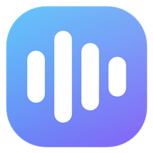

# 音匣 SoundVault — Logo

## 设计

| 元素 | 含义 |
|---|---|
| **圆角方形**（512 里圆角 144） | 「匣」—— 装音效的盒子 |
| **天蓝 → 紫罗兰渐变**（`#38BDF8` → `#8B5CF6`，55°） | 和软件默认强调色同一组，暗色/浅色界面都不抢眼 |
| **4 根白色圆角竖条** | 声波／波形。高低错落（34% / 60% / 44% / 26%），表示"一段声音"而不是匀速电平 |
| **顶部 20% 白色渐变高光** | 玻璃质感，和软件半透明面板的语言呼应 |

## 为什么是 4 根

试过 5 根和 3 根（见 `对比2.png`）：

- **5 根**：大尺寸好看，缩到 16px 条和缝各只剩 1px 多，糊成一块
- **3 根**：16px 最清楚，但像"暂停键"或书脊，辨识度偏弱
- **4 根**：兼顾 —— 32px 以上是清楚的波形，16px 仍认得出来

## 文件

| 文件 | 用途 |
|---|---|
| `final/音匣-logo.svg` | 矢量源（改色、放大都用它） |
| `final/音匣.ico` | 多尺寸图标（256/64/48/40/32/24/20/16），用于 exe 与安装包 |
| `final/音匣-logo-{512…16}.png` | 11 档 PNG（商店图、网页、文档配图） |
| `对比.png` / `对比2.png` | 三个概念方案 + 波形条数对比（设计过程存档） |

## 用在哪

- `音匣.exe` / `音匣安装包.exe` 的**文件图标**（csproj `<ApplicationIcon>`）
- 主窗口**标题栏**左上角（18×18）
- 安装器 / 卸载器头部（30×30）

## 改色

改 `svg` 里 `#body` 的两个 stop；PNG/ICO 需要重新导出（导出脚本见 `docs/dev/` 里的说明；SVG 是权威源）。
