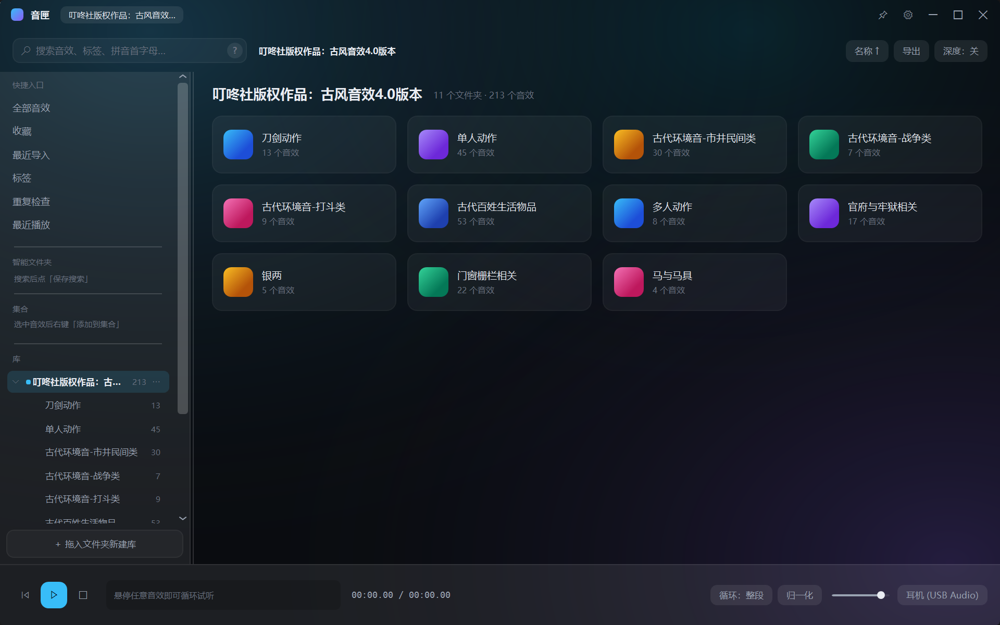
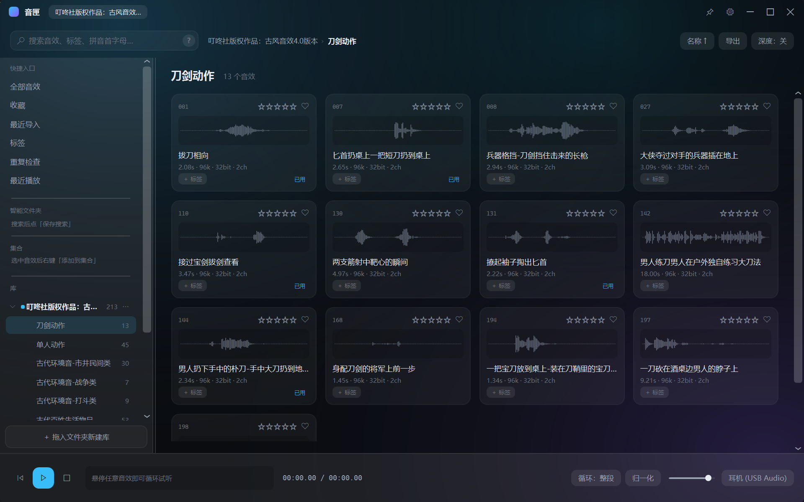
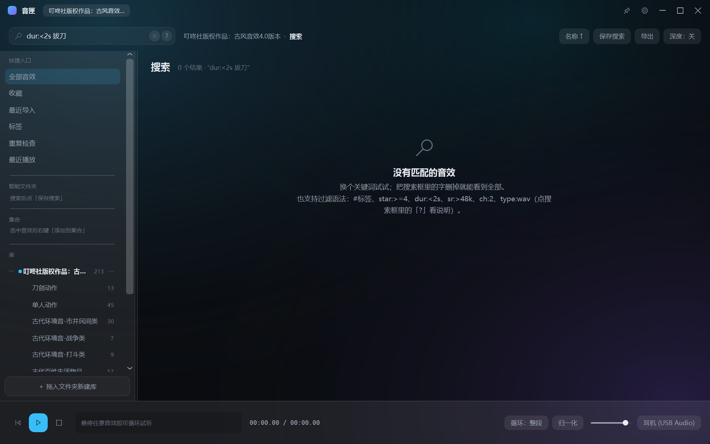
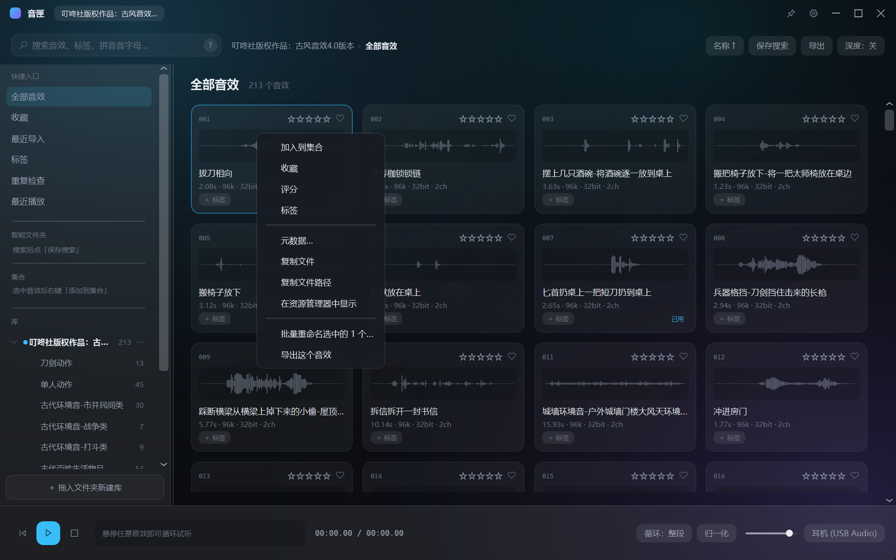
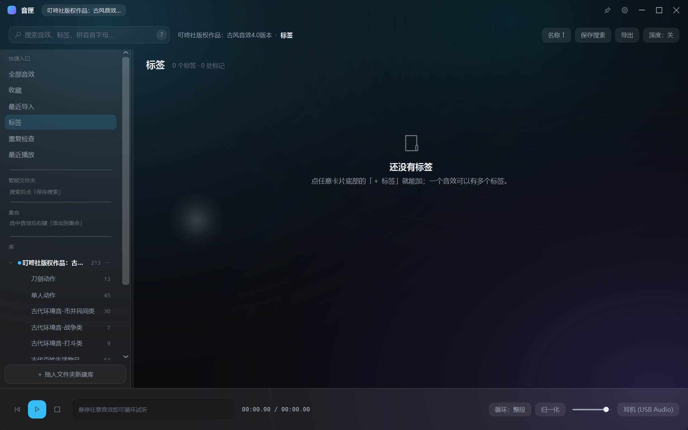
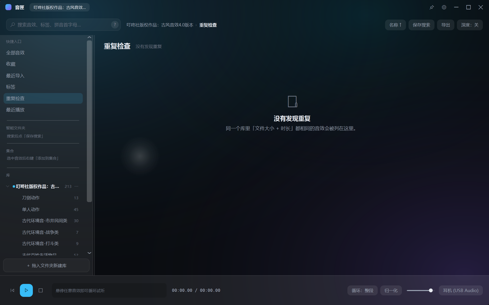
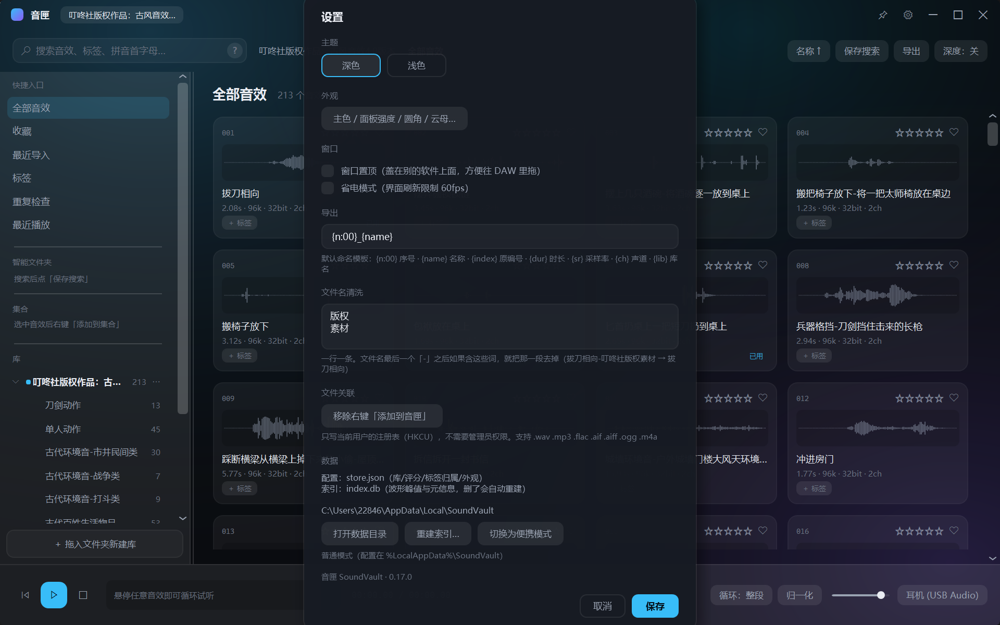
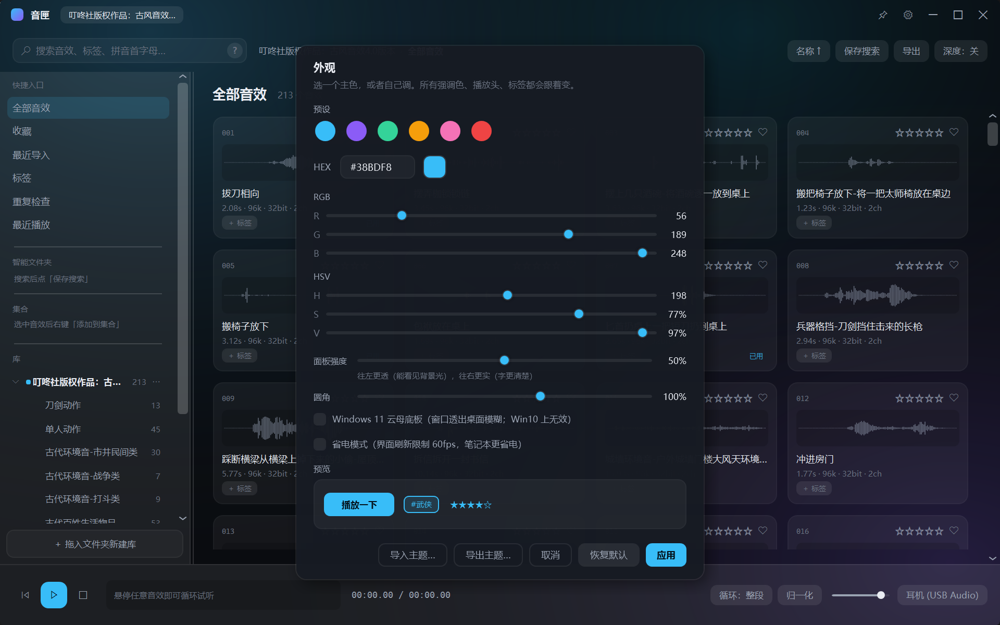

# 音匣 SoundVault 使用说明书

> 版本：1.0.0
> 适用系统：Windows 10 / 11（64 位）
> 说明书里的截图都来自真实界面，文件名在 `docs/images/` 下。

---

## 目录

1. [这是什么](#1-这是什么)
2. [安装与启动](#2-安装与启动)
3. [界面总览](#3-界面总览)
4. [左栏：四个分区](#4-左栏四个分区)
5. [音效卡片：每个按钮都能点](#5-音效卡片每个按钮都能点)
6. [搜索与过滤语法](#6-搜索与过滤语法)
7. [右键菜单](#7-右键菜单)
8. [标签页与重复检查](#8-标签页与重复检查)
9. [播放条](#9-播放条)
10. [设置面板](#10-设置面板)
11. [外观设置](#11-外观设置)
12. [导入素材包](#12-导入素材包)
13. [导出](#13-导出)
14. [批量重命名](#14-批量重命名)
15. [元数据](#15-元数据)
16. [复制与拖拽](#16-复制与拖拽)
17. [快捷键](#17-快捷键)
18. [数据在哪、怎么备份](#18-数据在哪怎么备份)
19. [常见问题](#19-常见问题)

---

## 1. 这是什么

音匣是一个**本地音效库管理器**：把它指向你硬盘上的音效文件夹，它负责

- **找**：拼音/首字母/过滤语法快速定位（`bdx` 能找到「拔刀相向」）
- **听**：鼠标悬停就试听，循环播放，切歌无空隙
- **整理**：打分、收藏、标签、集合、重复检测
- **交付**：拖进 DAW、复制文件、批量导出（可带命名模板和目录结构）

它**不移动、不修改、不删除**你的音频文件，只在旁边维护一个索引库。

---

## 2. 安装与启动

有三种用法，任选其一：

| 方式 | 怎么做 | 适合 |
|---|---|---|
| **绿色版** | 直接双击 `音匣.exe` | 先试试 |
| **安装包** | 双击 `音匣安装包.exe` → 选安装位置 → 「安装」 | 长期用、要开始菜单/桌面快捷方式 |
| **便携模式** | 把 `音匣.exe` 放进一个文件夹，同级新建 `data\` 空目录，再启动 | 放 U 盘，换电脑带走 |

**安装位置**：默认在 `%LocalAppData%\Programs\SoundVault`（不需要管理员权限）。
自己改路径时不用手动加 `SoundVault` 目录 —— 输入框失焦或点安装时会自动补上：
选 `D:\Apps` 就会装到 `D:\Apps\SoundVault`；已经带 `SoundVault` 的路径不会重复叠加。
装到 `C:\Program Files` 这类受保护目录会弹 UAC 提权。

**升级**：直接运行新版安装包即可，会依次处理：
1. 检测到音匣正在运行 → 提示「关闭并继续」；
2. 检测到旧版本装在别的位置 → 提示「卸载旧版再装新版」（用户数据保留）；
3. 同位置则直接覆盖安装。

安装过程有进度条，装完显示「安装完成 ✔」，点「完成」启动音匣。

卸载：安装目录里的 `卸载 音匣.exe`，或 Windows「设置 → 应用」里卸载。**评分/标签/集合不会被删**。

---

## 3. 界面总览



从上到下、从左到右一共 7 个区域：

| 编号 | 区域 | 作用 |
|---|---|---|
| ① | **标题栏** | 拖动可移动窗口；左边是库名，右边是「窗口置顶（图钉）、设置、最小化 / 最大化 / 关闭」。图钉点一下窗口就盖在别的软件上面，再点取消，图标亮起表示开着 |
| ② | **搜索栏** | 输入关键词或过滤语法；右边 `?` 是语法说明，`✕` 清空 |
| ③ | **面包屑** | 显示当前位置（`库 › 文件夹`），点前面任意一段能跳回去 |
| ④ | **左栏** | 快捷入口 / 智能文件夹 / 集合 / 库 四个分区 |
| ⑤ | **内容区** | 文件夹卡片或音效卡片；顶部是标题和统计 |
| ⑥ | **播放条** | 播放/暂停、进度、循环模式、归一化、音量、输出设备 |
| ⑦ | **右上角工具** | 排序方式、导出、深度（是否递归子文件夹） |

---

## 4. 左栏：四个分区

左栏从上到下分四块，中间有细分割线：

### ① 快捷入口

| 项 | 点了会看到 |
|---|---|
| **全部音效** | 当前库里所有音效（含所有子文件夹） |
| **收藏** | 你点过爱心的音效 |
| **最近导入** | 按文件修改时间倒序，最近放进来的在前 |
| **标签** | 所有标签的列表（见第 8 节） |
| **重复检查** | 内容相同/文件名相近的音效分组（见第 8 节） |
| **最近播放** | 按你播放过的时间倒序；今天播过的卡片右下角会有「已用」 |

### ② 智能文件夹

你在搜索框里筛出结果后，点搜索框右边的**「保存搜索」**，这组条件就会存成一个智能文件夹。
以后点它，等于一键重跑那套筛选（比如「短于 2 秒的金属声」）。

### ③ 集合

**集合 = 你自己挑的一组音效**，和标签不同：标签是给音效打属性，集合是「这一集我要用的这几个」。

- 选中音效 → 右键 → **加入到集合** → 选已有集合，或「新建集合…」
- 点左栏集合里的某一行就打开它
- **改集合**：右键集合行，或点行尾的 **⋯** → 打开 / 重命名 / 删除（删集合不动音效文件）
- **从集合里踢出音效**：打开集合 → 右键音效 → **从集合中移除**（多选时一次移除 N 个）

### ④ 库

每个素材包文件夹是一个「库」，下面按层级列出子文件夹，右边数字是音效个数。

- **点文件夹名**直接进那个文件夹
- **点库行右侧的 `⋯`**：重命名库 / 重新扫描这个库 / 在资源管理器中打开 / **移除库**
- 底部 **＋ 拖入文件夹新建库**：加一个新库（见第 12 节）
- 左栏右边界可以**左右拖动调宽**（最窄 150、最宽 560），双击那条线恢复默认

---

## 5. 音效卡片：每个按钮都能点



一张卡片上共有 5 个可点区域：

| 位置 | 是什么 | 点它会发生 |
|---|---|---|
| 左上角 **`001`** | 文件名里的序号 | 无（只是标识）；前面的小圆点是「正在播放」指示 |
| 右上角 **五颗星** | 评分 | 点第 N 颗 = N 星；再点同一颗 = 清零 |
| 右上角 **爱心** | 收藏 | 点一下加入收藏，再点取消 |
| 中间 **波形** | 波形图 | **按住左右拖 = 拖动播放头**（边拖边听）；单击 = 从那个位置播 |
| 底部 **`＋ 标签`** | 标签入口 | 弹出标签菜单：勾选/新建标签 |

卡片还有两个状态标识：

- **右下角「已用」**：今天播放过或拖出去用过，提醒你别在同一集里重复选同一个声音
- **琥珀色「文件丢失」**：硬盘上找不到这个文件了（只在你自己删过文件时出现）

**鼠标悬停卡片 = 立即循环试听**（不用点）。

### 文件夹卡片

库视图里显示的是**文件夹卡片**（带彩色方块 + 文件夹名 + 音效数）。点一下进入该文件夹。
卡片会按列数自动撑满整行，窗口或左栏变宽变窄都会重新排。

---

## 6. 搜索与过滤语法



**搜索的是整个库**，不管你现在在哪个文件夹。

| 写法 | 意思 |
|---|---|
| `拔刀` | 名称/文件名/路径里含「拔刀」 |
| `bdx` / `badou` | 拼音首字母 / 全拼 |
| `#古风` | 带「古风」标签 |
| `star:>=4` | 评分 ≥ 4（`star:>4` 是严格大于） |
| `dur:<2s` | 时长 < 2 秒（也能写 `dur:>5s`） |
| `sr:>48k` | 采样率 > 48kHz（也可写 `sr:96000`） |
| `ch:2` | 声道数 = 2 |
| `type:wav` | 只看 wav |

多个条件用空格连起来就是「并且」，例如 `#古风 star:>=4 dur:<2s`。

- 搜索框右边 **`?`**：语法说明
- 搜索框右边 **`✕`**：清空
- 筛完想存下来：点 **保存搜索** → 变成左栏的智能文件夹

---

## 7. 右键菜单



在任意卡片上右键：

| 菜单项 | 作用 |
|---|---|
| **加入到集合** | 悬停展开子菜单：已有集合 + 「新建集合…」 |
| **收藏** | 切换收藏 |
| **评分** | 悬停展开子菜单：★ 到 ★★★★★、清除评分 |
| **标签** | 悬停展开子菜单：已有标签、新建标签… |
| **元数据…** | 看 BWF `bext` / `LIST-INFO` / `iXML` 里的字段 |
| **复制文件** | 把文件放进剪贴板（多选时是「复制这 N 个文件」） |
| **复制文件路径** | 复制路径文本 |
| **在资源管理器中显示** | 打开资源管理器并选中它 |
| **批量重命名选中的 N 个…** | 见第 14 节 |
| **导出这个音效 / 导出选中的 N 个** | 见第 13 节 |

---

## 8. 标签页与重复检查

### 标签页



- 列出所有标签和各自的数量
- 点一行 → 进入 `库 › 标签 › 某标签`，只显示带这个标签的音效
- 每行右边有**改名**「✎」和**删除**「🗑」

### 重复检查



按「内容哈希相同」或「文件名去后缀后相同」分组，把疑似的重复音效并排列出来。
每组一行，方便你决定留哪个。

---

## 9. 播放条

底部一条，从左到右：

| 控件 | 说明 |
|---|---|
| **◀ ⏮** | 上一个 / 回到开头 |
| **▶ / ⏸** | 播放或暂停当前选中的音效（空格也是这个） |
| **■** | 停止 |
| **进度文字** | `当前时间 / 总时长` |
| **循环：整段 / 段** | 整段循环 / 只循环你拖出来的区间 |
| **归一化** | 打开后按 **LUFS** 把音量拉到 -18，来回试听不用调音量（只影响试听，不改文件） |
| **音量滑杆** | 试听音量 |
| **耳机/USB Audio** | 输出设备，点一下可切换 |

**拖动播放头**：在卡片波形上按住左键左右拖，边拖边听。

---

## 10. 设置面板



标题栏右边的**齿轮**打开。从上到下：

| 分组 | 内容 |
|---|---|
| **主题** | 深色 / 浅色，点一下立刻切换；点「取消」会还原 |
| **外观** | 打开外观对话框（主色、面板强度、圆角、云母） |
| **窗口** | **窗口置顶**（盖在别的软件上面，方便往 DAW 拖）、**省电模式**（限制 60fps） |
| **导出** | 默认命名模板（见第 13 节） |
| **文件名清洗** | 一行一条关键词；文件名最后一个「-」之后含这些词就把那一段剥掉。默认「版权 / 素材」 |
| **文件关联** | 注册/移除资源管理器右键「添加到音匣」 |
| **数据** | 显示配置与索引位置；**打开数据目录**、**重建索引…**、**切换为便携模式** |

**备份数据…**：设置 → 数据 → 备份数据… → 选一个文件夹，会把 `store.json` 和 `index.db`
复制成 `音匣备份_年月日_时分秒\` 放进去。换电脑、重装前先点一下，比手动找路径稳。

| **版本** | 当前版本号 |

> 改完记得点**保存**（置顶、省电、模板、清洗规则才会落盘；主题和外观是即时生效的）。

---

## 11. 外观设置



| 项 | 作用 |
|---|---|
| **主色** | 6 个预设色 + 自定义 HEX，也可用 RGB/HSV 滑杆调；影响按钮、选中框、播放头、鼠标光晕 |
| **面板强度** | 左栏/卡片/播放条的半透明程度，0=很透、1=很实 |
| **圆角** | 全局圆角大小，0=直角、160%=很圆 |
| **Windows 11 云母底板** | 让窗口透出桌面模糊（仅 Win11 有效） |
| **省电模式** | 限制刷新帧率 |
| **导入/导出主题** | 把一整套配色存成文件，换电脑带走 |

---

## 12. 导入素材包

三种入口，效果一样：

1. 把**文件夹拖进窗口**
2. 点左栏底部 **＋ 拖入文件夹新建库**
3. 点空状态里的 **选择文件夹…**

导入时音匣会先**识别素材包**，然后弹一个摘要：

```
名称：叮咚社版权作品：古风音效4.0版本
音频：213 个文件
封面：logo.jpg
授权文件：授权声明与音效作品设计方案.docx
⚠ 有 2 个没下完的文件（.downloading / .part / .!ut 等），建议下完再导入
```

- **版本号**会从文件夹名里提取，侧栏显示成 `名字 v4.0`
- 认出 `logo/cover/folder/封面` 图片当封面
- 认出 `LICENSE/授权/使用说明/README` 当授权文件
- 认出 `.downloading/.part/.!ut` 这类**没下完的文件**并提醒

确认后它开始扫描：建索引、算波形。**扫描期间界面可继续用**。

### 右键「添加到音匣」

设置 → 文件关联 → 注册后，资源管理器里右键任意音频 → **添加到音匣**：
音匣会被唤到前台，跳到那个文件所在文件夹并选中它。

---

## 13. 导出

两条路：

- 选中若干音效 → 右键 → **导出选中的 N 个**
- 右上角 **导出** 按钮（导出当前列表全部）

流程：

1. 选目标文件夹
2. **导出选项**对话框：
   - **文件命名模板**：`{n:00}` 序号、`{name}` 名称、`{index}` 原编号、`{dur}` 时长、`{sr}` 采样率、`{ch}` 声道、`{lib}` 库名；下面有实时预览
   - **保留原来的文件夹结构**：勾上会按库内相对路径建子目录
3. **进度窗**：显示 `已导出 / 总数` 和当前文件名，可**取消**
4. 完成时告诉你导出了多少、清单 CSV 叫什么名字（含时长、采样率、位深、评分等）

---

## 14. 批量重命名

选中若干音效 → 右键 → **批量重命名选中的 N 个…**

1. 填命名模板（语法同导出）
2. 下面立刻列出**旧名 → 新名**对照；同名或重名的会**标红划掉**，不会执行
3. 点「开始重命名」才**真的改磁盘文件名**

改名的同时会更新索引里的路径，**评分/标签/收藏不会丢**。

> ⚠ 这个操作不可撤销，动手前先看一遍预览。

---

## 15. 元数据

右键 → **元数据…**

显示文件里写的：

| 来源 | 字段 |
|---|---|
| BWF `bext` | 描述、录制者、录制者编号、录制日期时间 |
| `LIST-INFO` | 标题、作者、备注 |
| `iXML` | 工程、场景、备注 |

很多素材包只写文件名，那就会显示「没有找到元数据」——这本身也是信息。

---

## 16. 复制与拖拽

| 操作 | 效果 |
|---|---|
| 拖卡片到 DAW | 直接拖入；拖动时鼠标旁有个小标签显示「文件名 · 时长」或「N 个音效 · 共 时长」 |
| **Ctrl+C** | 把选中的音效作为**文件**放进剪贴板（某些 DAW 拖拽不灵时用它） |
| **Ctrl+Shift+C** | 复制路径文本 |

---

## 17. 快捷键

| 键 | 作用 |
|---|---|
| **空格** | 播放 / 暂停 |
| **F** | 切换收藏（选中项） |
| **Ctrl+C** | 复制文件 |
| **Ctrl+Shift+C** | 复制路径 |
| **Esc** | 关闭对话框 / 退出搜索 |
| 鼠标悬停卡片 | 自动循环试听 |

> 音匣是**鼠标优先**设计的：所有功能都有鼠标路径，快捷键只是加速。

---

## 18. 数据在哪、怎么备份

| 文件 | 位置（普通模式） | 内容 |
|---|---|---|
| `store.json` | `%LocalAppData%\SoundVault\` | 库列表、评分、收藏、标签、集合、外观设置、播放历史 |
| `index.db` | 同上 | 文件索引、波形峰值、元信息（**删了会自动重建**） |

**便携模式**：exe 旁边有 `data\` 目录时，这两个文件就放在那里，整个文件夹拷走即可。

备份：把这两个文件拷走就行。换电脑：装好音匣 → 关掉 → 把两个文件覆盖回去 → 打开。

设置里的 **重建索引…** 会清空索引重新扫（不动 `store.json`，评分标签都在）。

---

## 18.5 新手引导

第一次打开音匣时，会出现一个**半透明遮罩**，依次高亮 6 个区域并配一句话说明：

1. 搜索栏 → 2. 左栏 → 3. 卡片按钮 → 4. 右键菜单 → 5. 播放条 → 6. 设置

- **下一步 / 上一步**：前后翻
- **跳过**：直接退出（之后不再自动弹）
- 看完了想再看：**设置面板最下面 →「看一遍新手引导 ›」**

---

## 19. 常见问题

**Q：拖到 DAW 里没反应？**
用 **Ctrl+C** 复制文件，再到 DAW 里 Ctrl+V。有些宿主的拖拽接收有兼容问题。

**Q：杀毒软件报毒 / 提示未知发布者？**
单文件自解压程序容易被误报。可以加白名单；正式分发建议用代码签名证书（`tools\sign.ps1` 支持）。

**Q：卡片上出现「文件丢失」？**
硬盘上那个文件被移动或删除了。把文件放回原位，或移除这个库重新导入。

**Q：导入后统计是 0？**
v0.36 已修。如果还遇到，点设置里的「重建索引…」。

**Q：某个音效显示「已用」，但我没拖过？**
播放过也算——悬停试听会记一笔。

**Q：能管理别的盘/网络盘吗？**
可以，任何本地路径都能当库（网络盘扫描会慢一些）。

**Q：会改我的文件吗？**
不会。只有「批量重命名」会改文件名，而且必须先看预览确认。导出是复制，不动原文件。

---

*本说明书对应 1.0.0。功能改动请同步更新本文档与 `docs/images/` 截图。*
