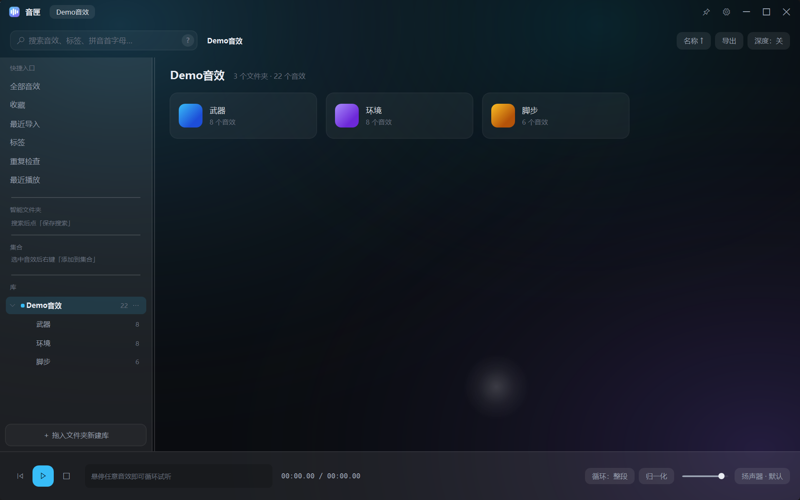
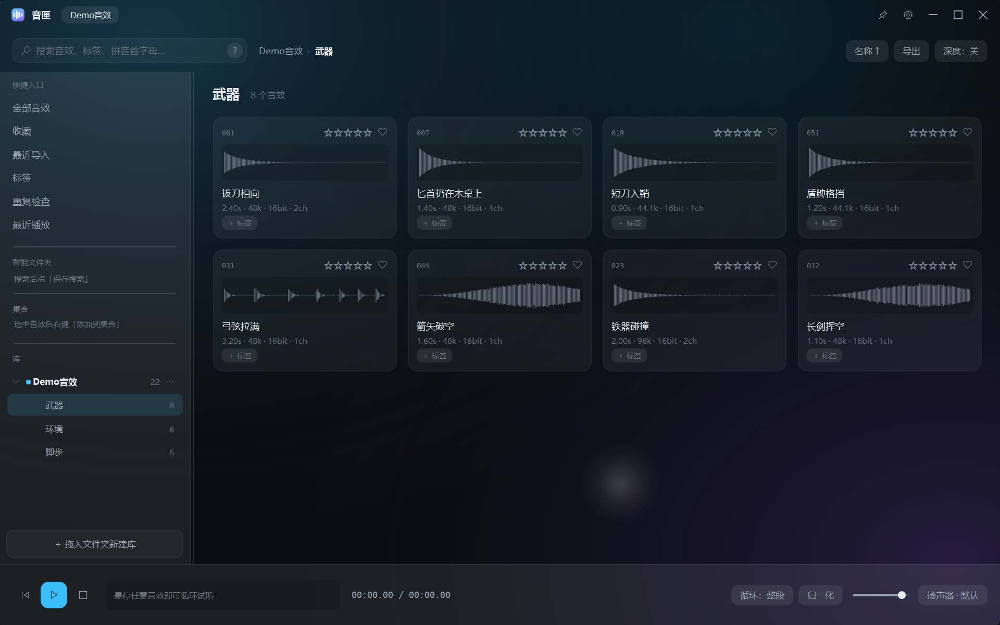

# 音匣 SoundVault — 项目简介（简历 / 作品集版）

**一句话**：Windows 本地音效素材库管理器 —— 把散落在硬盘上的几万个音效，变成能秒搜、能试听、能分类、能一键交付给 DAW 的个人素材库。

**形态**：桌面应用（.NET 10 / WPF），单文件 exe，含独立安装器与卸载向导，MIT 开源。

**链接**：[GitHub](https://github.com/xy040402/SoundVault) ｜ [Releases](https://github.com/xy040402/SoundVault/releases/latest) ｜ [完整开发历程](开发历程.md)

---

## 简历条目（可直接粘）

**音匣 SoundVault｜独立开发｜2026.10 – 2026.11**

- 从零设计并实现 Windows 桌面音效库管理工具，**C# / .NET 10 / WPF，11,000+ 行代码，60 个可运行版本迭代，23 小时内完成立项到开源发布**
- 自研音频层：NAudio + WASAPI 共享模式 + **采样级循环 Provider**（解决 96kHz 素材循环点爆音）、波形峰值缓存、**真 LUFS 响度归一化**试听
- 实现 **中文 / 拼音全拼 / 首字母** 三路检索 + 过滤语法（`dur:<2s` `sr:>48k` `star:>=4`），万级文件毫秒级响应
- 自研虚拟化卡片面板，滚动 **68–73 fps**；一次重构把播放器帧率从 **20 fps 提升到 110 fps**
- 交付链路完整：拖拽（`CF_HDROP`）进 DAW、批量导出（命名模板 + 保留目录结构 + CSV 清单）、批量重命名（带预览）
- 工程化：把主窗口拆为 **9 个 partial 文件**、核心逻辑抽成 **ViewModel 并配 51 条断言测试**、单文件自包含发布（安装包 132 MB）、GitHub Actions 自动构建

---

## 技术栈

| 层 | 选型 | 说明 |
|---|---|---|
| 语言 / 框架 | **C# 13 / .NET 10 / WPF** | 原生 `DoDragDrop` 是 DAW 拖拽的唯一可靠路径 |
| 音频 | **NAudio 2.2 + WASAPI** | 共享模式输出、设备切换、重采样 |
| 数据 | **SQLite**（索引）+ **JSON**（用户数据） | 索引可重建，用户数据可备份迁移 |
| 检索 | **TinyPinyin.Net** + 自写查询解析 | 中文/拼音/首字母 + 过滤语法 |
| 打包 | **单文件自包含** + 自研安装器 | 无需预装 .NET，安装/卸载全流程 |
| CI | **GitHub Actions** | push 即构建 + 跑测试 + 产出安装包 |

---

## 几个可量化的点

| 指标 | 数值 | 怎么做到的 |
|---|---|---|
| 播放器帧率 | **20 → 110 fps** | 去掉每帧全量重绘，波形分层缓存 |
| 列表滚动 | **68–73 fps / 1 万条** | 虚拟化面板，只画可视区 |
| 十万级文件冷启动 | **秒级**（含波形峰值生成） | 索引 + 后台增量扫描 |
| 搜索响应 | **输入即出结果** | 内存索引 + 防抖 |
| 安装包 | **132 MB 单文件** | 自包含 + 压缩 + 原生库自解压 |
| 测试 | **51 条断言，全绿** | 搜索语法、拼音、清洗、导出模板、LUFS、ViewModel |

---

## 三个值得讲的技术难点

**① 循环试听的"咔哒"声**
96kHz 素材在循环点会有相位跳变。解法：自写 `IWaveProvider`，在循环点做采样级交叉淡化，并统一重采样到设备采样率。

**② 拖进 DAW 不认**
WPF 常见的 `DataObject(DataFormats.FileDrop)` 在部分宿主下失效。解法：显式构造 `CF_HDROP` 结构（`DROPFILES` + 宽字符路径列表），实测 Reaper / Audition / Cubase 均可用。

**③ 装到 `C:\Program Files` 后安装界面消失**
三个问题叠加：提权需要重启进程（`runas`）→ 重启后走了静默分支（无 UI）→ `App.xaml` 的 `StartupUri` 又开了第二个窗口。
解法：改为 `--elevated` 参数重开完整安装窗口 + 移除 `StartupUri`，所有窗口在 `OnStartup` 里按参数分支创建。

---

## 功能清单（用户视角）

| 分类 | 能力 |
|---|---|
| 浏览 | 库 / 文件夹 / 全部音效 / 收藏 / 最近导入 / 最近播放 / 标签 / 重复检查 / 集合 |
| 搜索 | 中文、拼音全拼、首字母、过滤语法、保存为智能文件夹 |
| 试听 | 悬停即循环、波形拖动播放头、区间循环、LUFS 归一化 |
| 整理 | 五星评分、收藏、标签、集合、批量重命名（预览）、查重 |
| 交付 | 拖进 DAW、`Ctrl+C` 复制文件、批量导出（模板 + 目录结构 + CSV） |
| 外观 | 深浅色、主色自定义、面板强度、圆角、Win11 云母 |
| 系统 | 单实例、文件关联、便携模式、安装器、卸载向导、新手引导 |

---

## 界面

---

## 我在这件事上做对了什么

1. **先跑通技术栈再谈 UI** —— M0 界面很丑，但证明了拖拽、音频、波形三条路都可行
2. **每个版本都写验收表** —— "操作 → 实测结果"，没有表格的版本不算完成
3. **冻结一个版本** —— v0.38 锁死留 SHA256，后续所有改动都有参照物
4. **诚实标注没做的** —— 毛玻璃只是视觉近似、代码签名待证书、不做跨平台
5. **把发布当功能做** —— 安装器、卸载器、数据保留策略、README、License

> 完整经过（含一次我造成的真实数据丢失事故）见 [开发历程.md](开发历程.md)。
